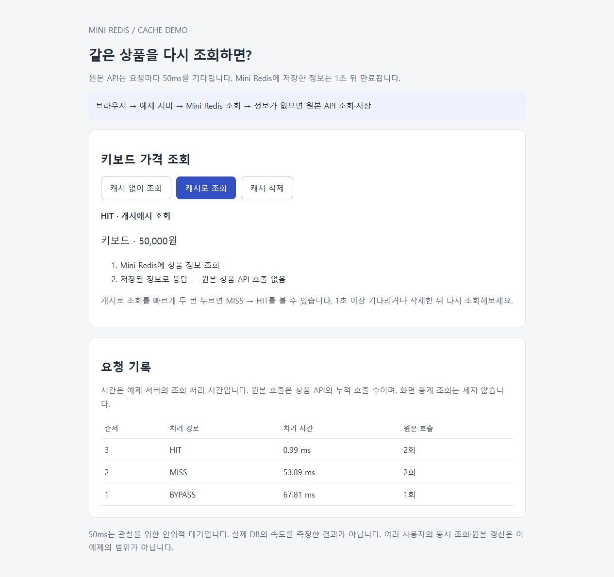
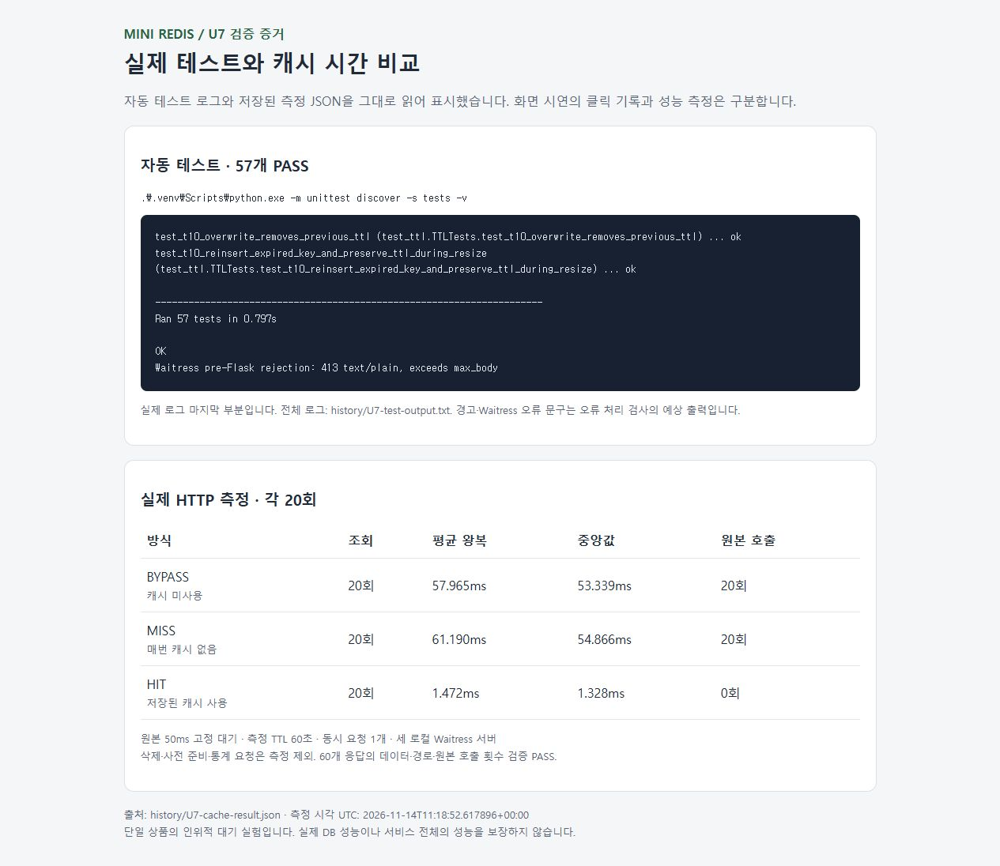

# Mini Redis

직접 만든 해시 테이블에 문자열 키·값을 보관하고, HTTP API로 저장·조회·삭제·TTL을 제공하는 작은 메모리 서버입니다.

**현재 상태:** U1~U7 필수 구현·검증 완료. 자동 테스트 57개 통과, 캐시 사용 방식별 실제 HTTP 왕복 각 20회 측정. [단위별 과정과 결과](history/README.md)

**바로 찾기:** [빠른 시작](#빠른-시작) · [HTTP API](#http-api) · [상품 캐시 예제](#상품-캐시-예제) · [테스트 실행](#테스트-실행) · [설계 문서](#프로젝트-문서) · [제한 사항](#제한-사항)

## 주요 기능

- 문자열 키·값 **저장·조회·삭제**, 빈 문자열과 한글·공백·줄바꿈 보존
- 양의 정수 밀리초 **TTL**, 조회 시 만료 확인과 주기적 청소
- 단일 저장소와 공용 락을 사용한 **여러 HTTP 요청 처리**
- 직접 만든 해시 테이블의 **충돌 처리·확장**
- 다른 프로그램이 API 응답을 저장·재사용하는 **상품 캐시 예제**

**Python + Flask + Waitress / Windows**를 사용합니다. C의 수동 메모리 관리보다 저장소 동작과 검증에 집중하기 위한 선택이며, 구현 시간 단축이나 성능 우위를 측정한 결과는 아닙니다. 실제 Redis 전체 기능과 RESP 클라이언트 호환은 목표가 아닙니다.

## 빠른 시작

Python 3.13을 준비하고 프로젝트 루트에서 PowerShell로 실행합니다. 아래 명령은 Windows 기준이며, Python 3.13.14·Flask 3.1.3·Waitress 3.0.2에서 검증했습니다. 설치 대상은 프로젝트 안의 `.venv`입니다.

```powershell
python -m venv .venv
.\.venv\Scripts\python.exe -m pip install -r requirements.txt
.\.venv\Scripts\python.exe -m mini_redis.server
```

실행하면 127.0.0.1:8080에서 요청을 기다립니다. 종료는 Ctrl+C입니다. **두 번째 PowerShell 창**에서 다음 순서로 호출합니다.

```powershell
Invoke-RestMethod http://127.0.0.1:8080/set -Method Post -ContentType 'application/json' -Body '{"key":"name","value":"JYE"}'
Invoke-RestMethod http://127.0.0.1:8080/get -Method Post -ContentType 'application/json' -Body '{"key":"name"}'
Invoke-RestMethod http://127.0.0.1:8080/delete -Method Post -ContentType 'application/json' -Body '{"key":"name"}'
```

순서대로 `{"ok":true}` → `{"found":true,"value":"JYE"}` → `{"deleted":true}`에 해당하는 응답을 받습니다. PowerShell은 JSON을 객체로 표시합니다. TTL을 사용하려면 `/set` 본문에 `"ttl_ms":1500`을 추가하세요. 1.5초 뒤 조회하면 `{"found":false,"value":null}`입니다. [정확한 입력·오류 규칙](docs/API.md)

기본 주소는 같은 컴퓨터에서만 접근합니다. 서버 창에서 `Ctrl+C`로 종료할 수 있습니다. 종료하면 메모리에 저장된 데이터가 사라집니다.

## HTTP API

모든 요청은 `POST`, 본문은 JSON 객체, `Content-Type`은 `application/json`입니다. 키를 JSON 본문에 전달하므로 빈 키와 특수문자를 같은 방식으로 보낼 수 있습니다.

| 경로 | 요청 본문 예 | 성공 응답 |
| --- | --- | --- |
| `/set` | `{"key":"name","value":"JYE","ttl_ms":1500}` | `{"ok":true}` |
| `/get` | `{"key":"name"}` | `{"found":true,"value":"JYE"}` 또는 `{"found":false,"value":null}` |
| `/delete` | `{"key":"name"}` | `{"deleted":true}` 또는 `{"deleted":false}` |

`ttl_ms`는 선택 필드이며 양의 정수 밀리초입니다. 생략하면 만료되지 않습니다. 같은 키를 TTL 없이 다시 저장하면 기존 TTL을 제거합니다. 이미 만료된 키를 삭제하면 `deleted:false`입니다.

키는 UTF-8 기준 최대 **1 KiB**, 값은 **1 MiB**, HTTP 본문은 **8 MiB**입니다. 잘못된 입력은 400, 크기 초과는 413, JSON이 아닌 콘텐츠 형식은 415로 처리합니다. Flask가 처리한 오류는 `{"error":{"code":"...","message":"..."}}` 형태입니다. Waitress가 Flask보다 먼저 본문을 거부하면 413 일반 텍스트가 반환될 수 있습니다. [전체 API 규격](docs/API.md)

## 상품 캐시 예제

설치 후 별도 PowerShell 창 3개에서 각각 실행합니다.

```powershell
# 창 1: Mini Redis (8080)
.\.venv\Scripts\python.exe -m mini_redis.server

# 창 2: 원본 상품 API (8082)
.\.venv\Scripts\python.exe -m examples.cache_demo origin

# 창 3: 예제 웹 서버 (8081)
.\.venv\Scripts\python.exe -m examples.cache_demo web
```

브라우저에서 **http://127.0.0.1:8081**을 엽니다. 다음 순서로 확인할 수 있습니다.

1. **캐시 없이 조회** → 원본 API를 호출하며 `BYPASS`가 보입니다.
2. **캐시로 조회** → 첫 조회에는 원본에서 가져와 저장하므로 `MISS`가 보입니다.
3. **1초 안에 다시 캐시로 조회** → 저장된 값을 사용해 `HIT`가 보이고 원본 호출 횟수는 늘지 않습니다.
4. **1초 후 재조회 또는 캐시 삭제 후 조회** → 다시 원본에서 가져와 `MISS`가 보입니다.

화면에는 상품, 처리 경로, 예제 서버 처리 시간, 원본 API 누적 호출 횟수가 표시됩니다. 브라우저 자체 캐시가 결과를 가리지 않도록 `no-store`를 적용했습니다. 각 서버는 해당 창에서 `Ctrl+C`로 종료합니다.

| 이번 측정: 각 20회 순차 요청 | 평균 HTTP 왕복 | 원본 상품 API 호출 |
| --- | ---: | ---: |
| 캐시 미사용 | 57.965ms | 20회 |
| 매번 MISS | 61.190ms | 20회 |
| HIT | 1.472ms | 0회 |

원본은 **인위적으로 50ms 대기**합니다. 캐시 Hit 준비와 Miss용 삭제는 측정에서 제외하고, 측정용 TTL은 60초입니다. 데이터·경로·호출 횟수를 검증했으며 속도 배수는 통과 조건으로 두지 않았습니다. Miss에는 원본 조회 외에 캐시 조회·저장 비용도 듭니다. 실제 DB나 동시 부하의 성능 보장이 아닙니다. [조건·실행 과정](history/U7-cache.md) · [원시 측정값](history/U7-cache-result.json) · [확인한 화면](history/U7-cache-screen.jpg)

## 시연과 검증 화면

실제 브라우저에서 캡처했습니다. 시연의 개별 처리 시간과 아래 20회 평균 왕복 시간은 다른 측정입니다.

<details>
<summary>캐시 미사용 → MISS → HIT 시연 보기</summary>



HIT 행에서 원본 호출 횟수가 2회로 유지됩니다.

</details>

<details>
<summary>57개 테스트와 20회씩 측정 결과 보기</summary>



실제 실행 로그·측정 JSON을 표시한 결과 페이지의 캡처입니다. [전체 로그](history/U7-test-output.txt) · [원시 수치](history/U7-cache-result.json) · [과정 기록](history/U7-cache.md)

</details>

## 테스트 실행

가상환경 설치 후 프로젝트 루트에서 실행합니다. **실행 중인 서버가 없어도 됩니다.** HTTP 검사는 필요한 서버를 임시 포트에 띄우고 종료합니다.

```powershell
# 저장소·TTL·동시성·HTTP·캐시 동작: 57개
.\.venv\Scripts\python.exe -m unittest discover -s tests -v

# 캐시 미사용·Miss·Hit 각각 20회 순차 HTTP 측정
.\.venv\Scripts\python.exe -m tests.measure_cache
```

첫 명령이 성공하면 `Ran 57 tests`와 `OK`가 표시됩니다. 두 번째 명령은 각 방식의 평균·중앙값과 원본 호출 횟수를 출력하고 [원시 측정값](history/U7-cache-result.json)을 갱신합니다. 이 측정에서는 TTL을 60초로 설정하며, 캐시 삭제·Hit 준비·통계 요청은 측정 시간에서 제외합니다. 이미 기록된 수치는 위 표에서 확인할 수 있습니다. 새 실행의 시간은 환경에 따라 달라집니다. [테스트별 역할·선택 실행](tests/README.md)

## 폴더 구조

```text
main-redis/
├─ mini_redis/             실제 저장소 구현
│  ├─ __init__.py          패키지 선언, 서버·스레드 시작 없음
│  ├─ store.py             해시·노드·저장소·TTL·제한된 청소
│  ├─ expiration.py        명시적으로 시작·종료하는 청소 스레드
│  ├─ api.py               JSON 입력 검사·HTTP 경로·응답
│  └─ server.py            저장소·청소 생성과 Waitress 실행 진입점
├─ tests/
│  ├─ test_store.py        기본 저장소·입력·확장 테스트
│  ├─ test_ttl.py          시간 주입을 사용한 TTL 테스트
│  ├─ test_cleanup.py      청소·커서·갱신 겹침·생명주기 테스트
│  ├─ test_concurrency.py  여러 스레드의 요청·락·일관성 검사
│  ├─ test_cleanup_focus.py  필수 흐름 하나를 집중 검증
│  ├─ test_api.py          Flask 요청·오류·TTL 연결 검사
│  ├─ test_server.py       실제 Waitress 연결·본문 제한·종료 검사
│  ├─ test_cache_demo.py   실제 HTTP 캐시 동작 검사
│  ├─ measure_cache.py     20회씩 순차 HTTP 성능 비교
│  └─ load_cleanup.py      명시적으로 실행하는 청소 부하 실험
├─ examples/              Mini Redis를 HTTP로 사용하는 상품 캐시 예제
│  ├─ cache_demo.py        원본 API·예제 서버
│  └─ cache.html           캐시 사용·미사용·삭제 관찰 화면
├─ docs/                  요구사항·설계·API·검증 계획
├─ history/               단위별 실행·실패·수정·재검증 기록
├─ study/                 개념 학습 노트
├─ requirements.txt       Flask·Waitress 직접 의존성
├─ AGENTS.md              AI 작업 규칙과 읽는 순서
└─ WORKLOG.md             현재 상태와 다음 작업
```

구현은 `mini_redis/`, 자동 검사는 `tests/`, 과정 설명은 `history/`에 둡니다. 테스트 파일은 기능·검증 목적에 맞춰 나누며 구현 단위마다 반드시 하나씩 만들지는 않습니다. HTTP 처리는 api.py, 실행은 server.py에 둡니다. 캐시 예제는 examples/에 두고 저장 엔진과 분리합니다.

## 프로젝트 문서

| 읽을 목적 | 문서 |
| --- | --- |
| AI가 이어서 작업하기 | [AGENTS.md](AGENTS.md) → [현재 작업 인계](WORKLOG.md) |
| 전체 문서의 역할·읽는 순서 | [docs/README.md](docs/README.md) |
| 과제와 프로젝트 범위 | [과제](docs/assignment.md) · [프로젝트 개요](docs/PROJECT.md) |
| 기대 동작과 통과 조건 | [REQUIREMENTS.md](docs/REQUIREMENTS.md) |
| 구조와 상태 소유 | [DESIGN.md](docs/DESIGN.md) |
| 선택 이유·대안·한계 | [DECISIONS.md](docs/DECISIONS.md) |
| HTTP 요청·응답 | [API.md](docs/API.md) |
| 구현 단위와 필수 테스트 | [TESTING.md](docs/TESTING.md) |
| 단위별 구현·테스트 이력 | [history/README.md](history/README.md) |
| 함께 검토·기록하는 방법 | [WORKFLOW.md](docs/WORKFLOW.md) |

## 구현한 설계

- FNV-1a 64비트, 연결 리스트 체이닝, 초기 16버킷. 신규 키로 적재율 0.75 초과 시 2배 전체 리해싱.
- 단일 프로세스·저장소 하나·공용 락 하나. 요청 워커 4개와 청소 스레드 1개가 공유합니다.
- UTF-8 문자열 키 최대 1 KiB, 값 최대 1 MiB. 빈 문자열과 원문 공백을 허용합니다.
- TTL은 양의 정수 밀리초, 단조 시간으로 판단합니다. 접근 검사와 목표 100ms 주기의 제한된 청소를 함께 사용합니다.
- POST /set, /get, /delete. 키는 JSON 본문에 전달합니다. 기본 주소 127.0.0.1:8080, 본문 최대 8 MiB.
- 영속성은 첫 범위에서 제외합니다. 서버 종료 시 데이터가 사라집니다.

숫자는 합의한 초기 설정입니다. 최적값이나 모든 만료 키의 100ms 내 회수를 보장하지 않습니다.


## 학습 문서

[학습 목차](study/00-overview.md)에서 Redis의 필요성 → 키·값과 캐시 → 해시 테이블 → TTL → 서버·동시성 → 메모리·영속성 → 선택 기록 → 검증 순서로 읽을 수 있습니다. 개념 설명과 제품 계약을 구분합니다.

## 제한 사항

- 데이터는 RAM에만 보관합니다. 재시작 복구·영속성은 이번 1차 범위에서 제외했습니다.
- 기본 바인딩은 `127.0.0.1`입니다. 인증과 다른 컴퓨터에 공개하는 설정은 제공하지 않습니다.
- 한 프로세스에서 저장소 하나를 공유합니다. 프로세스를 여러 개 실행하면 데이터도 각각 분리됩니다.
- RESP·`redis-cli` 호환, 트랜잭션, 추가 자료형, 전체 메모리 한도와 과부하 정책은 구현하지 않았습니다.
- 캐시 비교는 단일 상품·50ms 인위적 원본 대기·순차 요청 조건입니다. 실제 DB나 동시 부하의 성능을 보장하지 않습니다.

## 저장소 안내

[팀 저장소](https://github.com/WEEK11-12/mini-redis)의 개인 포크이며 실제 프로젝트의 기준 브랜치는 main입니다. 학습 필기도 같은 main의 study/ 폴더에서 함께 관리합니다. 기존 study-jye 브랜치는 과거 기록으로 보존합니다. 두 사람 모두 Redis와 DBMS 전 과정을 경험하되 DBMS는 별도 프로젝트로 관리합니다. 개인 포크 변경이 팀 저장소에 자동으로 반영되지는 않습니다.
