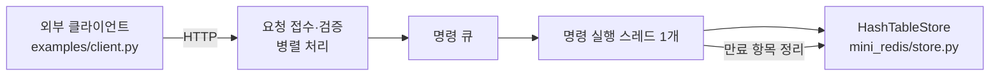
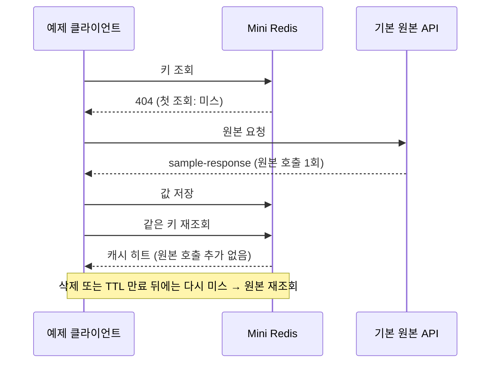
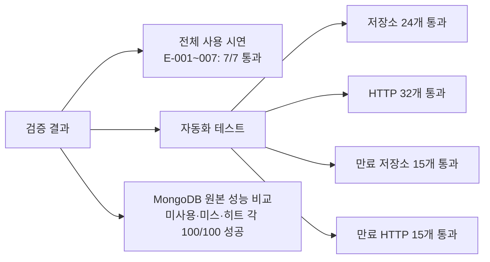
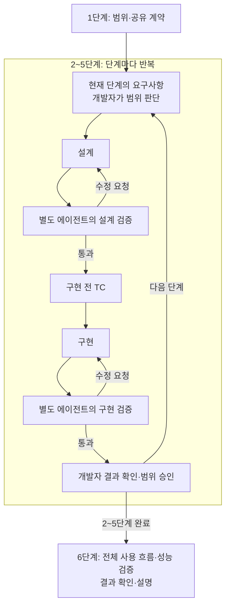

# Mini Redis

직접 구현한 **해시 테이블**을 저장소로 삼아, 여러 클라이언트가 **HTTP API**로 저장·조회·존재 확인·삭제를 할 수 있는 가벼운 인메모리 키-값 캐시입니다. 만료 시간(TTL)과 명시적 삭제(무효화), 외부 API 응답 재사용 사례, 동시 요청 처리 구조, 캐시 사용 전후의 성능 비교까지 다룹니다.

## 한눈에 보기



- **저장소:** 해시값을 버킷 수로 나눈 나머지로 버킷을 고르고, 같은 버킷의 충돌 키는 전체 키를 비교해 구분합니다. 적재율이 1을 넘으면 버킷을 두 배로 늘려 재해싱합니다.
- **만료·무효화:** TTL은 별도 요청으로 설정·갱신·제거하고, 일반 저장(PUT)은 이전 TTL을 해제하며, `DELETE`가 명시적 무효화입니다. 만료된 키는 없는 키처럼 응답합니다.
- **동시성:** HTTP 요청의 접수·해석은 병렬로 하되, 저장소를 읽거나 바꾸는 모든 명령(만료 정리 포함)은 한 스레드가 차례로 처리해 경쟁 상태를 피합니다.
- **활용 사례:** 별도 프로세스의 원본 API 응답을 캐시 미스일 때만 가져와 저장하고, 다음 호출부터는 캐시에서 재사용합니다.

## 시연·검증 결과

### 전체 사용 시연 (E-001~007: 7/7 통과)

별도 프로세스로 띄운 Mini Redis와 원본 API에 실제 HTTP 요청과 예제 클라이언트로 외부 사용 흐름을 끝까지 실행했습니다. 사례마다 서버를 새로 시작했고, 만료는 제어한 시간원으로 확인했습니다.



위 흐름은 E-001~003의 핵심 경로입니다. 빈 값·거부·실패·동시 삭제 경합까지 포함한 실제 확인 결과는 아래 표에 구분했습니다.

| 사례 | 시나리오 | 실제 확인 결과 |
| --- | --- | --- |
| E-001 | 최초 조회와 캐시 재사용 | 두 번 모두 `sample-response`. 미스일 때만 원본을 호출해 원본 횟수 0→1→1 |
| E-002 | 삭제(무효화) 뒤 재조회 | 삭제 뒤 미존재, 재삭제 `false`, 재호출 시 원본 1→2로 다시 저장. 다른 키는 그대로 보존 |
| E-003 | TTL 만료 | 유효 중에는 히트(원본 1 유지), 기한 뒤 `404`, 재호출 시 원본 2로 다시 저장 |
| E-004 | 빈 값과 덮어쓰기 | 빈 값도 `200` 히트(원본 0). 일반 저장이 이전 TTL을 해제해 옛 기한 뒤에도 최신 값 유지 |
| E-005 | 잘못된 요청 거부 | TTL 0, 본문 추가 필드는 `400 INVALID_BODY`. 거부 뒤에도 원래 값과 기한 유지 |
| E-006 | 원본·캐시 연결 실패 | 둘 다 예제가 비정상 종료. 실패한 캐시 쓰기 없음, 캐시가 닿지 않아도 원본으로 우회하지 않음 |
| E-007 | 동시 클라이언트와 삭제 경합 | 두 히트의 결과 일치. 조회·삭제가 겹쳐도 실행 순서(GET→DELETE, DELETE→GET→SET)에 맞는 응답과 최종 상태 |

실행 결과 상세: [6단계 검증 2절](docs/iterations/06-integration-performance/verification.md#2-전체-사용-흐름-검증)

### 자동화 테스트



| 파일 | 결과 |
| --- | --- |
| `test_store.py` (해시 테이블 저장소) | 24개 통과 |
| `test_http_api.py` (HTTP API·응답 재사용) | 32개 통과 |
| `test_expiration_store.py` (만료 저장소) | 15개 통과 |
| `test_expiration_http.py` (만료 HTTP) | 15개 통과 |

동시성(5단계)은 [5단계 검증](docs/iterations/05-concurrency/verification.md)에서 요청 접수·완료 통지·종료 경계를 별도로 확인했습니다. 그 테스트는 임시 시험 접점을 계측해 실행했으므로 위 명령처럼 보정 없이 실행한 통과가 아닙니다.

### 성능 비교: 캐시를 쓸 때와 쓰지 않을 때

서버 DB(Docker MongoDB, 100만 문서·값 1KiB·약 1.06GB, WiredTiger 캐시 0.25GB)를 조회하는 원본을 두고, 매 요청이 서로 다른 키를 읽도록 해 순차 100회씩 측정했습니다.

| 조건 | 성공/실패 | 중앙값 | P90 |
| --- | --- | --- | --- |
| 캐시 미사용 (원본 → MongoDB) | 100/0 | 2.352ms | 3.183ms |
| 캐시 미스 (캐시 조회 → 원본 → 캐시 저장) | 100/0 | 3.566ms | 4.503ms |
| 캐시 히트 (Mini Redis 조회) | 100/0 | 0.558ms | 0.636ms |

- 이 조건에서 히트는 미사용보다 중앙값이 약 4.2배 빠르고, 미스는 약 1.5배 느립니다(첫 조회에서 캐시 저장 비용이 추가됨).
- 캐시 밖에서 읽은 페이지가 실제 디스크에서 온 것인지는 확인하지 않았고(OS·Docker 파일 캐시), 모든 경로가 로컬 HTTP를 거치는 전체 흐름 비교입니다. 한 대의 로컬 호스트, 순차 단일 클라이언트 기준이며 동시 부하·원격 DB로 일반화하지 않습니다.

측정 조건과 해석: [6단계 개요](docs/iterations/06-integration-performance/overview.md#확정된-성능-비교-조건) · [성능 결과](docs/iterations/06-integration-performance/verification.md#3-성능-비교-실행)

## AI 기반 개발 루프 구조

이 프로젝트는 **개발자가 범위와 선택을 판단하고, 에이전트가 역할별로 초안·설계·구현·검증을 지원하는 반복 루프**로 진행했습니다. 설계를 먼저 모두 끝내지 않고, **단계마다 요구사항→설계→설계 검증→구현 전 TC→구현→구현 검증의 한 사이클을 돌려** 앞 단계의 결과를 다음 단계에 반영했습니다. 설계와 구현은 작성한 에이전트가 아니라 별도의 검증 에이전트가 검토했고, 수정 요청이 나오면 해당 단계로 돌아갔습니다. 단계 간 계약이 바뀌면 새 결정으로 기록했습니다(3단계의 순차 서버 → 5단계의 단일 명령 스레드, [D-0007](docs/decisions/0007-single-thread-command-execution.md)).



- 3~5단계에서는 독립 검증이 캐시 리다이렉트 허용, 만료 제거 중 항목 수 불일치, 완료 통지 실패 시 영구 대기 같은 결함을 실제로 찾았고, 수정과 회귀 테스트·재검토를 거쳐 승인했습니다. ([검증 루프가 잡아낸 것](docs/iterations/README.md#검증-루프가-실제로-잡아낸-것))
- 에이전트의 완료 보고만으로 승인하지 않고 소스 해시와 실행 결과를 대조했으며, 승인 범위를 검토한 범위로 한정했습니다. ([검증 방식](docs/iterations/README.md#검증을-믿을-수-있게-한-방식))
- 사람이 정한 측정 조건과 직접 설명한 핵심 로직은 [사람의 개입 지점](docs/iterations/README.md#사람의-개입이-결과를-바꾼-지점)에 구분해 적었습니다.
- 반복 방식, 역할·모델 표, 단계별 사례: [AI와 함께 진행한 반복 루프](docs/iterations/README.md#ai와-함께-진행한-반복-루프) · 진행 원칙: [D-0001](docs/decisions/0001-project-workflow.md)

## 폴더 구조와 의미

```text
mini-redis/
├── README.md                  이 문서: 프로젝트 입구
├── mini_redis/                제품 코드
│   ├── store.py                 해시 테이블 저장소 (직접 구현, 만료 기한·정리 포함)
│   └── http_api.py              HTTP API, 입력 검증, 명령 큐와 단일 실행 스레드
├── examples/                  활용 사례와 측정 도구
│   ├── origin_api.py            가상의 원본 API(기본: 고정 응답, 성능 측정: MongoDB `--mongo-uri`)
│   ├── seed_mongo.py            성능 측정용 MongoDB 시드(기본 100만 문서, pymongo 필요)
│   ├── requirements-mongo.txt   MongoDB 측정에만 쓰는 선택 의존성(격리 venv에 설치)
│   ├── client.py                캐시 조회 → 미스일 때만 원본 호출·저장하는 클라이언트
│   └── benchmark.py             캐시 미사용·미스·히트 지연시간 측정
├── tests/                     자동화 테스트 (저장소·HTTP·만료·동시성)
└── docs/                      사람이 읽는 모든 문서
    ├── assignment.md            과제 원문 (기준)
    ├── requirements.md          요구사항 통합 안내: 단계별 요구사항을 한 곳에서 요약
    ├── design.md                설계 통합 안내: 구조와 주요 선택을 한 곳에서 요약
    ├── implementation.md        구현 통합 안내: 코드 경로·역할·실행 방법 요약
    ├── decisions/               주요 결정 기록 D-0001~0007 (선택 이유·영향·재검토 조건)
    ├── iterations/              1~6단계 작업 기록 (아래 설명)
    └── study/                   Redis 개념 학습 자료
```

`docs/iterations/`는 작업을 6개 단계로 나눠 진행한 기록입니다. 각 단계 폴더에 요구사항·설계·테스트 계획·구현·검증 기록이 있고, 상위 `README.md`가 단계별 진행 결과를 정리합니다.

| 단계 | 내용 |
| --- | --- |
| 1 | [범위·공유 계약](docs/iterations/01-scope-and-contract/overview.md) |
| 2 | [해시 테이블 저장소](docs/iterations/02-hash-table/overview.md) |
| 3 | [HTTP API·응답 재사용](docs/iterations/03-http-api/overview.md) |
| 4 | [만료·무효화](docs/iterations/04-expiration-invalidation/overview.md) |
| 5 | [동시성](docs/iterations/05-concurrency/overview.md) |
| 6 | [전체 사용·성능 검증](docs/iterations/06-integration-performance/overview.md) |

## 주제별로 읽기

| 궁금한 주제 | 먼저 볼 문서 | 근거 상세 |
| --- | --- | --- |
| 무엇을 왜 만들었나 | [과제 원문](docs/assignment.md), [D-0002 Python·HTTP 선택 이유](docs/decisions/0002-python-http-interface.md), [요구사항 통합 안내](docs/requirements.md) | [1단계 범위·계약](docs/iterations/01-scope-and-contract/overview.md) |
| 해시 테이블 구현과 설명 (핵심 로직) | [설계 통합 안내](docs/design.md) | [2단계 설계](docs/iterations/02-hash-table/design.md), [2단계 구현](docs/iterations/02-hash-table/implementation.md), 코드 `mini_redis/store.py` |
| 외부에서 쓰는 방법과 API 응답 재사용 | [3단계 설계 4절](docs/iterations/03-http-api/design.md#4-외부-사용-예제의-흐름과-실패), [D-0003 기본 HTTP 계약](docs/decisions/0003-http-response-contract.md) | [3단계 실행 방법](docs/iterations/03-http-api/implementation.md#실행-방법) |
| 만료와 무효화를 어떻게 처리했나 | [D-0006 TTL·무효화 계약](docs/decisions/0006-ttl-invalidation-contract.md) | [4단계 설계](docs/iterations/04-expiration-invalidation/design.md), [4단계 검증](docs/iterations/04-expiration-invalidation/verification.md) |
| 동시성 문제를 어떻게 다뤘나 | [D-0007 단일 명령 실행 스레드](docs/decisions/0007-single-thread-command-execution.md) | [5단계 설계](docs/iterations/05-concurrency/design.md), [5단계 검증](docs/iterations/05-concurrency/verification.md) |
| 캐시를 쓰면 빨라졌나 (성능 비교) | [6단계 개요의 측정 조건](docs/iterations/06-integration-performance/overview.md#확정된-성능-비교-조건) | [6단계 성능 결과·해석](docs/iterations/06-integration-performance/verification.md#3-성능-비교-실행) |
| AI와 어떻게 진행·검증했나 | [AI와 함께 진행한 반복 루프](docs/iterations/README.md#ai와-함께-진행한-반복-루프), [D-0001 진행 방식](docs/decisions/0001-project-workflow.md) | [검증 루프가 잡아낸 것](docs/iterations/README.md#검증-루프가-실제로-잡아낸-것) |

## 실행과 확인

저장소 루트에서 Python 3으로 실행합니다.

```sh
python3 -m unittest discover -s tests -p 'test_store.py' -q
python3 -m unittest discover -s tests -p 'test_http_api.py' -q
python3 -m unittest discover -s tests -p 'test_expiration_store.py' -q
python3 -m unittest discover -s tests -p 'test_expiration_http.py' -q
```

Mini Redis·원본 API·클라이언트 실행 명령은 [3단계 구현 기록](docs/iterations/03-http-api/implementation.md#실행-방법), 성능 측정 명령은 [6단계 검증](docs/iterations/06-integration-performance/verification.md#3-성능-비교-실행)에 있습니다. `tests/test_concurrency_http.py`의 동시성 테스트는 임시 시험 접점을 계측해 실행했으며, 위 명령처럼 보정 없이 실행한 통과 결과로 보지 않습니다. 실제 실행 결과는 [5단계 검증](docs/iterations/05-concurrency/verification.md)에 있습니다.
