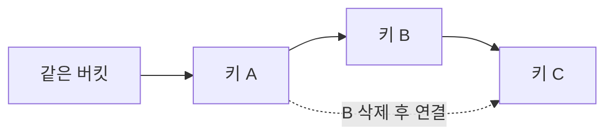
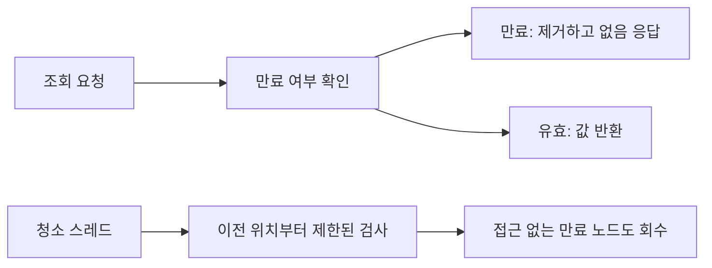
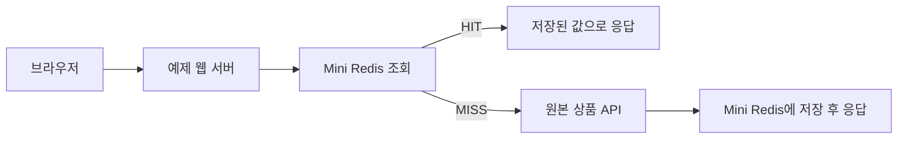
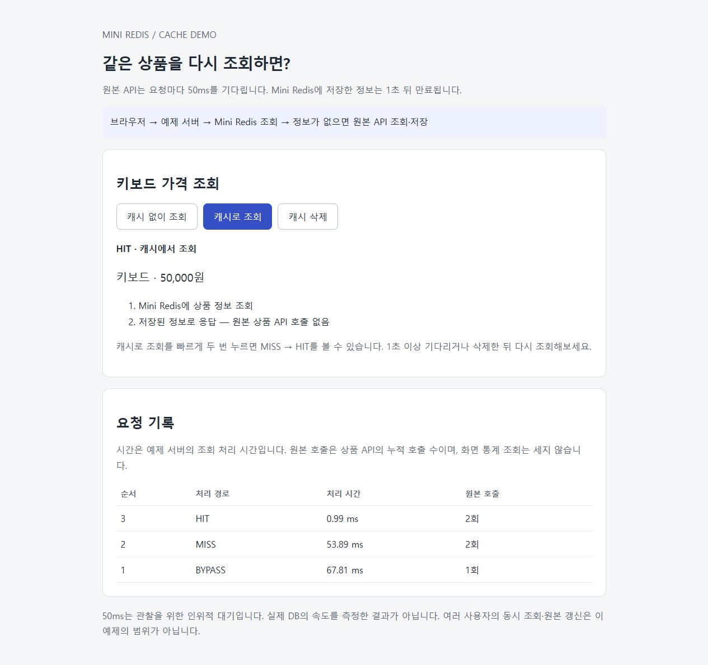
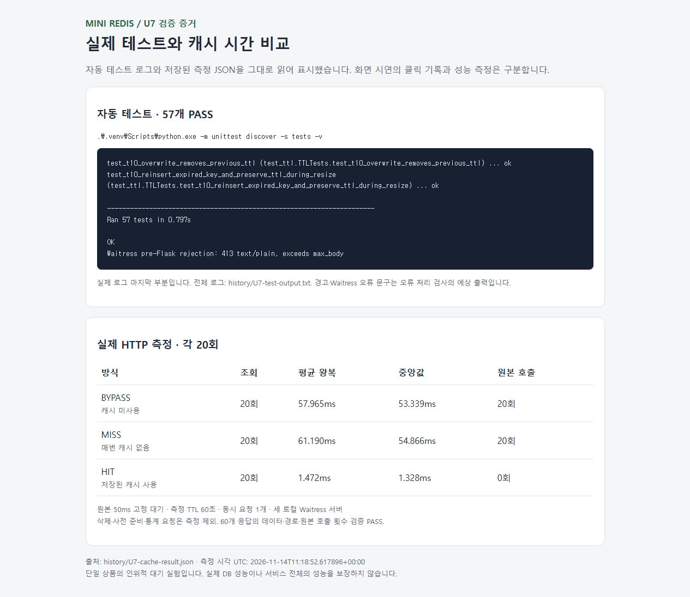

# Mini Redis

**인메모리 캐시의 동작을 직접 구현하고 검증하는 프로젝트입니다.** 문자열 키·값을 메모리에 보관하며, HTTP API로 저장·조회·삭제와 TTL을 제공합니다.

[빠른 시작](#빠른-시작) · [주요 기능](#주요-기능) · [설계 선택](#설계-선택) · [상품 캐시 예제](#상품-캐시-예제) · [테스트 실행](#테스트-실행) · [설정과 주의사항](#설정과-주의사항) · [HTTP API](#http-api) · [문서 안내](#문서-안내)

## 프로젝트의 출발점

구현에 앞서 “Redis가 무엇이고, 왜 사용하는가?”를 설명할 수 있도록 개념을 공부하고 토의했습니다. 그 과정에서 코치님과 정리한 핵심 표현이 **인메모리 캐시**였습니다. 이번 구현에서는 반복 요청되는 API 응답을 저장하고 재사용해 원본 호출을 줄이는 활용에 집중했습니다. 실제 Redis의 용도는 캐시 외에도 있으며, 이 프로젝트는 RESP나 기존 Redis 클라이언트와 호환되지 않습니다.

수동 메모리 관리보다 **해시 충돌·만료·동시 접근의 동작과 검증**에 집중하고자 Python을 선택했습니다. 외부 프로그램에서 호출하고 시연할 수 있도록 Flask·Waitress로 HTTP API를 구성했습니다.

## 주요 기능

- **키로 데이터 저장·조회·삭제:** 문자열을 저장하며, 빈 문자열·한글·공백·줄바꿈을 보존합니다.
- **보관 기간 지정:** `/set`에 `ttl_ms`를 넣으면 해당 기간이 지난 값은 조회되지 않습니다. 생략하면 만료되지 않습니다.
- **여러 요청의 저장소 공유:** 한 프로세스의 요청 스레드와 청소 스레드가 같은 저장소를 사용하고, 공용 락으로 저장소 작업을 보호합니다.
- **해시 충돌 처리와 확장:** 버킷 배열과 연결 리스트 체이닝으로 키를 찾고, 키가 늘면 버킷을 확장합니다.
- **캐시 사용 흐름 확인:** 예제 화면에서 캐시 미사용·MISS·HIT·만료·삭제에 따른 원본 API 호출을 관찰합니다.

## 설계 선택

### 충돌 처리: 조회·삭제의 정확성을 추적하기

**문제:** 서로 다른 키가 같은 버킷에 들어와도 각각 저장·조회·삭제할 수 있어야 합니다.

| 비교 기준 | 체이닝 | 개방 주소법 |
| --- | --- | --- |
| 삭제 과정에서 확인할 것 | 노드 제거 후 앞뒤 연결 보존 | 삭제 이후에도 다른 키의 탐색 경로 보존 |
| 감수할 비용 | 노드별 할당·연결 정보, 긴 체인의 탐색 | 탐사 과정과 삭제 표시 또는 재배치 관리 |

이번에는 충돌한 키의 조회와 삭제 과정을 직접 추적하고 검증하기 쉬운지를 우선해 **체이닝을 선택**했습니다. 다른 방식보다 빠르다고 측정해 선택한 것은 아닙니다.



충돌한 키가 각각 조회되는지, 체인의 첫·중간·마지막 노드를 삭제해도 나머지 키가 보존되는지 테스트했습니다.

키가 늘어 탐색 후보가 많아지는 것을 줄이기 위해 **적재율 0.75 초과 시 버킷을 두 배로 확장**하고 전체 키를 다시 배치합니다. 초기 16버킷에서 13번째 신규 키가 첫 확장을 일으킵니다. 확장은 노드 수를 줄이거나 메모리를 절약하는 기능이 아니며, 버킷 공간과 재배치 비용이 추가됩니다. 이 수치는 실측 최적값이 아닌 초기 정책입니다.

### TTL 처리: 만료 응답 방지와 메모리 회수

**문제:** 조회할 때만 만료를 확인하면 다시 읽히지 않는 데이터가 남고, 주기적인 청소에만 맡기면 청소 전 만료된 값을 반환할 수 있습니다.

두 문제를 처리하기 위해 **조회 시 만료 검사와 별도 청소 스레드를 함께 사용**했습니다.



청소가 저장소 락을 오래 점유하면 요청이 기다리므로 **회차당 최대 100키·100버킷**으로 검사량을 제한하고 다음 회차에 이어갑니다. 청소 작업 후 100ms를 기다리며, 만료 키의 100ms 이내 회수를 보장하지 않습니다. 요청과 청소는 같은 락으로 테이블·TTL·진행 위치를 보호합니다.

테스트에서는 만료 노드만 제거되는지, 삭제 후 연결과 다음 검사 위치가 유지되는지 확인했습니다. 만료 시각 경계는 시간원을 주입해 검증했습니다.

[설계 상세](docs/DESIGN.md) · [선택 이유·대안·비용](docs/DECISIONS.md) · [핵심 구현](mini_redis/store.py)

## 상품 캐시 예제

원본 상품 API와 예제 웹 서버는 Mini Redis와 별도 프로세스로 실행됩니다. Mini Redis가 원본을 직접 조회하는 구조는 아닙니다.



<details>
<summary>캐시 예제 실행 명령</summary>

프로젝트 루트에서 PowerShell 창 3개를 열고 각각 실행합니다. 빠른 시작에서 띄운 Mini Redis가 실행 중이면 창 1은 그대로 사용하세요.

```powershell
# 창 1: Mini Redis (8080)
.\.venv\Scripts\python.exe -m mini_redis.server

# 창 2: 원본 상품 API (8082)
.\.venv\Scripts\python.exe -m examples.cache_demo origin

# 창 3: 예제 웹 서버 (8081)
.\.venv\Scripts\python.exe -m examples.cache_demo web
```

</details>

브라우저에서 **http://127.0.0.1:8081**을 엽니다. 다음 순서로 확인할 수 있습니다.

1. **캐시 없이 조회** → 원본 API를 호출하며 `BYPASS`가 보입니다.
2. **캐시 삭제 후 캐시로 조회** → 캐시를 비운 뒤 첫 조회에는 원본에서 가져와 저장하므로 `MISS`가 보입니다.
3. **1초 안에 다시 캐시로 조회** → 저장된 값을 사용해 `HIT`가 보이고 원본 호출 횟수는 늘지 않습니다.
4. **1초 후 재조회 또는 캐시 삭제 후 조회** → 다시 원본에서 가져와 `MISS`가 보입니다.

화면에는 상품, 처리 경로, 예제 서버 처리 시간, 원본 API 누적 호출 횟수가 표시됩니다. 브라우저 자체 캐시가 결과를 가리지 않도록 `no-store`를 적용했습니다. 각 서버는 해당 창에서 `Ctrl+C`로 종료합니다.

| 이번 측정: 각 20회 순차 요청 | 평균 HTTP 왕복 | 원본 상품 API 호출 |
| --- | ---: | ---: |
| 캐시 미사용 | 57.965ms | 20회 |
| 매번 MISS | 61.190ms | 20회 |
| HIT | 1.472ms | 0회 |

원본은 **인위적으로 50ms 대기**합니다. 캐시 Hit 준비와 Miss용 삭제는 측정에서 제외하고, 측정용 TTL은 60초입니다. 데이터·경로·호출 횟수를 검증했으며 속도 배수는 통과 조건으로 두지 않았습니다. Miss에는 원본 조회 외에 캐시 조회·저장 비용도 듭니다. 실제 DB나 동시 부하의 성능 보장이 아닙니다. [조건·실행 과정](history/U7-cache.md) · [원시 측정값](history/U7-cache-result.json) · [확인한 화면](history/U7-cache-screen.jpg)

## 시연과 검증 화면

실제 브라우저에서 캡처했습니다. 시연의 개별 처리 시간과 위 표의 20회 평균 왕복 시간은 다른 측정입니다.

<details>
<summary>캐시 미사용 → MISS → HIT 시연 보기</summary>



HIT 행에서 원본 호출 횟수가 2회로 유지됩니다.

</details>

<details>
<summary>57개 테스트와 20회씩 측정 결과 보기</summary>



실제 실행 로그·측정 JSON을 표시한 결과 페이지의 캡처입니다. [전체 로그](history/U7-test-output.txt) · [원시 수치](history/U7-cache-result.json) · [과정 기록](history/U7-cache.md)

</details>

## 검증과 개선

합의한 필수 범위의 **자동 테스트 57개**를 통과했고, 청소는 별도로 10,000키 중 만료 7,000개 회수·유효 3,000개 보존을 확인했습니다. 구현 단위를 나누고 기대 동작과 테스트를 논의한 뒤 실제 결과를 기록했습니다.

캐시 비교에서는 HIT의 원본 호출 감소와 함께 MISS의 추가 조회·저장 비용도 확인했습니다. 선택의 이득뿐 아니라 비용을 테스트 결과와 함께 설명하는 것을 중요하게 다뤘습니다.

리뷰에서 지적된 **청소 스레드 예외 처리와 청소·다중 HTTP 요청의 통합 검증**은 후속 개선 사항입니다. 영속성은 현재 범위에 포함하지 않아 서버 종료 시 데이터가 사라집니다.

[단위별 구현·검증 기록](history/README.md) · [테스트 계획과 미검증 범위](docs/TESTING.md)

## 빠른 시작

Git과 Python 3.13을 준비하세요. 아래는 **Windows PowerShell 기준**입니다. 기존 검증 환경은 Python 3.13.14, Flask 3.1.3, Waitress 3.0.2이며, 다른 운영체제에서의 실행은 검증하지 않았습니다.

### 1. 프로젝트 받기

```powershell
git clone --branch yeongeun-main https://github.com/WEEK11-12/mini-redis.git main-redis
cd main-redis
```

이미 프로젝트가 있다면 해당 폴더로 이동하세요. 이후 명령은 모두 `requirements.txt`가 있는 프로젝트 루트에서 실행합니다.

### 2. 의존성 설치

```powershell
python --version
python -m venv .venv
.\.venv\Scripts\python.exe -m pip install -r requirements.txt
```

`python --version`으로 3.13인지 확인하세요. 가상환경을 활성화할 필요 없이 `.venv`의 Python을 직접 사용합니다. 별도의 Redis 설치, 환경 변수, API 키는 필요하지 않습니다.

### 3. 서버 실행

```powershell
.\.venv\Scripts\python.exe -m mini_redis.server
```

기본 주소는 `http://127.0.0.1:8080`입니다. 실행한 창을 열어 둔 채 **두 번째 PowerShell 창**에서 아래 요청을 보냅니다.

### 4. 저장·조회·삭제 확인

```powershell
Invoke-RestMethod http://127.0.0.1:8080/set -Method Post -ContentType 'application/json' -Body '{"key":"name","value":"JYE"}'
Invoke-RestMethod http://127.0.0.1:8080/get -Method Post -ContentType 'application/json' -Body '{"key":"name"}'
Invoke-RestMethod http://127.0.0.1:8080/delete -Method Post -ContentType 'application/json' -Body '{"key":"name"}'
```

순서대로 `{"ok":true}` → `{"found":true,"value":"JYE"}` → `{"deleted":true}`에 해당하는 결과가 나옵니다. PowerShell은 JSON을 객체로 표시합니다. 삭제 후 다시 조회하면 `{"found":false,"value":null}`입니다.

서버 창에서 `Ctrl+C`로 종료합니다. **종료하면 저장된 데이터도 사라집니다.**

## 테스트 실행

가상환경 설치 후 프로젝트 루트에서 실행합니다. **실행 중인 서버가 없어도 됩니다.** HTTP 검사는 필요한 서버를 임시 포트에 띄우고 종료합니다.

```powershell
# 저장소·TTL·동시성·HTTP·캐시 동작: 57개
.\.venv\Scripts\python.exe -m unittest discover -s tests -v

# 캐시 미사용·Miss·Hit 각각 20회 순차 HTTP 측정
.\.venv\Scripts\python.exe -m tests.measure_cache
```

첫 명령이 성공하면 `Ran 57 tests`와 `OK`가 표시됩니다. 두 번째 명령은 각 방식의 평균·중앙값과 원본 호출 횟수를 출력하고 [원시 측정값](history/U7-cache-result.json)을 갱신합니다. 이 측정에서는 TTL을 60초로 설정하며, 캐시 삭제·Hit 준비·통계 요청은 측정 시간에서 제외합니다. 이미 기록된 수치는 위 표에서 확인할 수 있습니다. 새 실행의 시간은 환경에 따라 달라집니다. [테스트별 역할·선택 실행](tests/README.md)

## 설정과 주의사항

현재 실행 명령에는 주소·포트를 바꾸는 옵션이나 환경 변수 설정이 없습니다. 아래 값은 실행 코드의 기본값입니다.

| 항목 | 현재 설정 | 확인할 코드 |
| --- | --- | --- |
| Mini Redis | `127.0.0.1:8080`, 요청 스레드 4개 | [server.py](mini_redis/server.py) |
| 원본 상품 API / 예제 웹 서버 | `127.0.0.1:8082` / `127.0.0.1:8081` | [cache_demo.py](examples/cache_demo.py) |
| 만료 청소 | 한 회 작업 후 100ms 대기, 회차당 최대 100키·100버킷 검사 | [expiration.py](mini_redis/expiration.py), [store.py](mini_redis/store.py) |
| 입력 크기 | UTF-8 키 1 KiB, 값 1 MiB, HTTP 본문 8 MiB | [api.py](mini_redis/api.py), [store.py](mini_redis/store.py) |

- 같은 컴퓨터에서 사용하는 구성이며 인증·외부 공개용 설정은 제공하지 않습니다.
- 데이터는 RAM에만 보관합니다. 재시작 복구·영속성은 구현하지 않았습니다.
- 프로세스를 여러 개 실행하면 저장소도 각각 분리됩니다.
- 실제 Redis의 RESP 프로토콜과 `redis-cli`는 지원하지 않습니다. 문자열 외 자료형·트랜잭션·전체 메모리 한도도 구현하지 않았습니다.
- 만료 여부는 조회 시에도 검사합니다. 청소 작업이 모든 만료 노드를 100ms 안에 제거한다는 보장은 없습니다.

### 자주 생기는 오류

| 증상 | 확인할 내용 |
| --- | --- |
| `python` 명령을 찾지 못함 | Python 설치와 명령 경로를 확인하고 `python --version`을 실행하세요. |
| `.venv` 실행 파일을 찾지 못함 | 프로젝트 루트인지, 가상환경 생성이 성공했는지 확인하세요. |
| `No module named flask` 또는 `waitress` | `.venv`의 Python으로 의존성 설치 명령을 실행했는지 확인하세요. |
| 서버 시작 시 포트 사용 중 오류 | 같은 서버를 이미 실행했는지 확인하세요. 캐시 시연에서는 기존 Mini Redis를 그대로 사용합니다. |
| 요청 연결 실패 | 해당 서버 창이 열려 있는지, 주소·포트가 맞는지 확인하세요. |
| 400 / 413 / 415 응답 | 각각 입력 형식·크기·Content-Type을 [API 규격](docs/API.md)과 비교하세요. |
| 예제 화면에서 502 응답 | Mini Redis와 원본 상품 API가 모두 실행 중인지 확인하세요. |

## HTTP API

모든 요청은 `POST`, 본문은 JSON 객체, `Content-Type`은 `application/json`입니다. 키를 JSON 본문에 전달하므로 빈 키와 특수문자를 같은 방식으로 보낼 수 있습니다.

| 경로 | 요청 본문 예 | 성공 응답 |
| --- | --- | --- |
| `/set` | `{"key":"name","value":"JYE","ttl_ms":1500}` | `{"ok":true}` |
| `/get` | `{"key":"name"}` | `{"found":true,"value":"JYE"}` 또는 `{"found":false,"value":null}` |
| `/delete` | `{"key":"name"}` | `{"deleted":true}` 또는 `{"deleted":false}` |

`ttl_ms`는 선택 필드이며 양의 정수 밀리초입니다. 생략하면 만료되지 않습니다. 같은 키를 TTL 없이 다시 저장하면 기존 TTL을 제거합니다. 이미 만료된 키를 삭제하면 `deleted:false`입니다.

키는 UTF-8 기준 최대 **1 KiB**, 값은 **1 MiB**, HTTP 본문은 **8 MiB**입니다. 잘못된 입력은 400, 크기 초과는 413, JSON이 아닌 콘텐츠 형식은 415로 처리합니다. Flask가 처리한 오류는 `{"error":{"code":"...","message":"..."}}` 형태입니다. Waitress가 Flask보다 먼저 본문을 거부하면 413 일반 텍스트가 반환될 수 있습니다. [전체 API 규격](docs/API.md)

## 폴더 구조

```text
main-redis/
├─ mini_redis/        저장소·TTL 청소·HTTP API·서버 실행
├─ examples/          원본 상품 API와 캐시 시연 화면
├─ tests/             자동 테스트·별도 부하 및 성능 측정 코드
├─ docs/              요구사항·설계·API·검증 계획
├─ history/           단위별 실행 과정·결과·측정값·스크린샷
├─ study/             개념 학습 노트
├─ requirements.txt  Flask·Waitress 버전
├─ AGENTS.md          AI 작업 안내
└─ WORKLOG.md         작업 상태와 인계 기록
```

HTTP 진입점은 [api.py](mini_redis/api.py), 저장소 핵심은 [store.py](mini_redis/store.py), 서버 실행은 [server.py](mini_redis/server.py)에서 확인할 수 있습니다. 저장소는 FNV-1a 64비트 해시와 체이닝을 사용하며, 초기 16버킷에서 신규 키로 적재율이 0.75를 초과하면 버킷을 두 배로 늘려 다시 배치합니다.

## 문서 안내

| 알고 싶은 내용 | 문서 |
| --- | --- |
| 전체 문서의 역할·읽는 순서 | [문서 목차](docs/README.md) |
| 프로젝트 목표와 범위 | [프로젝트 개요](docs/PROJECT.md) · [과제 요구](docs/assignment.md) |
| 기대 동작·설계·선택 이유 | [요구사항](docs/REQUIREMENTS.md) · [설계](docs/DESIGN.md) · [선택 이유와 대안](docs/DECISIONS.md) |
| API 입력과 응답 | [API 규격](docs/API.md) |
| 테스트 계획과 실제 실행 결과 | [테스트 계획](docs/TESTING.md) · [단위별 기록](history/README.md) |
| 함께 작업하는 방법 | [작업 방식](docs/WORKFLOW.md) · [AI 안내](AGENTS.md) · [작업 인계](WORKLOG.md) |
| Redis 개념 공부 | [학습 목차](study/00-overview.md) |

개인 저장소는 [jye-1123/mini-redis](https://github.com/jye-1123/mini-redis)의 `main`, 팀 공유 브랜치는 [WEEK11-12/mini-redis의 yeongeun-main](https://github.com/WEEK11-12/mini-redis/tree/yeongeun-main)입니다.
