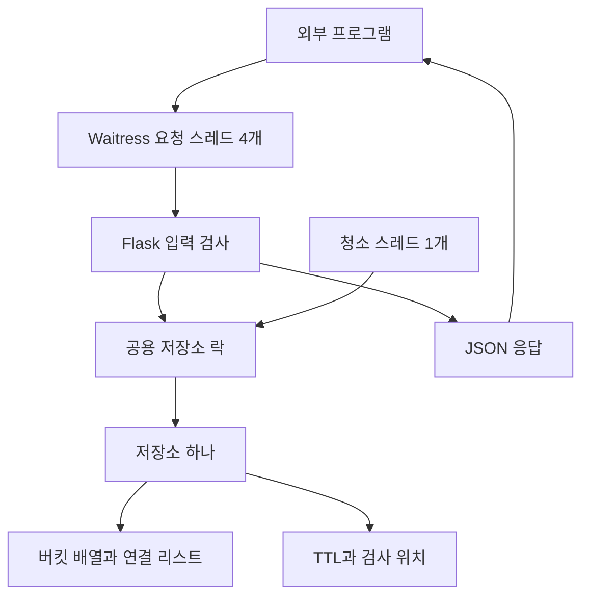

# Mini Redis 내부 설계

Python + Flask + Waitress로 문자열 키·값을 제공하는 단일 프로세스 메모리 서버다. 규칙은 [REQUIREMENTS](REQUIREMENTS.md), HTTP 계약은 [API](API.md), 이유와 대안은 [DECISIONS](DECISIONS.md)를 따른다. U1~U4의 저장소·입력 검사·확장·TTL·능동 청소와 작업자 시작/종료를 구현했다. U5의 합의한 필수 동시성 검증도 통과했으며 U6 HTTP 연동과 U7 캐시 예제의 필수 검증도 완료했다. 단위별 실제 결과는 [history 목차](../history/README.md)를 따른다.

## 처리 흐름

요청 스레드는 기능별 담당이 아니다. 비어 있는 워커가 다음 요청을 처리한다. 저장소 내부에는 한 번에 하나의 작업만 들어간다. 락은 스레드 전환 자체를 금지하지 않으며 여러 HTTP 요청을 묶는 트랜잭션도 아니다.

## 역할과 소유

| 역할 | 책임 | 의존 경계 |
| --- | --- | --- |
| 해시 테이블 | 해시·체인·키 개수·전체 리해싱 | Flask 없이 테스트 가능 |
| 저장소 | 문자열 검사, 저장·조회·삭제, TTL과 청소 위치, 공용 락 | 노드나 내부 가변 상태를 외부에 노출하지 않음 |
| Flask API | JSON 입력·오류 변환·응답 | 테이블을 직접 수정하지 않고 저장소 호출 |
| 청소 작업 | Event 대기·반복 청소 | 요청과 같은 저장소 API·락 사용 |
| 실행 진입점 | 저장소·청소·Waitress의 시작과 정리 | import만으로 실행되지 않음 |
| 캐시 데모 | 원본 API 조회와 캐시 사용 판단 | 저장 서버 안에서 원본 API를 호출하지 않음 |

위 표는 책임 경계다. 현재 U1·U2는 mini_redis/store.py에 해시·노드·저장소를 함께 배치하고 tests/test_store.py에서 검증한다. 이후 모듈 분리는 해당 역할의 코드가 생길 때 검토한다.

## 저장소와 입력

- 문자열 키·값, 빈 문자열 허용. 자동 문자열 변환·공백 제거를 하지 않는다.
- UTF-8 바이트 길이로 키 1,024바이트, 값 1,048,576바이트까지 허용한다.
- FNV-1a 64비트를 UTF-8 키 바이트에 적용한다. Python 정수는 자동으로 64비트에서 넘치지 않으므로 각 곱셈 결과를 64비트 범위로 제한한다.
- 버킷 위치는 해시값 % 버킷 수. 같은 버킷에서는 실제 키를 비교한다.
- 초기 16버킷, 신규 키로 적재율 0.75 초과 시 2배. 전체 리해싱. 덮어쓰기는 키 수를 늘리지 않는다.
- get은 문자열 또는 None, delete는 삭제 여부 bool. set은 별도 결과 없이 None을 반환한다. HTTP의 ok 응답과 내부 호출 결과를 구분한다.
- 문자열 외 키·값은 TypeError, UTF-8 길이 초과는 ValueError로 알린다. HTTP 상태 코드로의 변환은 API 단위에서 다룬다.
- 전체 리해싱은 새 버킷과 노드 연결을 준비한 뒤 교체한다. 기존 체인을 유지하는 대신 노드 메모리가 일시적으로 늘며 메모리 고갈 복구는 별도 검증 대상이다.
- 검증 오류는 변경 전에 거부한다. 문자열은 불변 객체이므로 C의 빌린 포인터·수동 free 규칙을 옮기지 않는다.

## 락의 범위

테이블, 키 개수, TTL, 청소 커서의 읽기·변경은 같은 락으로 보호한다. 조회도 만료 키를 삭제할 수 있으므로 락이 필요하다. with 문으로 예외 발생 시에도 락을 반환한다. 락을 이미 잡은 코드에서 같은 일반 Lock을 다시 잡지 않도록 공개 진입점과 내부 보조 처리를 나눈다.

입력 전체를 검증한 뒤 락 안에서 필요한 현재 상태를 확인하고 변경한다. HTTP 파싱·응답 직렬화·외부 I/O는 락 밖에서 한다. 긴 리해싱이나 청소 중에는 다른 요청이 기다리므로 지연을 측정한다. GIL을 동기화 보장으로 쓰지 않는다.

## TTL

TTL은 양의 정수 밀리초이며 bool은 정수로 취급하지 않는다. 생략은 무기한, 일반 저장은 기존 TTL 제거, TTL 포함 저장은 저장 적용 시점부터 새로 계산한다. 잘못된 TTL은 기존 값·TTL을 바꾸지 않는다.

시간원은 단조 시간이다. 현재 시간 >= 만료 시각부터 조회는 None이다. 경계 테스트는 시간을 제공하는 함수를 교체해서 실제 대기 없이 수행한다. 내부 표현은 monotonic_ns의 정수 나노초이며 TTL 밀리초를 1,000,000배해 더한다. 기간 상한은 두지 않는다. 만료 키 삭제는 False를 반환하면서 노드를 정리한다. len(store)는 만료 잔여 항목도 포함하는 노드 수다.

## 청소 진행 위치

- 목표 간격 100ms, 회차당 최대 100키 검사와 최대 100버킷 방문 중 먼저 도달한 한도에서 중단한다.
- 버킷 번호·다음 검사 노드·앞 노드를 기억한다. 고정 순번이 아니다. 삭제할 때 앞 노드를 다시 탐색하지 않기 위해서다.
- 커서 대상 삭제 시 다음 노드로, 앞 노드 삭제 시 그 이전 노드로 보정한다. 새 헤드 삽입도 앞 노드를 보정한다. 요청 삭제·접근 만료·청소 삭제에 공통 적용한다.
- 버킷 끝이면 다음 버킷, 테이블 끝이면 처음으로 순환한다. 한 회차에서 버킷 수만큼 방문하면 같은 항목을 반복 검사하지 않도록 회차를 끝낸다.
- 리해싱 후 새 테이블 처음으로 커서를 초기화한다. 모든 위치 변경은 공용 락 안에서 한다.
- 락 대기·작업 시간 때문에 주기는 늦어질 수 있다. 100ms 이내 회수 보장이 아니며, 반복 확장은 뒤쪽 항목의 회수를 지연시킬 수 있다. 구조 변경이 멈춘 조건에서 전체 순회 진행을 검증한다.

## 시작과 종료

진입점에서 저장소·락 생성 → 청소 스레드 하나 시작 → Waitress 실행. 종료 시 finally에서 Event로 종료 신호 → 청소 스레드 종료 확인. Event 대기로 대기 중에도 종료 신호에 반응하게 한다. join 중 저장소 락을 잡지 않는다.

청소 스레드는 import·요청마다 시작하지 않는다. 강제 종료에서는 finally 실행을 보장하지 않는다. 초기 범위에 영속성이 없으므로 정상 종료라도 재시작하면 데이터가 없다. U6에서는 실제 Waitress 요청·테스트 서버 정리와 진입점의 인터럽트/오류 후 청소 종료를 검증했다. Windows 실제 Ctrl+C 키 입력·처리 중 강제 종료는 미검증이다.

## 초기 실행 설정

단일 프로세스, 요청 워커 4개, 청소 1개, 127.0.0.1:8080, HTTP 본문 최대 8 MiB. Flask와 Waitress 모두 본문 제한을 적용한다. Waitress 3.0.2는 설정값 이상을 거부하므로 8 MiB + 1바이트, Flask는 8 MiB로 설정해 8 MiB까지 허용한다. 실제 Waitress 선행 거부는 413 text/plain으로 확인했다.

여러 프로세스를 켜면 각각의 저장소가 나뉘므로 금지한다. 127.0.0.1은 같은 컴퓨터의 다른 프로그램에서 접근하는 기본값이다. 다른 컴퓨터에서 사용할 설정은 실제 노출 범위를 확인한 후 적용한다. 총 저장 용량이나 과부하 보호가 완성됐다는 뜻은 아니다.

## 캐시 예제의 경계

examples/cache_demo.py의 원본 API(8082)와 예제 서버(8081)는 Mini Redis(8080)와 별도 프로세스다. 브라우저 → 예제 서버 → Mini Redis 조회 → Miss면 원본 API 조회·Redis 저장 순서다. Mini Redis 자체에서 원본 API를 호출하지 않는다.

원본 상품 하나의 JSON 응답을 문자열로 직렬화해 demo:product:1 키에 저장한다. 화면 TTL은 1초, 원본 대기는 50ms이며 상품 API 호출 횟수는 락으로 보호한다. 통계 조회는 상품 호출 횟수에 포함하지 않는다. 예제 응답은 no-store로 브라우저 캐시의 개입을 막는다.

UI 시간은 예제 서버 처리 구간이며, 성능 스크립트는 클라이언트 HTTP 요청부터 JSON 응답 해석까지 측정한다. 의존 서버 오류는 예제에서 502로 보고하며 원본 우회·동시 Miss 합치기는 구현하지 않았다. 상세 조건과 한계는 [U7](../history/U7-cache.md)에 둔다.

## 구현 순서

[TESTING](TESTING.md)의 U1 저장·조회·삭제 → U2 입력·해시·확장 → U3 TTL → U4 청소·생명주기 → U5 동시 접근 → U6 HTTP → U7 캐시 데모·성능 비교. 각 단위를 확인한 뒤 다음으로 이동한다.

U4 실제 구현은 mini_redis/expiration.py의 ExpirationWorker와 store.cleanup이다. 작업자 인스턴스는 한 번의 시작/종료를 소유하며 반복 start는 추가 스레드를 만들지 않는다. 실제 서버 진입점과 finally 연결은 mini_redis/server.py에 구현했고 U6에서 검증했다. [U4 검증](../history/U4-cleanup.md)
