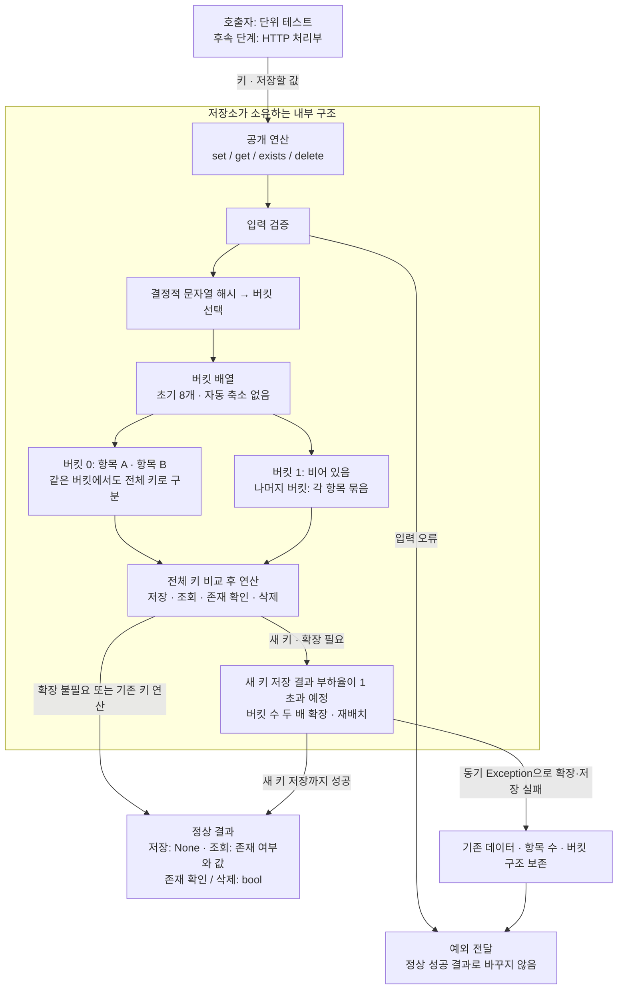
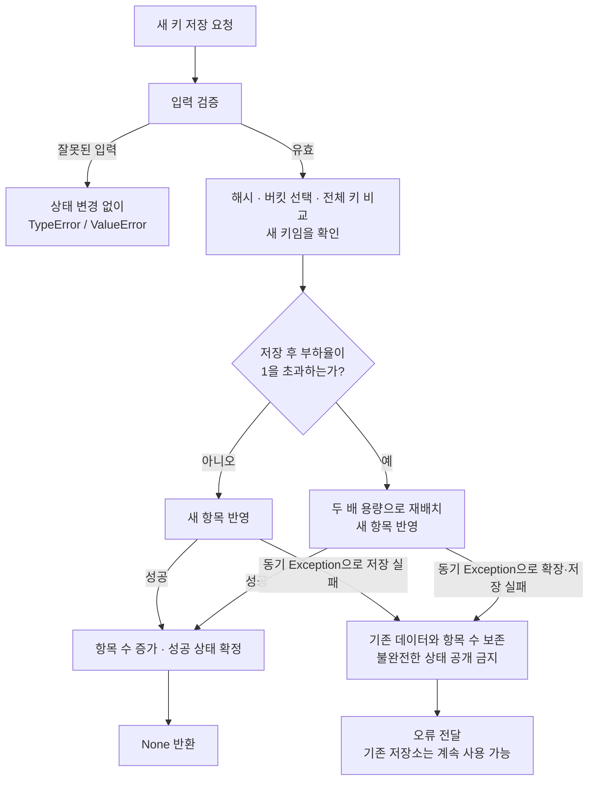

# 2단계 설계 — 해시 테이블 저장소

- 문서 상태: 설계 계약 검토 완료 — 구조·정책 선택, 피드백 재확인 완료·구현 전
- 단계 상태: 구현·테스트 미실시
- 근거: [요구사항 명세](requirements.md), [1단계 공유 계약](../01-scope-and-contract/overview.md), [D-0002](../../decisions/0002-python-http-interface.md), [D-0003](../../decisions/0003-http-response-contract.md)
- 진행·검증 결과: [2단계 진행](overview.md)

## 한눈에 보는 구조와 흐름

### 저장소 구조와 책임 경계

버킷별 체인은 충돌한 항목의 논리적 묶음이며 연결 리스트 구현을 강제하지 않는다. 확장 판단은 새 키 저장에만 해당한다. 도식은 책임·결과를 설명하며 세부 탐색·재배치 절차를 강제하지 않는다.

### 새 키 저장과 확장·실패 흐름

기존 키의 덮어쓰기는 이 새 키 흐름에 진입하지 않으며 값만 교체한다. 그림의 실패 보존은 저장 연산 중 발생해 호출자에게 전달되는 동기 `Exception`(메모리 할당의 `MemoryError` 포함)에 한정한다. 프로세스 중단과 `KeyboardInterrupt`·`SystemExit` 같은 비동기·종료 신호는 포함하지 않는다. 실패 보존을 만족하는 준비·확정 절차는 구현에 위임한다.

## 1. 범위와 책임

HTTP와 독립적인 인메모리 저장소가 문자열 키·값의 저장, 조회, 존재 확인, 삭제를 담당한다. 핵심 보관을 Python `dict`에 위임하지 않고 해시 계산·전체 키 비교·충돌 처리를 직접 수행한다.

- 호출자는 공개 연산만 사용하며 버킷이나 내부 항목을 수정하지 않는다.
- 저장소가 입력 검증, 해시·버킷 선택, 체이닝, 항목 수와 확장을 관리한다.
- 책임 구분을 별도 클래스·파일로 일대일 분리하지 않는다. 별도의 서비스 계층·범용 저장소 인터페이스는 추가하지 않는다.
- HTTP 요청 해석·응답 변환(3단계), TTL·무효화(4단계), 동시성 방어(5단계)는 제외한다.
- 이번 단계의 호출은 순차 호출을 전제로 한다. 스레드·동시 호출 안전성이나 여러 프로세스의 메모리 공유는 보장하지 않는다.

## 2. 공개 인터페이스와 입력 계약

| 연산 | 인터페이스 | 반환·효과 |
| --- | --- | --- |
| 저장·덮어쓰기 | `set(key: str, value: str) -> None` | 새 키를 저장하거나 기존 값을 교체. 성공 시 `None`. |
| 조회 | `get(key: str) -> tuple[bool, str \| None]` | 존재하면 `(True, 값)`, 없으면 `(False, None)`. |
| 존재 확인 | `exists(key: str) -> bool` | 키가 있으면 `True`, 없으면 `False`. |
| 삭제 | `delete(key: str) -> bool` | 실제 제거했으면 `True`, 없으면 `False`. |

타입 표기는 계약 설명이며 Python 런타임 버전 선택을 뜻하지 않는다. 각 인스턴스는 비어 있는 저장소로 시작하며 초기 버킷 수는 8이다. 용량·부하율을 조정하는 공개 생성자 인자나 버킷 조회 API는 이번에 추가하지 않는다.

### 입력과 예외

- 모든 연산: 문자열 아닌 키는 `TypeError`, 빈 문자열 키는 `ValueError`.
- 저장: 문자열 아닌 값은 `TypeError`. 빈 문자열 값은 유효하다.
- 키·값은 필수 인자다. 인자 누락은 Python 함수 호출의 `TypeError`로 거부하며 별도 누락 센티널·전용 예외를 추가하지 않는다.
- 함수 본문에서의 검증 순서는 키 타입 → 빈 키 여부 → 저장할 값의 타입이다. Python의 호출 인자 검사는 본문 실행에 앞선다.
- 잘못된 입력은 미존재 결과나 성공으로 바꾸지 않는다. 예외 메시지 문구는 공개 계약이 아니다.
- 입력 검증 실패 시 기존 데이터·항목 수·버킷 수를 변경하지 않는다.
- 공백 제거, 대소문자 변환, 유니코드 정규화를 하지 않는다. 빈 문자열 외에 키의 추가 제약은 두지 않는다.

## 3. 저장 구조·상태와 불변조건

### 저장 구조와 해시

버킷 배열의 각 버킷은 여러 키·값 항목을 보관할 수 있다. 같은 버킷 안에서 전체 문자열 키의 일치 여부로 항목을 식별한다.

- 같은 키는 저장소에 하나만 존재한다. 덮어쓰기 뒤 이전 값이 별도 항목으로 남지 않는다.
- 같은 해시값이나 버킷 위치가 같은 키를 의미하지 않는다.
- 서로 다른 키의 덮어쓰기·삭제는 독립적이다.
- 관리하는 항목 수는 실제 서로 다른 키의 수와 일치한다.
- 같은 키의 해시값은 실행 간 동일하며, 프로세스별로 달라지는 Python 내장 문자열 `hash`에 맡기지 않는다.
- 현재 버킷 수를 기준으로 유효한 버킷 위치를 정한다. 확장하면 해시값이 같아도 버킷 위치는 바뀔 수 있다.
- 모든 항목은 현재 버킷 배치 규칙에 맞는 버킷에 존재한다.

구체적인 해시 계산식·문자 처리 방식은 구현에 위임한다. 전체 문자열을 처리하고 결정성을 만족해야 하며, 구현 결과에 계산 규칙을 남겨 설명·재현할 수 있어야 한다. 균등 분포나 공격적인 입력에 대한 내성을 보장한 설계는 아니다.

### 용량 정책

부하율은 `저장된 서로 다른 키의 수 / 버킷 수`다. 비어 있지 않은 버킷의 비율이 아니다.

- 초기 버킷 수 8, 확장 시 현재 버킷 수의 두 배, 자동 축소 없음.
- 새 키 저장 결과 부하율이 1을 초과하게 되면 그 저장 연산 안에서 확장한다. 정확히 1이면 확장하지 않는다.
- 덮어쓰기는 항목 수·버킷 수를 바꾸지 않는다.
- 삭제는 항목 수만 감소시킨다. 없는 키의 삭제는 어느 수치도 바꾸지 않는다.
- 확장 자체는 기존 키·값·항목 수를 바꾸지 않는다. 새 키 저장까지 성공하면 항목 수만 하나 증가한다.
- 실패하지 않은 공개 연산의 종료 시 부하율은 1 이하이며, 외부 호출자는 재배치 중인 상태를 다루지 않는다. 이는 동시 호출의 원자성 보장이 아니다.

## 4. 주요 연산 흐름

| 경로 | 입력 → 처리 → 출력 |
| --- | --- |
| 새 키 저장 | 검증 → 해시·버킷 결정 → 전체 키 비교로 미존재 확인 → 필요 시 확장·재배치 → 새 항목과 항목 수 반영 → `None`. |
| 기존 키 덮어쓰기 | 검증 → 대상 키 탐색 → 그 값만 교체 → `None`. 항목 수·버킷 수 유지. |
| 조회 | 검증 → 대상 버킷에서 전체 키 비교 → `(True, 값)` 또는 `(False, None)`. 상태 변경 없음. |
| 존재 확인 | 검증 → 대상 키 탐색 → `True` 또는 `False`. 빈 값도 존재하며 상태 변경 없음. |
| 삭제 | 검증 → 대상 키 탐색 → 있으면 그 항목 제거·항목 수 감소 후 `True`, 없으면 상태 유지 후 `False`. |

## 5. 자원 소유권·수명과 실패 동작

- 저장소 인스턴스가 배열·항목과 내부 관리 상태를 소유한다. 문자열 키·값은 보관에 필요한 참조를 유지하며, 변경 가능한 내부 항목이나 버킷 참조를 외부에 반환하지 않는다.
- 삭제·덮어쓰기 시 더는 필요 없는 내부 참조를 해제한다. 실제 메모리 회수 시점은 Python 런타임에 맡긴다.
- 확장 시 기존 배열과 새 배열이 일시적으로 공존할 수 있다. 성공 후 사용하지 않는 기존 내부 구조에 대한 참조를 해제한다.
- 파일·소켓·백그라운드 작업을 소유하지 않으므로 명시적인 종료 API는 추가하지 않는다. 인스턴스 수명이 끝나면 데이터도 유지하지 않는다.
- 저장 연산 중 동기적으로 발생해 호출자에게 전달되는 `Exception`(할당 실패의 `MemoryError` 포함)에 대해서는 기존 키·값·항목 수·버킷 수와 저장소의 후속 사용 가능성을 보존한다. 확장 실패 시 기존 버킷 구조를 계속 사용할 수 있어야 한다. 실패한 새 키를 일부만 반영하거나 불완전한 새 테이블로 교체하지 않는다.
- 예상하지 못한 내부 오류도 성공·미존재로 숨기지 않고 호출자에게 전달한다. 모든 예외를 잡거나 자동 재시도하도록 강제하지 않는다. 실패를 안전하게 만드는 구체적 준비·확정 절차는 구현에 위임한다.
- 프로세스 강제 종료·서버 중단과 `KeyboardInterrupt`·`SystemExit` 같은 비동기·종료 신호는 위 상태 보존 대상에서 제외한다. 중단 후 데이터 보존도 보장하지 않는다. Optional 영속성 채택을 뜻하지 않는다.
- 후속 HTTP 계층에서는 모든 `TypeError`를 입력 오류로 일괄 변환하지 않도록 요청 검증과 내부 오류 처리를 구분해야 한다.

## 6. 주요 선택과 대안

| 선택 | 비교한 대안 | 이유와 감수하는 비용 |
| --- | --- | --- |
| 체이닝 | 개방 주소법 | 충돌·삭제 독립성을 단순하게 설명·검증. 버킷별 항목 공간과 긴 체인의 탐색 비용을 감수. |
| 부하율 기반 확장 | 고정 버킷 | 항목 증가에 따라 평균 체인 길이를 관리. 재배치 시간·추가 메모리·실패 경로가 추가됨. 나쁜 해시 분포까지 해결하지는 않음. |
| 직접 작성한 결정적 해시 | Python 내장 문자열 `hash` | 실행 간 충돌 상황의 재현·추적을 우선. 계산식 선택과 분포 품질에 대한 책임이 생김. 내장 `hash`도 같은 프로세스 안에서는 일관됨. |
| 표준 예외 | 저장소 전용 예외 | 빠른 개발과 작은 구성을 우선. 호출 계층이 입력 오류와 내부 버그를 구분할 책임을 가짐. |
| 임계값 1 | 0.5·0.75 등 | 체이닝의 실행 가능한 기준선을 먼저 확보. 최적값으로 확정한 것은 아니며, 공간 절약 대신 버킷 내 비교가 늘 수 있음. |
| 자동 축소 없음 | 삭제 후 축소 | 축소·재확장 정책과 검증을 생략. 삭제 후에도 늘어난 배열 공간을 유지. |

초기 크기 8과 두 배 확장 역시 측정으로 도출한 최적값이 아니다. 이후 임계값 1과 0.5를 비교하고 필요하면 중간값을 선택한다. 같은 데이터·해시·초기 용량·확장 배율·연산 순서·환경에서 조회, 저장 및 확장 지연, 메모리, 버킷별 항목 분포를 확인한다. 이번 문서는 측정 완료나 우열을 주장하지 않으며 공개 설정 API를 미리 추가하지 않는다.

## 7. 요구사항 대응과 검증 지점

아래는 검증 계획이며 통과 결과가 아니다. 구현 전 TC는 `test-cases.md`, 실제 실행 명령·환경·결과는 `verification.md`에 기록한다. 두 파일은 해당 작업을 시작할 때 작성한다. 현재 상태는 [진행 문서](overview.md#5-테스트결과-확인--미실시)에 남긴다.

| 요구사항 | 설계 대응 | 집중해서 볼 관찰 결과 |
| --- | --- | --- |
| REQ-02-001 | `set`, 키 유일성, 덮어쓰기 | 마지막 값만 조회되고 한 번 삭제하면 이전 값도 나타나지 않음. 덮어쓰기 시 항목 수·용량 유지. |
| REQ-02-002 | `get`의 존재 여부·값 튜플 | 빈 값은 `(True, "")`, 없는 키는 `(False, None)`. |
| REQ-02-003 | `exists` | 빈 값을 포함한 존재·삭제·미존재 구별. |
| REQ-02-004 | `delete`, 축소 없음 | 첫 삭제만 `True`, 재삭제는 `False`, 다른 키 유지. |
| REQ-02-005 | 입력 검증·표준 예외 | 각 연산의 잘못된 키, 저장 값 타입·누락, 검증 순서와 기존 상태 보존. |
| REQ-02-006 | 체이닝·전체 키 비교 | 실제 같은 버킷으로 매핑되는 서로 다른 키를 준비해 갱신·삭제 독립성 확인. 우연한 충돌 발생에 의존하지 않음. |
| REQ-02-007 | 자체 해시·버킷 보관·키 비교 | `dict` 위임 없이 실제 연산 경로를 설명. HTTP 없이 사용 가능. |
| REQ-02-008 | 저장소 단위 테스트 | 각 요구사항 ID와 테스트 연결, 실행 명령·환경·결과 기록. |

추가 설계 검증 지점은 부하율이 정확히 1인 경계, 초과 직전 새 키 저장, 반복 확장 후 모든 키·값 보존, 확장 실패 후 기존 상태와 후속 연산의 유지다. 메모리 부족을 실제로 유발하는 대신 실패를 제어해 확인할 방법은 구현·검증 담당이 정한다. 이를 위해 운영용 공개 인터페이스를 추가하지 않는다.

## 8. 구현 위임과 후속 경계

- 구현에 위임: 해시 계산식·문자 처리 방식, 버킷 내 항목 표현, 탐색·재배치·실패 보존 절차, 클래스명·파일 배치·보조 함수.
- 구현·검증 착수 시 선택: Python 버전, 패키지 관리와 테스트 도구·명령. 이번 설계로 자동 채택하지 않는다.
- 후속 단계에서 결정: HTTP 오류 매핑·키 경로 표현, TTL 설정·만료 제거·무효화, 동시성 구조·배포 형태. 내부 구조를 외부에 노출하지 않아 해당 단계에서 저장소 내부를 조정할 여지를 유지한다.
- 설계 검증 상태: 독립 검토에서 구현 착수를 막는 확정 설계 오류가 발견되지 않았고, 피드백으로 수정한 두 쟁점은 설계 검증 에이전트의 초점 재검토에서 해소됐으며 해당 수정의 새 충돌은 발견되지 않았다. 초점 재검토는 문서 수정의 직접 영향에 한정된다. 구현·테스트 성공을 의미하지 않는다.
