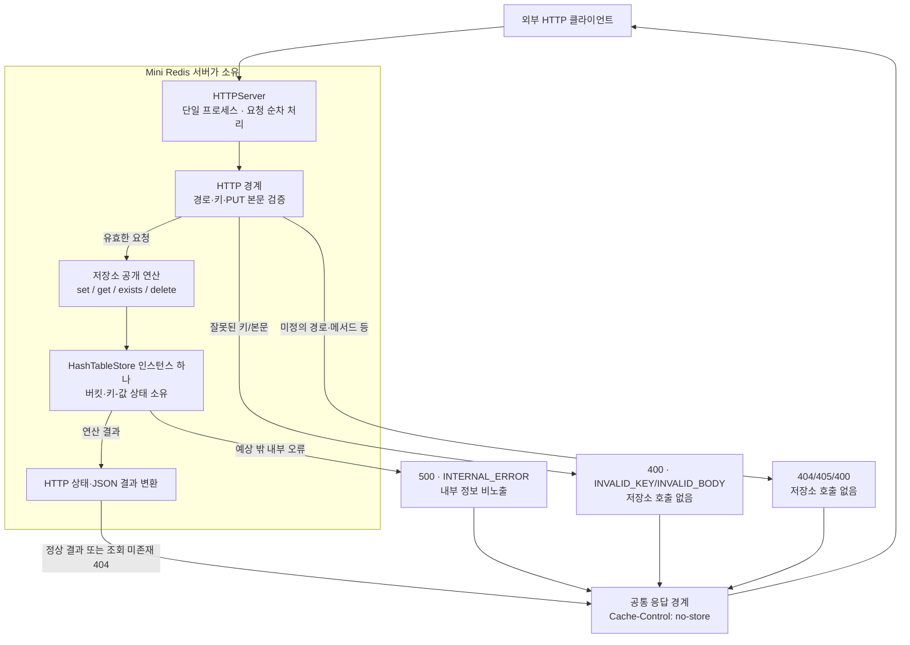
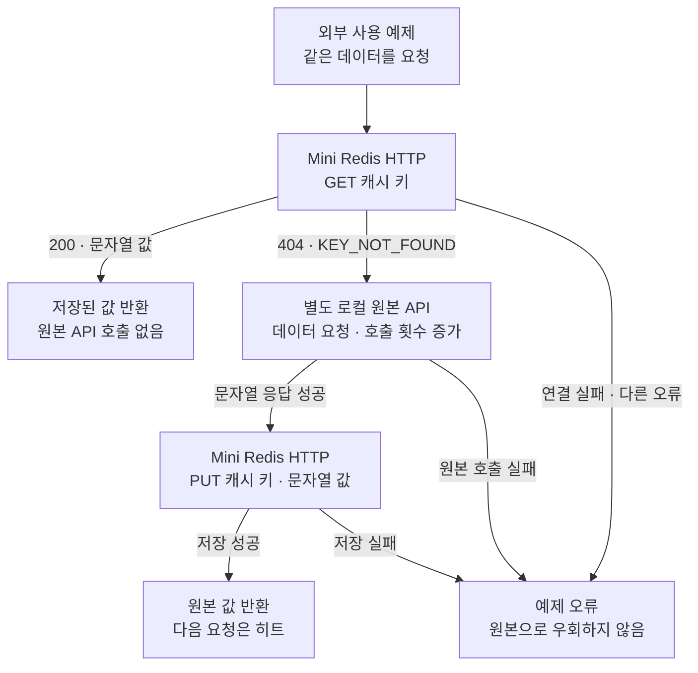

# 3단계 설계 — HTTP 연결과 API 응답 재사용

- 문서 상태: 설계 계약 확정·독립 검토 반영 완료 — 구현자 점검 결과는 [검증 기록](verification.md) 참조
- 단계 상태: 최신 공식 테스트 통과·독립 3단계 범위 승인
- 근거: [3단계 요구사항](requirements.md), [1단계 공유 계약](../01-scope-and-contract/overview.md), [D-0002 Python·HTTP API](../../decisions/0002-python-http-interface.md), [D-0003 기본 HTTP 계약](../../decisions/0003-http-response-contract.md), [D-0004 HTTP 키 제약](../../decisions/0004-http-key-no-slash.md), [D-0005 3단계 HTTP 경계](../../decisions/0005-http-api-boundary.md), [2단계 저장소 설계](../02-hash-table/design.md)

## 한눈에 보는 구조와 흐름

### Mini Redis 기본 API: 요청에서 저장소 결과까지

`HashTableStore`가 해시·버킷·항목을 관리한다. HTTP 경계는 저장소 공개 연산만 호출한다. 그림의 조회 `404`는 유효한 키가 저장소에 **없는** 결과이고, 잘못된 경로의 처리와는 구별한다. 정상·오류별 정확한 응답은 2절에 정리한다. 이 그림은 서버의 요청 처리이며 아래 예시 API와 섞지 않는다.

### 외부 사용 예제: 원본 API 응답 저장·재사용

로컬 원본 API와 외부 사용 예제는 **Mini Redis 서버 안에 넣지 않는다**. 원본 호출 횟수를 조회해 두 번째 요청에서 증가하지 않았는지 확인한다. 이 그림은 외부 사용 동작이며 Mini Redis의 기본 키 API에 예시 전용 엔드포인트를 추가하자는 뜻이 아니다. 예시 데이터·경로·실행 계약은 4절을 따른다.

## 1. 범위와 책임

이번 단계는 2단계의 `HashTableStore`에 외부 HTTP 경로를 붙이고, 실제 외부 사용 예제에서 원본 API 응답의 첫 저장과 다음 요청의 재사용을 보여 준다. 확정된 범위와 관찰 가능한 인수 조건은 [요구사항 명세](requirements.md)에 있다. 구현자 실행 결과는 [검증 기록](verification.md)에 있으며 독립 인수 판정은 아직 없다.

| 구성 요소 | 책임과 경계 |
| --- | --- |
| Mini Redis HTTP 서버 | 한 프로세스에서 `HTTPServer`로 요청을 **단일 스레드·순차** 처리. 요청 해석·검증, 저장소 호출, HTTP 응답 변환. 저장소 내부 버킷은 조작하지 않음. |
| `HashTableStore` | 같은 서버 인스턴스의 키-값 상태를 소유. `set/get/exists/delete`와 자체 키·값 검증 담당. HTTP나 원본 API를 알지 못함. |
| 외부 사용 예제 | Mini Redis 공개 HTTP API를 조회·저장에 사용. 미스에서만 별도 로컬 원본 API를 호출하고 문자열 결과를 재사용. 저장소 인스턴스에 직접 접근하지 않음. |
| 로컬 원본 API | 정해진 문자열 데이터 제공과 **실제 데이터 요청**의 호출 횟수 관찰. Mini Redis의 저장소·라우팅과 독립. 공개 외부 서비스에 의존하지 않음. |

Mini Redis HTTP 처리부와 저장소를 **서로 다른 프로세스로 분리하지 않는다**. 별도 로컬 원본 API는 저장소 서버 분할이 아니라 외부 사용 사례의 데이터 출처다. 요청이 느리면 뒤 요청은 기다릴 수 있다. 저장소의 순차 호출 전제에 맞춘 이번 구조를 5단계 동시성 방어의 최종 결론으로 삼지 않는다. TTL·무효화는 4단계, 동시성 위험 점검·방어는 5단계, 성능 비교와 전체 검증은 6단계로 넘긴다.

## 2. 기본 HTTP 인터페이스와 입력 계약

[D-0003](../../decisions/0003-http-response-contract.md#결정)의 기본 연산과 상태·본문 및 [D-0005](../../decisions/0005-http-api-boundary.md)의 경로·오류·본문 정책을 따른다. HTTP 경계는 반환값을 변환하며, 내부 저장소는 2단계의 공개 연산을 유지한다.

| 외부 요청 | 저장소 호출 | 외부 응답 |
| --- | --- | --- |
| `PUT /keys/{key}` + `{"value":"..."}` | `set(key, value)` | 성공 `200` · `{"stored":true}`. 빈 문자열 값도 저장 가능. |
| `GET /keys/{key}` | `get(key)` | `(True, 값)`은 `200` · `{"value":"..."}`; `(False, None)`은 `404` · `{"error":{"code":"KEY_NOT_FOUND"}}`. 빈 값은 `200`. |
| `GET /keys/{key}/exists` | `exists(key)` | 존재 여부와 관계없이 `200` · `{"exists":true/false}`. |
| `DELETE /keys/{key}` | `delete(key)` | 실제 삭제 여부와 관계없이 `200` · `{"deleted":true/false}`. |

### HTTP 키와 경로

다음 문자 집합·인코딩·경로 분류는 D-0004의 **슬래시 제외**를 [D-0005](../../decisions/0005-http-api-boundary.md)에서 구체화한 계약이다.

- HTTP 키는 **한 개의 비어 있지 않은 경로 구간**이며 ASCII 영문자·숫자·`-`·`_`·`.`·`~`만 허용한다. 다만 **키 전체가 `.` 또는 `..`인 경우는 제외**한다. 경로 정규화로 다른 위치로 해석될 위험이 있기 때문이다. `a.b`, `.name`, `...`처럼 점이 포함된 다른 키는 허용한다. 저장소 자체는 기존 계약대로 다른 문자열 키도 받을 수 있지만 외부 HTTP에서는 받지 않는다. 대소문자를 바꾸거나 공백을 제거하지 않는다.
- 키는 URL에 **그대로** 쓴다. 퍼센트 인코딩을 디코딩해 허용하지 않는다. 예를 들어 `/keys/%61`과 `/keys/a%2Fb`는 `a`나 `a/b`로 저장하지 않는다. 서버는 키를 전달하기 전에 원시 요청 경로를 확인한다.
- `/keys/{key}`와 `/keys/{key}/exists`를 정상 키 경로로 구별한다. `/keys/`, `/keys/a/b`, `/keys/%61`, `/keys/a%2Fb`, 원시 경로에서 확인 가능한 `/keys/.`·`/keys/..`처럼 `/keys/` 아래의 구분 가능한 잘못된 키 경로는 `400` · `INVALID_KEY`이며 저장소를 호출하지 않는다. 중간 계층이 점 구간을 먼저 정규화해 다른 경로로 바꾼 경우 서버가 원래 키를 복원하거나 반드시 `400`을 보낸다고 보장하지 않는다. 정상 `.../exists` 접미사는 키 오류가 아니다. `/keys/a/unknown`은 아래 라우팅 표에 따라 잘못된 키 경로다.

### 라우팅·메서드·쿼리 계약

| 외부 요청 분류 | 응답 | 저장소 호출 |
| --- | --- | --- |
| 정확히 일치하는 네 기본 연산 | 위 D-0003 표 | 해당 연산만 호출 |
| 지원 경로에 다른 메서드(예: `POST /keys/a`, `PUT /keys/a/exists`) | `405` · `METHOD_NOT_ALLOWED`; `Allow`는 그 경로의 지원 메서드(기본 키 `GET, PUT, DELETE`, 존재 확인 `GET`) | 없음 |
| `/keys/` 하위에서 키가 비었거나 문자·구간 제약을 위반(예: `/keys/a/b`, `/keys/a/unknown`) | `400` · `INVALID_KEY` | 없음 |
| 그 밖의 미정의 경로(예: `/unrelated`, `/keys`) | `404` · `ROUTE_NOT_FOUND` | 없음 |
| 정의된 경로에 `?`로 시작하는 쿼리 문자열(빈 `?` 포함) | `400` · `INVALID_QUERY` | 없음 |

경로 분류와 메서드 분류의 우선순위는 **원시 경로(쿼리 제외) → 지원 경로 또는 잘못된 키/미정의 경로 → 지원 경로의 메서드 → 쿼리 → `PUT` 본문 → 저장소 호출**로 정한다. 따라서 `POST /unrelated`는 `404`, `POST /keys/a`는 `405`, `GET /keys/a?x=1`은 `400`이다. `/keys/a/exists/extra`는 이 계약에서는 추가 구간이 있는 잘못된 키 경로(`400`)다. 정의되지 않은 경로의 쿼리는 먼저 경로 오류를 반환한다. 키와 본문을 모두 위반하면 키 오류를 우선한다. `HEAD`·`OPTIONS` 자동 응답도 애플리케이션이 생성하는 경우 이 분류와 공통 응답 경계에 따르며, 암묵적 `HEAD` 성공이나 자동 `OPTIONS`를 추가하지 않는다. `HEAD` 오류 응답에는 해당 상태·헤더(`Allow`와 `no-store` 포함)를 적용하되 본문은 전송하지 않는다. 구문 자체가 HTTP 서버에 접수되지 않은 요청은 이 표의 대상이 아니다.

### 본문·오류 경계

- `PUT`에서 JSON 문법 오류, 객체가 아닌 본문, `value` 누락 또는 문자열 아닌 값은 `400` · `{"error":{"code":"INVALID_BODY"}}`로 거부한다. `{"value":""}`는 유효하다.
- **본문 계약:** `Content-Type: application/json`을 요구하고 `charset` 등 매개변수는 받지 않는다. 본문은 UTF-8 JSON 단일 객체이며 `value` 필드 **하나만** 허용한다(추가 필드 거부). 정상적으로 HTTP 서버에 접수된 `PUT`에서 유형 누락·불일치, `Content-Length` 누락·유효하지 않음·길이 `0`, UTF-8/JSON/객체/필드 오류는 모두 `400 INVALID_BODY`다. `Content-Length`는 단일 필드의 ASCII 십진 숫자로만 받고 중복 선언(값이 같아도 거부)·쉼표 목록·부호가 있으면 `400 INVALID_BODY`로 거부하고 연결을 닫는다. **본문 선언 길이 상한은 64 KiB(65,536 bytes)**이며 초과 시 `400 INVALID_BODY`로 거부하고 본문을 읽거나 저장소를 호출하지 않는다. D-0003의 잘못된 입력 `400`을 보존하기 위해 별도의 `413`·`415`는 사용하지 않는다. 청크 전송(`Transfer-Encoding`)은 `Content-Length`의 동반 여부와 무관하게 `400 INVALID_BODY`로 거부하고 연결을 닫는다. 선언 길이보다 짧게 전송되거나 읽기 시간이 초과되면 저장소를 호출하지 않고 연결을 종료하며 응답 전송은 보장하지 않는다. 이미 응답하기로 한 본문 거부 요청의 남은 바이트로 다음 요청을 해석하지 않도록 연결을 닫는다. 이 제한은 저장소 문자열 길이 제한이 아니다.
- 오류 응답에는 `code`만 두고 `message`·요청 입력값·내부 예외 상세를 넣지 않는다. `INVALID_KEY`와 `INVALID_BODY`는 각각 키·본문 오류를 구별하며, 상세 제한은 이 문서의 입력 계약에서 확인한다.
- HTTP 경계에서 입력 검증을 마친 뒤 저장소를 호출한다. 저장소의 예상 밖 `TypeError`를 무조건 `400`으로 바꾸지 않는다. 예기치 않은 서버 내부 오류는 `500` · `{"error":{"code":"INTERNAL_ERROR"}}`로 구분하고 내부 예외를 노출하지 않는다. 입력 거부는 기존 저장소 값을 바꾸지 않는다.
- [D-0003](../../decisions/0003-http-response-contract.md#결정)에 따라 Mini Redis 애플리케이션이 생성해 전송하는 **모든 최종 HTTP 응답**에 `Cache-Control: no-store`를 넣는다. 정상·키 미존재·입력 오류뿐 아니라 `500` 내부 오류에도 적용한다. 미정의 경로·메서드 응답을 생성할 때도 공통 응답 경계를 거친다. HTTP 요청 파싱 전 실패, 응답 생성 전 프로세스 중단·연결 단절에 대해 헤더 전송을 보장한다는 뜻은 아니다. 외부 예시 API의 헤더와 혼동하지 않는다.

## 3. 기본 연산의 상태·실패 흐름

- `PUT`은 유효한 키와 값을 검증한 후 `set`을 호출한다. 같은 키를 다시 저장하면 마지막 값만 조회된다. `set` 성공 뒤 `200`을 반환하며, 검증 거부 시 기존 값은 변하지 않는다.
- `GET`은 저장소 반환값의 **존재 여부**로만 조회 결과를 결정한다. 값이 `""`라도 존재하면 `200`; 없으면 `KEY_NOT_FOUND`다. `exists`의 없는 키와 `delete`의 재삭제는 오류가 아니라 `200`·`false`다.
- 저장소에서 예기치 않은 동기 `Exception`이 발생하면 이를 성공이나 미존재로 바꾸지 않고 `500`으로 변환한다. 저장소 `set`이 호출자에게 전달하는 동기 `Exception`에 대해 기존 상태를 보존한다는 2단계 계약을 따른다. 이를 프로세스 중단·네트워크 단절에 대한 롤백 보장으로 확장하지 않는다.
- 응답 전 연결이 끊기면 클라이언트는 쓰기 적용 여부를 성공 응답 없이 단정하지 않는다. HTTP 요청의 자동 재시도나 전역 트랜잭션 보장은 이번 설계에 추가하지 않는다. 잘못된 경로·본문은 저장소 호출 전에 거부한다.

## 4. 외부 사용 예제의 흐름과 실패

외부 사용 예제는 **캐시 조회 → 미스일 때만 원본 API → Mini Redis에 저장 → 결과 반환** 순서다. `200`의 빈 문자열도 히트다. 오직 `404`와 `KEY_NOT_FOUND`의 조합만 미스로 해석한다.

- 첫 요청의 미스에서 원본 API 호출이 성공하면 받은 **문자열 한 개**를 캐시 값으로 저장한다. `PUT`의 성공을 확인하고 결과를 돌려준다. 이후 같은 데이터 요청은 저장된 문자열을 사용하므로 원본 호출 횟수가 늘지 않는다.
- 캐시 연결 실패, `500`, 예상 밖 상태·오류 코드는 미스로 바꾸거나 원본으로 우회하지 않고 예제 오류로 드러낸다. 원본 호출 실패 시 캐시에 쓰지 않는다. `PUT` 실패도 성공한 재사용으로 보고하지 않는다. 쓰기 중 연결 단절은 저장 여부 미확인으로 남긴다.
- 원본 호출 횟수는 **실제 원본 데이터 요청**에서만 증가한다. 횟수 조회는 카운트를 늘리지 않는다. 예제의 캐시 사용 여부를 성능 향상으로 해석하지 않는다.

### 구체적 요청·실행·관찰 계약

- 별도 로컬 원본 API `GET /items/demo` → `200 {"value":"sample-response"}`. `GET /origin-calls` → `200 {"count":n}`. 응답의 JSON 객체/문자열은 예제와 원본 사이의 계약이며 Mini Redis에 저장하는 값은 JSON 객체가 아니라 `sample-response` 문자열이다. 정의되지 않은 데이터 ID·원본 내부 실패는 예제 오류이고 캐시 저장을 시도하지 않는다. 원본 API의 오류 표현 상세는 구현에 위임한다.
- 외부 사용 예제의 데이터 ID `demo`를 HTTP 키 `example-demo`에 고정 대응시킨다. 사용자에게 노출하는 예제 진입은 **같은 데이터 ID로 한 번 실행하는 one-shot 호출**이다. 첫 호출: `GET /keys/example-demo`의 `404 KEY_NOT_FOUND` → `GET /items/demo` → `PUT /keys/example-demo`에 `{"value":"sample-response"}` → 사용자에게 `sample-response`를 출력. 두 번째 호출: Mini Redis의 `200 {"value":"sample-response"}`를 사용해 같은 문자열을 출력하고 원본 호출 없음. 예제는 `PUT` 저장 응답이 `200 {"stored":true}`인지 확인해야 첫 호출을 성공 처리한다. 다른 상태·본문 구조·연결 실패는 오류로 종료하고 성공 결과를 출력하지 않는다.
- 실행 단위는 Mini Redis 서버 **장기 실행 프로세스 하나**, 원본 API **별도 장기 실행 프로세스 하나**, 그리고 두 서버의 로컬 HTTP 주소를 지정해 실행하는 **별도 one-shot 예제 클라이언트**다. 시작 순서는 Mini Redis와 원본 API를 각각 시작·준비 확인한 뒤 클라이언트를 실행한다. 동일 프로세스 수명 동안 Mini Redis 인스턴스와 원본 카운터를 유지한다. 클라이언트는 프로세스를 재실행해도 자체 캐시를 소유하지 않는다. 구체적 파일명·실행 명령·포트 번호는 구현에 위임하되, 구현 기록에 두 서버 시작 명령, 주소 지정 방법, 클라이언트 실행 명령, 종료 방법을 명시한다. 시작 실패나 주소 충돌 시 준비 완료를 주장하지 않고 해당 서버를 종료한 뒤 설정을 바로잡아 재시작한다.
- 재현 가능한 초기화는 **두 서버를 종료하고 다시 시작**하는 방식이다. 원본 카운터는 원본 프로세스 시작 시 `0`; Mini Redis 저장소는 서버 시작 시 비어 있다. 별도의 reset HTTP API는 추가하지 않는다. 준비 확인용 원본 횟수 조회는 카운트를 늘리지 않으며 실제 `GET /items/demo` 요청에만 호출 횟수가 1 증가한다. 이전 실행 상태가 남아 있다면 첫 요청의 미스를 주장하지 않는다.
- 관찰 순서는 깨끗한 두 서버에서 `GET /origin-calls`의 `0` → 첫 one-shot 호출의 출력 `sample-response` → 횟수 `1` → 두 번째 one-shot 호출의 동일 출력 → 횟수 `1`이다. 동일 Mini Redis 서버에서 `GET /keys/example-demo`가 `200 {"value":"sample-response"}`인지 확인한다. 횟수 조회 외에 원본 데이터 요청을 따로 실행하면 카운터가 바뀌므로 이 관찰 절차에는 포함하지 않는다. 예제 요청 중 실패하면 호출 횟수나 캐시 상태가 부분 진행됐을 수 있으므로 두 서버 재시작 후 처음부터 다시 관찰한다.
- 위 예시의 경로·데이터·실행 및 초기화 규약은 3단계 설계 제안에 대한 확인으로 채택했으며, 이 단계의 활용 사례에만 적용한다. [D-0005](../../decisions/0005-http-api-boundary.md)는 공통 HTTP 경계만 기록한다. 구체적인 파일명·명령·포트 번호는 구현에 위임한다.

## 5. 자원 소유권과 수명

Mini Redis 서버는 시작할 때 비어 있는 `HashTableStore` 인스턴스 하나를 만들고 모든 순차 요청에서 재사용한다. HTTP 수신 소켓도 서버가 소유하며 종료 시 닫는다. 저장소의 인메모리 값은 서버 인스턴스 수명에 묶이고 재시작 뒤 복구되지 않는다. 영속성은 이번 단계의 범위가 아니다.

별도 로컬 원본 API는 자신의 데이터·호출 카운터를 소유한다. 외부 사용 예제는 저장소 내부를 소유하거나 직접 접근하지 않고 HTTP를 통해서만 결과를 얻는다. 검증은 빈 Mini Redis 저장소와 초기화된 원본 카운터를 전제하며 초기화는 4절의 서버 재시작 방식을 따른다.

## 6. 주요 선택과 대안

아래 표는 공통 HTTP 경계의 [D-0005](../../decisions/0005-http-api-boundary.md)와 이 단계에 한정된 활용 사례 설계의 대안·비용을 비교한다. 키 문자 집합·본문 형식의 엄격한 제한은 필수 안전 조치가 아니라 계약을 단순화하기 위한 선택이며, 일반 클라이언트의 수용 범위를 줄인다.

| 선택 | 비교한 대안 | 이유와 감수하는 비용 |
| --- | --- | --- |
| Mini Redis 서버·저장소를 한 프로세스, 순차 단일 스레드로 운영 | 별도 저장소 프로세스 또는 작업 스레드 | 현재 저장소의 순차 호출 계약을 그대로 사용하고 최소 구조로 외부 경로를 검증. 느린 요청은 뒤 요청을 막으며 동시성 구조는 5단계에서 재검토. |
| 표준 라이브러리 `HTTPServer` | 웹 프레임워크 | 추가 의존성·실행 설정을 줄임. 경로·JSON 처리 절차를 더 직접 작성해야 하지만 입력·오류 정책은 어느 쪽이든 설계해야 함. |
| 단순 문자 집합과 인코딩 없는 키 경로; 키 전체 `.`·`..` 제외 | 슬래시 외 유니코드·퍼센트 인코딩 수용 또는 점 구간 허용 | 경로 해석을 단순화하고 점 구간의 정규화 위험을 피함. 저장소가 받을 수 있는 일부 문자열을 HTTP에서 거부하고 인코딩하는 클라이언트도 수용하지 않음. |
| 잘못된 `/keys/` 경로를 `400`으로 구분 | 매칭 실패를 모두 `404` | 슬래시 포함 등 구분 가능한 잘못된 키를 진단 가능하게 함. `/keys/` 아래 미정의 추가 경로도 입력 오류로 취급. |
| 로컬 원본 API와 외부 사용 예제를 Mini Redis 밖에 둠 | 예시 엔드포인트를 Mini Redis 서버 안에 둠 | 실제 공개 HTTP 캐시 경로를 사용하고 원본 호출 횟수를 관찰. 예시 실행 구성이 늘어남. |
| 단일 문자열 값을 저장하고 미스에서만 원본 호출 | JSON 객체 직렬화, 캐시 장애 시 원본 우회 | 저장·재사용 확인을 단순화하고 캐시 장애를 숨기지 않음. 복합 데이터 사례·장애 중 가용성은 제공하지 않음. |
| 키/본문 별도 오류 코드를 사용하고 본문에는 코드만 제공 | 단일 `INVALID_REQUEST` 또는 설명 메시지 추가 | 제약이 많은 입력의 오류 범주를 구분하면서 응답을 작게 유지. 같은 범주의 세부 원인은 문서를 확인해야 함. |
| 정의된 경로의 미지원 메서드를 `405`, 다른 경로를 `404`로 구분하고 쿼리를 `400`으로 거부 | 모두 `404` 또는 쿼리 무시 | 클라이언트의 사용 오류를 구분하고 저장소 키의 동일성을 유지. 라우팅 우선순위·오류 종류가 늘어남. |
| 엄격한 단일 필드 JSON·미디어 유형 및 크기 제한 | 추가 필드·매개변수·큰 본문 수용 | 예제에서 필요한 문자열 값만 제한하며 크기 상한을 둠. 매개변수·추가 필드 거부는 단순화 선택이고 일반 클라이언트의 표현 유연성을 줄임. |
| 재시작으로 예제 카운터와 캐시를 초기화 | 예시 reset API 추가 | 초기화 전용 공개 경로 없이 재현 가능. 두 프로세스를 재시작해야 하는 비용을 감수. |

## 7. 요구사항 대응과 검증 지점

아래는 **검증할 설계 지점**이며 실행 결과가 아니다. 구현 전 통합 TC와 실제 실행 결과는 각각 `test-cases.md`, `verification.md`에 기록한다.

| 요구사항 | 설계 대응 | 집중해서 볼 결과 |
| --- | --- | --- |
| REQ-03-001~004 | 네 공개 저장소 연산의 HTTP 변환 | 덮어쓰기·빈 값·미존재·존재 확인·삭제 결과가 D-0003과 일치. |
| REQ-03-005 | 키/본문 선검증·오류 코드 분리·내부 실패 변환 | 원시/인코딩 슬래시와 원시 경로에서 확인 가능한 `.`·`..` 키 및 잘못된 본문은 `400`이고 기존 값 유지. `a.b`·`.name`은 허용. 제어된 내부 실패는 세부 누출 없는 `500`. 클라이언트의 점 구간 정규화 가능성은 실제 외부 요청에서 확인. |
| REQ-03-006 | Mini Redis가 생성하는 응답의 공통 `no-store` 경계 | 정상·미존재·입력 오류·제어된 내부 오류와 미정의 경로·메서드 응답의 헤더 확인. |
| REQ-03-007 | 별도 로컬 원본 API와 외부 사용 예제 | 첫 요청만 원본 호출, 두 번째 결과 동일·원본 호출 횟수 불변. 캐시 장애는 미스로 숨기지 않음. |
| REQ-03-008 | `HashTableStore` 공개 연산만 호출 | 외부 HTTP+실제 저장소 통합 경로, 저장소 단위 회귀 테스트를 분리해 확인. |

## 8. 설계 검토 결과와 구현에 위임한 부분

- **독립 설계 검토:** D-0003의 네 연산과 2단계 저장소 반환값에 대한 확정 충돌이나 구조 재설계를 요구하는 차단 결함은 발견되지 않았다. 검토에서 지적된 `HEAD` 응답 본문 생략과 중복·비정상 `Content-Length` 거부 계약을 2절에 반영했다. 확인된 세 정책 묶음 중 공통 HTTP 경계는 [D-0005](../../decisions/0005-http-api-boundary.md)에, 원본 API 활용 사례는 이 문서 4절에 기록했다. 이 검토는 설계 문서의 계약에 한정하며 구현 통과 판정이 아니다.
- **구현에 위임:** HTTP 핸들러·보조 함수의 파일/클래스 배치, 경로 판별과 JSON 처리의 세부 절차, 예제 프로그램의 파일 배치, 테스트 도구·구체적 실행 명령과 로컬 포트 번호, 유한 읽기 타임아웃의 구체적 초 값. 2·4절의 외부 입력·응답과 관찰 흐름은 구현 기록·TC에 재현 가능하게 남긴다. 추가 서비스 계층·범용 저장소 인터페이스는 요구하지 않는다.
- **구현 전 TC와 실행에서 확인:** `BaseHTTPRequestHandler`의 기본 미지원 메서드 응답(예: `501`·HTML)이 채택한 애플리케이션 계약으로 새지 않게 모든 접수 메서드를 공통 응답 경계로 연결한다. `POST /unrelated`의 `404`, `POST /keys/a`의 `405`·`Allow`, `HEAD`의 본문 부재, `OPTIONS`와 기타 미지원 메서드, 원시 경로 검증, 길이·전송 인코딩 거부와 연결 종료·저장소 미호출, 유한 읽기 타임아웃, 모든 Mini Redis 최종 응답의 `no-store`를 확인한다. 파싱 전에 서버가 거부한 요청까지 애플리케이션 JSON 형식으로 통일할 필요는 없다.
