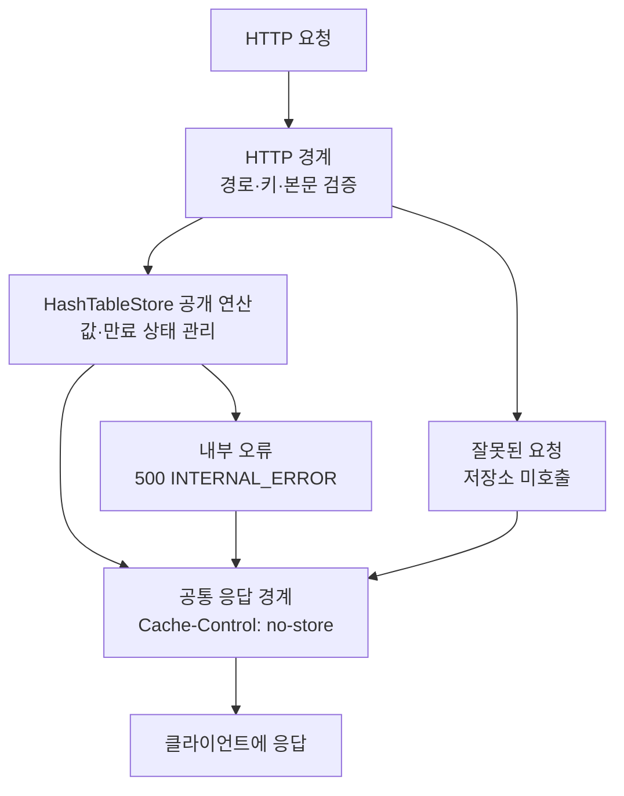

# 4단계 설계 — 만료와 명시적 무효화

- 문서 상태: 설계 계약 — 독립 검토에서 차단 발견 없음; 비차단 의견 반영 부분 초점 재확인 완료
- 단계 상태: 요구사항 범위 확정·설계 검토·구현 전 TC 목록 작성 완료, 구현·실행 검증 전
- 근거: [4단계 요구사항](requirements.md), [D-0003 기본 HTTP 계약](../../decisions/0003-http-response-contract.md), [D-0005 HTTP 경계](../../decisions/0005-http-api-boundary.md), [D-0006 TTL·무효화 계약](../../decisions/0006-ttl-invalidation-contract.md), [3단계 설계](../03-http-api/design.md), [2단계 설계](../02-hash-table/design.md)

## 한눈에 보는 구조와 흐름

### Mini Redis 요청과 만료 책임 경계

HTTP는 키·본문을 검증하고 저장소 공개 연산의 결과를 응답으로 바꾼다. 저장소는 값과 TTL을 함께 관리하며 만료 여부를 판단한다. 그림의 TTL 연산은 기존 값 저장과 **별도의 HTTP 요청**이다. 정확한 경로·응답·시간 경계는 아래 계약을 따른다. 주기 정리는 요청 흐름에 섞지 않고 2절의 별도 그림에 표시한다.

## 1. 범위와 책임

이번 단계는 이미 구현된 `HashTableStore`와 HTTP 경로에 TTL을 연결한다. `mini_redis/http_api.py`의 `create_server`는 공급받은 저장소를 순차 `HTTPServer`의 수명 동안 사용하고 요청을 검증해 공개 저장소 연산만 호출한다. `mini_redis/store.py`의 `HashTableStore`에는 현재 `set/get/exists/delete`만 있고 TTL 상태나 시간원은 없다. 새 TTL 입력의 해석과 응답 변환은 HTTP 경계, 값·기한의 일관성과 만료 판단은 저장소 경계가 맡는다. HTTP 경계가 버킷을 직접 조작하지 않는다. 추가할 저장소 공개 연산은 4절을 따른다.

5단계 동시성 방어, 6단계 전체 종단 간·성능 검증, Optional 영속성은 이번 범위가 아니다.

주기적 정리는 **기존 HTTP 서버의 요청 처리 스레드에서 요청 사이에** 실행한다. 서버가 유휴 상태여도 정리를 시도할 수 있어야 하지만, 진행 중인 요청을 중단하지 않으므로 정리 예정 시각은 정확한 마감 시각이 아니다. 별도 작업 스레드와 저장소의 동시 접근은 도입하지 않는다. 이 선택은 5단계 동시성 방어가 완료됐다는 뜻이 아니다.

## 2. 외부 인터페이스와 확정된 계약

| 요청 | 역할·입력 | 응답 계약 |
| --- | --- | --- |
| `PUT /keys/{key}` | 기존 `{"value":"..."}` 한 필드로 저장·덮어쓰기. 이전 TTL 해제 | 기존 `200 {"stored":true}`. 값 저장과 TTL 설정 두 요청 사이 원자성 없음. |
| `PUT /keys/{key}/ttl` | **별도 요청**으로 양의 정수 초 TTL 설정·갱신. `{"ttl_seconds":60}` | 유효한 키는 `200 {"ttl_set":true}`; 없는 키·이미 만료된 키는 `404 KEY_NOT_FOUND`. 새 값은 만들지 않음. |
| `DELETE /keys/{key}/ttl` | 값은 유지하며 TTL만 제거 | 유효한 키의 TTL을 제거했다면 `200 {"ttl_removed":true}`; 유효하지만 TTL이 없거나 키가 없거나 이미 만료됐다면 `200 {"ttl_removed":false}`. |
| `GET /keys/{key}` | 만료 전 빈 값도 유효한 값 | 만료 시 `404 KEY_NOT_FOUND`; 만료 전 빈 값은 `200 {"value":""}`. |
| `GET /keys/{key}/exists` | 유효한 키의 존재 확인 | 만료 시 `200 {"exists":false}`. |
| `DELETE /keys/{key}` | 키 단위 무효화. TTL 제거 요청과 다름 | 만료 시 `200 {"deleted":false}`; 유효한 키는 `200 {"deleted":true}`. |

TTL 설정 본문은 `ttl_seconds` 한 필드만 있는 UTF-8 JSON 객체이며 값은 양의 정수다. 누락·추가 필드, `0`·음수·분수·문자열·불리언은 `400 INVALID_BODY`로 거부하고 기존 값·만료 상태를 유지한다. TTL이 없는 값은 만료되지 않는다. 만료 후 재저장하거나 일반 `PUT`으로 덮어쓴 값에는 옛 기한이 적용되지 않는다. 기존 HTTP 키 제한·경로/메서드/쿼리 분류 순서, JSON 본문의 프레이밍·크기 제한, 내부 오류 변환은 [3단계 설계](../03-http-api/design.md#2-기본-http-인터페이스와-입력-계약)를 기준으로 새 경로에 적용한다. 선언 본문 크기 제한 안의 양의 정수에 자릿수 상한을 조용히 추가하지 않는다. JSON 파서의 런타임 정수 변환 제한 때문에 유효한 입력을 거부하지 않는지 구현 전 TC와 실제 HTTP 경로에서 확인한다. 애플리케이션이 생성하는 모든 최종 응답에 `Cache-Control: no-store`를 유지한다. 기존 `PUT` 본문에 TTL 필드를 추가하지 않는다.

### 만료 판단의 시간 기준

저장소가 단조 시간원을 사용한다. TTL 설정·갱신에 성공하면 그 연산의 기준 시각에 `ttl_seconds`를 더한 기한을 해당 값에 연결한다. 현재 단조 시간이 기한 **이상**인 키는 이미 만료된 것으로 취급한다. 따라서 기한 직전에는 유효하고 기한과 정확히 같은 시각부터 미존재다. 갱신은 이전 기한에 초를 누적하지 않고 갱신 시각을 기준으로 새 기한을 정한다. HTTP 계층은 시각이나 기한을 계산하지 않는다. 저장소 생성 시 기본 단조 시간원 대신 제어 가능한 시간원을 공급할 수 있는 경계를 두어 실제 대기 없이 경계 테스트를 수행한다. 시간원은 저장소 인스턴스의 수명 동안 유효해야 하며, 인메모리 값·기한은 재시작 시 소멸한다. 시간 읽기 실패는 5절의 실패 계약을 따른다.

### 만료 항목의 물리적 정리

만료 항목은 접근할 때 미존재로 처리하고, **주기적 정리도 추가**해 다시 접근하지 않는 만료 항목을 물리적으로 제거한다. 서버의 기존 실행 루프가 유휴 중에도 주기를 확인하고, 요청 처리와 물리적 정리는 한 번에 하나씩 같은 저장소를 사용한다. 정리 작업은 서버 인스턴스가 소유하고 서버가 종료되면 더 실행되지 않는다. 고정된 목표 간격은 **1초**로 하며, 외부 간격 설정 API·CLI 인자는 추가하지 않는다. 이는 검증 가능한 초기 정책이지 측정으로 도출한 최적값은 아니다. 오래 걸리는 요청·정리로 주기가 밀릴 수 있어, 만료 시각에 즉시 메모리 회수를 보장하지 않는다. 밀린 횟수만큼 정리 시도를 연속 실행하지 않고 다음 기회에 한 번만 시도한다. 정리 전에도 만료된 값이 유효한 값으로 노출되지는 않는다. 물리적 정리 전 항목 수·확장 판단은 아래에서 구체화한다. 서버 루프에 정기 실행을 연결하는 세부 방법은 구현에 위임한다.

정리 시도 중 호출자에게 전달되는 예상 밖 동기 `Exception`이 발생하면 그 시도는 **실패**로 기록하고 중단한다. 이미 완전히 제거된 키는 제거 상태를 유지해도 되지만, 실패한 키의 항목·항목 수·버킷 배치는 일관되어야 하며 그 키의 오래된 값이 재노출되어서는 안 된다. 전체 순회를 처음 상태로 되돌리는 트랜잭션은 요구하지 않는다. 서버의 정리 실행 경계가 이 예외를 요청 핸들러와 별도로 격리해 내부 진단에 남기고 요청 처리를 계속하며, 성공·실패 모두 다음 **정기 정리 시점**으로 진행한다. 진단 출력 자체가 실패해도 서버 루프를 중단하거나 즉시 재시도 루프에 진입하지 않는다. 같은 오류가 계속되면 다음 주기마다 실패할 수 있으며 회수 지연을 허용한다. 이 정책은 정리 실패에 한정된다. 요청 처리 중 내부 오류는 기존 `500 INTERNAL_ERROR` 경계를 유지하고, 프로세스 종료·비동기 종료 신호에는 재시도를 보장하지 않는다.

## 3. 주요 선택과 대안

| 선택 | 비교한 대안 | 선택 이유와 비용 |
| --- | --- | --- |
| `/keys/{key}/ttl`에 `PUT`(설정·갱신)과 `DELETE`(TTL만 제거) | `/keys/{key}/expire`와 `/keys/{key}/persist`에 별도 `POST` | 키에 속한 하나의 TTL 상태를 한 하위 경로에서 다루고 기존 값 `PUT`과 구분한다. 기존 HTTP 라우터에 하위 경로와 허용 메서드를 추가해야 한다. |
| TTL 설정 본문은 JSON 객체 | JSON 숫자 하나 | 초 단위를 필드명으로 표현할 수 있고 기존 API의 객체 본문과 일관된다. 필드 검증이 필요하지만 숫자 본문도 양의 정수·불리언·분수의 거부 규칙은 필요하다. |
| TTL 설정의 미존재는 `404`, TTL 제거의 미존재·TTL 없음은 `200`과 `false` | 두 연산 모두 `404` | 없는 값에 기한을 만들지 않고, TTL 제거는 반복 호출해도 변경 여부로 결과를 알 수 있다. 두 연산의 미존재 응답이 서로 달라지는 비용을 감수한다. |
| 단조 시간과 `현재 >= 기한` 만료 | 벽시계 시간 | 시스템 시계 조정으로 TTL이 늘거나 줄지 않으며 경계 테스트를 제어할 수 있다. 실제 날짜·시각의 기한 표현이나 재시작 후 복원에는 쓸 수 없다. |
| 접근 시 만료 판단에 더해 주기적 물리 정리 | 접근 시에만 정리 | 다시 접근하지 않는 만료 항목도 회수할 수 있다. 주기 실행·수명·실패와 저장소 접근 순서를 설계해야 한다. |
| 서버의 기존 요청 처리 스레드에서 요청 사이 정리 | 별도 정리 스레드 | 저장소에 동시에 접근하지 않아 현재 순차 전제를 유지한다. 긴 요청·정리 동안 회수가 지연될 수 있다. |
| 정리 오류 시 해당 시도를 중단하고 다음 주기에 재시도 | 서버 중단 | 메모리 회수 실패가 정상 요청 전체를 막지 않는다. 정리 지연·반복 실패를 감수하며 부분 진행 상태의 일관성과 진단이 필요하다. |
| 고정 1초 목표 간격 | 시작 시 간격 설정 | 설정 경로 없이 유휴 중 정리를 반복한다. 매초 전체 상태를 검사하는 비용을 감수하며, 이 숫자는 성능상 최적값으로 검증되지 않았다. |

## 4. 저장소 경계와 상태 전이

기존 공개 연산 `set/get/exists/delete`의 시그니처·반환 형식은 유지한다. 저장소에 아래 공개 연산을 추가한다. 메서드 이름은 호출 경계를 설명하기 위한 것이며 파일·보조 함수 구성은 구현에 위임한다.

| 연산 | 입력·반환 | 상태와 실패 경계 |
| --- | --- | --- |
| `set_ttl(key: str, ttl_seconds: int) -> bool` | 유효한 키에 설정·갱신하면 `True`, 없거나 만료됐다면 `False` | 값은 바꾸지 않고 현재 단조 시각을 기준으로 새 기한을 부여. 잘못된 키는 기존 키 예외, 정수 아닌 TTL(불리언 포함)은 `TypeError`, `0`·음수는 `ValueError`. 잘못된 입력은 상태 유지. |
| `clear_ttl(key: str) -> bool` | 유효한 키의 TTL을 제거했다면 `True`; 그 밖에는 `False` | 값 유지. 만료 키는 되살리지 않음. 잘못된 키는 기존 키 예외. |
| `sweep_expired() -> int` | 이번 시도에 물리적으로 제거한 항목 수 | 서버 루프만 호출. 반환은 성공적으로 끝난 시도의 제거 수이며 내부 진단·테스트에 쓰고 새 HTTP API로 노출하지 않음. 동기 오류는 호출자에게 전달. |

HTTP는 TTL 설정 본문을 **저장소 호출 전에** 검증한다. 유효한 JSON이지만 `ttl_seconds`가 잘못돼도 `400 INVALID_BODY`다. 저장소의 예상 밖 예외는 입력 오류로 바꾸지 않고 `500 INTERNAL_ERROR`로 변환한다. `set_ttl`의 `False`만 `404 KEY_NOT_FOUND`로, `clear_ttl`의 반환은 `200 {"ttl_removed":true/false}`로 변환한다. TTL 경로에서 미지원 메서드의 `Allow`는 `PUT, DELETE`, 쿼리·키·메서드의 오류 순서는 기존 HTTP 경계를 따른다. TTL 설정은 기존 `PUT`과 동일한 JSON 미디어 유형·본문 크기·프레이밍 정책을 적용한다. TTL 제거는 요청 본문을 해석하지 않으며 기존 `DELETE /keys/{key}`의 본문 처리 관행을 유지한다.

저장소 인스턴스는 각 물리 항목의 **값과 선택적인 만료 기한**을 함께 소유한다. 한 키에는 현재 값과 현재 기한만 하나씩 대응한다. `set`은 값과 TTL 해제를 한 상태 변경으로 확정한다. `set_ttl`은 키가 유효한지 확인한 뒤 기존 기한을 새 기한으로 교체하며, `clear_ttl`은 기한만 해제한다. `get/exists/delete/set_ttl/clear_ttl`이 해당 키의 만료를 확인할 때 기한에 도달했다면 물리적으로 제거하고 미존재 결과를 낸다. 이미 만료된 항목을 같은 키로 `set`하면 새 값은 만료 없이 저장되며 이전 기한·값이 재출현하지 않는다.

물리적으로 남은 만료 항목은 정리 전까지 내부 항목 수와 기존 부하율 계산에 포함한다. 항목 수는 버킷 안의 **물리 항목 수**와 일치하며, 외부 조회에서 보이는 유효 키 수와 다를 수 있다. 정리·만료 키 접근으로 제거되면 항목 수가 줄지만 기존의 자동 축소 없음 계약은 유지한다. 더 이른 정리로 확장 비용을 낮추기 위한 별도 인덱스·강제 전수 정리를 새 `set`에 요구하지 않는다. 정리 순서·내부 항목 표현·탐색 방식은 구현에 위임한다.

시간원은 저장소 인스턴스에 연결된 단조 시간 기준이며 기본값은 `time.monotonic_ns`처럼 정수 나노초를 반환하는 함수다. 저장소 생성 시 같은 단위의 제어 가능한 시간원을 선택적으로 공급할 수 있다. 외부에 절대 기한을 반환하지 않는다. 양의 정수 초 입력에 임의의 작은 최대값을 추가하지 않고, 큰 정수에도 기한 계산이 부정확한 부동소수·무한대가 되지 않게 정수 단위로 기한을 다룬다. 내부 항목 표현은 구현에 위임한다.

## 5. 소유권·수명과 실패 동작

HTTP 서버 인스턴스는 저장소 하나, 수신 소켓, 요청 사이의 주기 정리 실행 상태를 소유한다. 정리 경로에는 독립 스레드·소켓·공개 리셋 API가 없다. 저장소 인스턴스가 값·기한·시간원 참조를 소유하며, 시간원은 저장소보다 먼저 소멸하면 안 된다. 종료 시 정리 호출을 멈추고 서버 소켓을 닫는다. 데이터·기한과 실패한 정리의 재시도 상태는 재시작 뒤 복구되지 않는다.

- 입력 거부는 저장소 호출 이전에 끝내며 기존 값·기한을 변경하지 않는다. 저장소 직접 호출에서도 잘못된 인자는 상태를 보존한다.
- `set` 또는 TTL 설정·제거가 호출자에게 동기 `Exception`(할당 실패 `MemoryError` 포함)을 전달하면, 이전 값·기한·물리 항목 수·버킷 배치 및 후속 사용 가능성을 유지한다. `set`의 기존 실패 보존 계약을 훼손하지 않는다. 프로세스 종료·`KeyboardInterrupt`·`SystemExit` 같은 종료 신호는 대상이 아니다.
- 읽기·삭제에서 만료 항목의 물리적 제거에 실패하면 오래된 값을 반환하거나 `deleted:true`로 보고하지 않고 오류를 전달한다. HTTP는 가능한 경우 `500 INTERNAL_ERROR`로 변환한다. 저장소 상태가 훼손되지 않아 후속 시도는 계속 가능해야 한다.
- 정리 시도는 키 단위로 완료한 제거를 유지할 수 있다. 한 키의 제거가 실패하면 그 키의 이전 물리 상태와 항목 수는 보존하고, 나머지 시도를 중단한다. 서버는 실패를 내부 진단에 남기고 다음 1초 목표 주기에 재시도한다. 오류를 제거 성공으로 기록하지 않는다. 내부 진단의 구체적인 출력 방식은 구현에 위임한다.
- 시간 읽기에 실패하면 `set_ttl`은 상태를 변경하지 않고 오류를 전달한다. 만료 여부가 필요한 공개 연산도 유효한 결과를 추측하지 않고 오류를 전달한다. 정리 시도의 시간 읽기 실패는 위 정리 재시도 정책을 따른다. 서버 자체의 시간·실행 루프가 지속적으로 실패하면 정기 실행의 성공을 보장하지 않는다.
- HTTP 응답을 보내기 전에 연결이 끊어진 쓰기는 적용 여부를 클라이언트가 확정하지 못한다. 자동 HTTP 요청 재시도는 추가하지 않는다. 정리 재시도와 혼동하지 않는다.

## 6. 검증 지점과 구현 위임

아래는 검증할 계약이지 실행 결과가 아니다. 구현 전 TC 목록은 [테스트 케이스](test-cases.md), 실제 실행 결과는 `verification.md`에 기록한다.

| 요구사항 | 집중 확인할 결과 |
| --- | --- |
| REQ-04-001 | TTL 없는 저장, 객체 본문·정수 초 검증, 잘못된 입력 시 값·기한 보존. 값 저장과 TTL 지정은 별도 HTTP 요청. 본문 제한 이내의 부동소수 범위 초과 정수와 런타임 JSON 정수 자릿수 제한 초과 정수를 HTTP로 각각 확인. |
| REQ-04-002 | 기한 직전·정확히 같은 시각·직후, 빈 값·미존재·만료의 `GET/exists/DELETE` 및 `no-store`. |
| REQ-04-003 | 일반 `PUT`의 TTL 해제, TTL 갱신·제거와 만료 후 재저장; 이전 값·기한 재출현 방지. |
| REQ-04-004 | 유효/없는/만료 키 삭제의 `true/false`, 다른 키 유지. |
| REQ-04-005 | 저장소 공개 경계만 사용, TTL 경로 입력·메서드·쿼리 오류와 기존 2·3단계 회귀. `/keys/ttl`·`/keys/exists`의 일반 키 동작, `/keys/a/ttl/exists`의 잘못된 키, TTL 경로의 `HEAD` 본문 부재·`Allow`·쿼리 우선순위. |
| REQ-04-006 | 제어된 시간원의 저장소 단위·실제 저장소 HTTP 통합 테스트; 유휴 서버의 주기 정리, 첫 정리 실패 후 요청 지속·즉시 반복 없음·다음 주기 재시도, 진단 출력 실패 시 루프 유지. |

구현에 위임: 내부 항목과 기한의 표현, 정리 순회·삭제 절차, 서버 루프의 주기 호출 연결, 진단 출력 방식, 테스트 보조 도구와 파일/함수 배치. 1초 목표 간격의 성능 우위는 주장하지 않는다. 설계 검증 에이전트의 독립 검토에서는 기존 요구사항·HTTP 계약, 상태·실패 경계, 단조 시간, 유휴 정리 실행 가능성, 라우팅·도식에 **구현 착수를 막는 확정 설계 오류가 발견되지 않았다**. 비차단 의견인 큰 정수 TTL의 HTTP 파싱 제한과 정리 콜백의 예외 격리·다음 시도 시점, 경로 회귀 TC를 위 계약·검증 지점에 반영했다. 해당 보완의 **초점 재확인에서 세 의견 모두 문서상 해소됐고 새 직접 충돌은 발견되지 않았다**. 이 초점 재확인은 전체 재승인이나 구현·테스트 통과 판정이 아니다.
