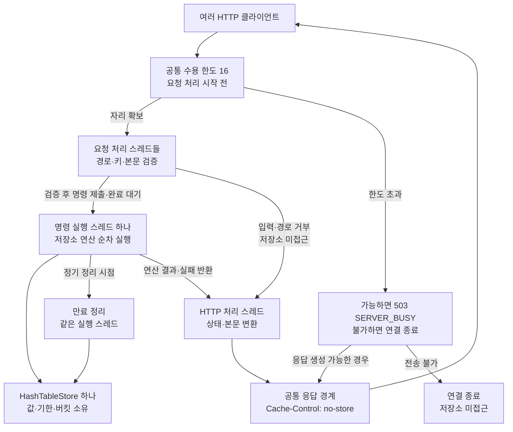

# 5단계 설계 — HTTP 요청 병렬 해석과 단일 명령 실행

- 문서 상태: 설계 초안 — 독립 검토 지적의 초점 재확인 및 상위 계약 문서 정합화 초점 검토 완료
- 단계 상태: 요구사항 범위 확정·설계 전체 검토·[구현 전 TC 목록](test-cases.md) 작성 — 구현·실행 검증 전
- 근거: [5단계 요구사항](requirements.md), [D-0007 명령 실행 경계](../../decisions/0007-single-thread-command-execution.md), [D-0005 기존 HTTP 계약](../../decisions/0005-http-api-boundary.md), [4단계 설계](../04-expiration-invalidation/design.md), [3단계 설계](../03-http-api/design.md), [2단계 설계](../02-hash-table/design.md)

## 한눈에 보는 구조와 흐름

### 요청 해석과 저장소 실행의 분리

그림의 요청 처리 스레드는 저장소를 직접 호출하지 않는다. 해석과 검증, 결과의 HTTP 변환·전송은 해당 요청의 처리 경계에 남는다. **저장소 연산과 주기 정리만** 전담 명령 실행 스레드에서 직렬화한다. 요청 처리 스레드를 시작하기 전에 공통 한도 **16자리** 중 하나를 확보하고 응답 전송 또는 연결 종료까지 점유하며, 연결이 먼저 닫혀도 제출된 명령이 완료될 때까지 자리를 유지한다. 자리 확보 실패 시 저장소에 도달시키지 않고 가능한 경우 `503 SERVER_BUSY`로 거부한다. 실패를 정상 결과나 미존재로 바꾸지 않고 기존 HTTP 오류 경계로 전달한다. 종료가 시작되면 새 수용을 멈추고 이미 수용한 요청의 결과 처리까지 기다린다.

## 1. 범위와 책임

5단계는 서로 다른 HTTP 클라이언트의 요청 해석을 겹치게 할 수 있지만, `set/get/exists/delete/set_ttl/clear_ttl/sweep_expired` 및 조회 중 만료 제거와 버킷 확장을 **같은 명령 실행 스레드에서 한 번에 하나씩** 수행한다. 저장소 직접 병렬 호출의 안전성, 요청 두 개를 묶는 트랜잭션, 6단계의 성능 비교와 Optional 영속성은 범위가 아니다.

현재 `mini_redis/http_api.py`의 `create_server(host, port, store)`는 공급받은 저장소를 순차 `HTTPServer`에서 사용한다. `_handle`은 검증 후 저장소 공개 메서드를 직접 호출하고, `Server.service_actions`는 서버 루프에서 주기 정리를 호출한다. `mini_redis/store.py`의 `HashTableStore`는 값·기한·물리 항목 수를 소유하고, `get/exists/delete` 등에도 만료 제거가 수반될 수 있다. 이는 **현재 코드**이며 선택한 구조가 이미 구현됐다는 뜻은 아니다.

| 구성 요소 | 선택된 책임 |
| --- | --- |
| HTTP 요청 처리 경계 | 여러 요청의 접수·경로/본문 검증·명령 전달 및 결과 대기·기존 상태/JSON/헤더 변환·응답 전송. 저장소 및 정리를 직접 호출하지 않음. |
| 단일 명령 실행 경계 | 유효한 요청의 저장소 공개 연산을 순서대로 실행하고 결과 또는 실패를 요청 경계로 돌려줌. 정기 만료 정리도 이 스레드에서 실행. |
| `HashTableStore` | 기존 값·기한·버킷·항목 수와 단조 시간원을 소유. HTTP·스레드 전달 방식을 알지 못함. |

## 2. 인터페이스와 데이터 흐름

외부 경로, 본문·오류·`Allow`·`HEAD`·`Cache-Control: no-store`는 [3단계 설계](../03-http-api/design.md#2-기본-http-인터페이스와-입력-계약)와 [4단계 설계](../04-expiration-invalidation/design.md#2-외부-인터페이스와-확정된-계약)를 유지한다. `create_server(host, port, store)`의 공급 저장소 경계도 유지한다. 새로운 공개 HTTP 경로와 저장소 메서드는 추가하지 않는다.

자리를 확보한 요청은 기존 순서로 경로·키·메서드·쿼리·필요한 본문을 검증한다. 검증된 잘못된 요청은 기존 오류 계약을 따르며, **과부하 거부를 악의적/잘못된 입력의 유일한 방어로 취급하지 않는다**. 검증 거부와 과부하 거부 모두 명령 실행 경계에 저장소 작업을 제출하지 않는다. 통과한 요청은 **연산 종류와 검증된 인자**를 한 건의 명령으로 넘기고, 한 건의 저장소 공개 연산 결과 또는 예외를 돌려받는다. 요청 처리 경계는 자기 명령의 완료를 기다린 뒤 결과의 HTTP 매핑과 전송을 담당한다. 요청 스레드가 결과를 기다리는 것과 저장소를 직접 실행하는 것은 다르다.

각 명령은 연산 종류·검증된 키/필요한 값 또는 TTL 초·그 요청 전용 완료 결과를 포함한다. 명령 실행 경계는 성공적으로 제출된 명령을 **제출 확정 순서**대로 한 번씩 실행한다. 제출 확정은 하나의 순서 지정 경계에서 일어나며 같은 키 요청에도 별도 우선권을 주지 않는다. 서로 다른 요청의 접수·해석 시작 순서는 제출 확정 순서와 다를 수 있다. 정리 시점이 끼어들 수 있다는 3절 규칙을 제외하면 대기 명령끼리 앞지르지 않는다. 결과에는 저장소 반환값 또는 동기 예외가 담기고, 해당 요청만 결과를 소비한다. 명령·완료 객체의 구체 표현은 구현에 위임한다.

과부하에 명시적으로 응답할 수 있게 **HTTP 요청 전체에 고정된 공통 수용 한도 16**을 둔다. 서버가 허용한 요청은 HTTP 처리 시작 전 자리를 확보하며 본문 읽기, 명령 대기·실행, 응답 전송 또는 연결 종료까지 점유한다. 성공·입력 오류·예상 밖 예외·연결 단절 어느 경로든 해당 요청의 응답/연결 처리와 제출 명령의 완료·실패 확정이 모두 끝나면 자리를 반환한다. 명령 실행 후 HTTP 응답이 늦어져도 그 요청은 한도에 포함된다. 작업 제출을 별도로 무제한 적재해서 이 한도를 우회하지 않는다. 반대로 한도 초과 연결은 정규 요청 처리 스레드를 새로 만들지 않고 짧은 거부 경계에서 처리한다. 거부 경계 자체도 무제한 스레드·대기 객체를 만들지 않아야 한다. OS의 이미 수락 대기 중인 연결 수나 모든 네트워크 공격을 이 애플리케이션 한도가 제한한다는 뜻은 아니다. 외부 한도 설정 API·CLI 인자는 추가하지 않는다. 16은 측정한 최적 처리량이 아니라 이번 단계의 고정 초기 정책이다.

한도 확인은 경로·본문 검증보다 앞서므로, **이미 과부하 상태인 연결**은 요청 내용이 잘못됐더라도 기존 `400/404/405` 대신 `503`을 보거나 HTTP 응답을 받지 못할 수 있다. 자리를 얻은 요청에 대해서는 기존 경로·메서드·쿼리·본문 오류 우선순위를 유지한다. 한도 초과는 클라이언트별 요청 빈도 오류(`429`)가 아니라 서버의 동시 수용량 부족으로 보고, **응답을 생성·전송할 수 있다면** `503`·`{"error":{"code":"SERVER_BUSY"}}`·`Cache-Control: no-store`와 `Connection: close`를 적용한다. 한도 초과의 짧은 거부 경계에서 메서드를 안전하게 식별할 수 있는 `HEAD`에는 **본문을 전송하지 않는다**. 메서드를 안전하게 식별할 수 없으면 본문이 있는 응답을 추측해 보내지 않고 연결을 닫는다. 이 거부 경계에서 요청 전체를 정규 해석하거나 무제한 스레드를 만들지 않는다. 응답을 만들거나 보내지 못한 연결은 닫고, 그 연결에 JSON·헤더가 도착했다고 주장하지 않는다. 과부하 거부 자체는 저장소에 적용되지 않으며 자동 재시도도 하지 않는다. 기존의 입력·응답 계약 유지 주장은 **자리를 확보하여 정상 처리 경계에 진입한 요청**에 적용한다. 한도 초과/배출 중 접수 거부는 이 절의 좁은 가용성 예외다.

HTTP 요청의 네트워크 도착 순서는 명령 처리 순서를 약속하지 않는다. 단일 실행 경계가 실제로 처리한 순서에 따라 각 연산의 결과가 정해진다. 값 `""`과 미존재는 구분하고, `PUT /keys/{key}`와 별도 TTL 요청 사이에는 다른 명령이 끼어들 수 있다. `PUT`의 이전 TTL 해제, TTL의 만료 판정과 정리 실패 시 상태 보존 범위는 [4단계 설계](../04-expiration-invalidation/design.md#4-저장소-경계와-상태-전이)를 그대로 따른다.

## 3. 상태 전이와 불변조건

- 하나의 서버 인스턴스에서 저장소 공개 연산과 `sweep_expired`에 진입하는 스레드의 정체성은 동일하며, 두 호출은 겹치지 않는다. 요청 처리 스레드와 서버 접수 루프는 저장소의 조회조차 수행하지 않는다.
- 한 요청의 유효 명령은 한 차례만 실행 대상으로 전달한다. 제출 전에 연결이 끊긴 경우 명령을 제출하지 않는다. **제출 확정 뒤에는** 연결이 끊기거나 요청 측의 응답 쓰기가 실패해도 명령을 취소·재실행하지 않는다. 명령 실행 결과/오류는 해당 요청의 완료 상태로만 연결하고 연결이 끊겼다면 전달을 시도하지 않는다. 제출 직전 연결 상태 관찰은 단절 시점을 원자적으로 판정하지 못하므로, 단절과 제출이 겹치면 적용 여부를 클라이언트가 단정할 수 없다.
- 정기 만료 정리는 **1초 목표 시점에 도달하면 진행 중인 명령이 끝난 다음, 대기 중인 다음 명령보다 앞서 한 번 시도**한다. 유휴 중에도 시도하고 별도 스레드에서 실행하거나 진행 중인 명령을 가로막지 않는다. 성공·실패 모두 **정리 시도가 끝난 시각부터** 다음 1초 목표 시점을 잡고 밀린 횟수를 따라잡으려고 연속 실행하지 않는다. 오래 걸린 정리 뒤에도 대기 명령을 진행시킬 기회를 준다. 오류가 나면 해당 시도를 중단·진단하고 다음 정기 시점으로 넘어가며, 명령 실행 경계는 계속 살아 있어야 한다. 진단 출력 자체가 실패해도 명령 실행을 막거나 즉시 정리를 반복하지 않는다. 정리 중에는 대기 명령이 지연될 수 있다. 배출 중에도 대기 명령이 있는 동안은 같은 규칙을 적용하고, 배출 완료 후 새 정리 시도를 시작하지 않는다.
- HTTP 경계에서 유효한 응답을 만들 수 있는 경우 기존 결과를 보존한다. 내부 연산의 예상 밖 동기 `Exception`은 성공·미존재로 바꾸지 않고 `500 INTERNAL_ERROR`로 매핑한다. 정리 오류는 개별 요청 성공/실패로 매핑하지 않고 내부 진단 후 다음 정기 시점으로 진행한다.
- 수용 한도를 초과한 작업은 실행 대기열에 무한히 쌓이지 않는다. 처리 시작 전 거부된 연결의 명령은 저장소에 적용되지 않으며, 이미 접수된 작업의 실행을 과부하 때문에 자동 반복하지 않는다. 전달 가능한 과부하 응답은 `503 SERVER_BUSY`다.
- 한 요청이 확보한 자리는 요청의 응답/연결 처리가 끝나고 **제출된 명령도 완료 또는 실패로 확정된 뒤** 정확히 한 번 반환한다. 연결이 먼저 닫혀도 실행 대기·진행 중인 명령이 남아 있다면 자리를 즉시 반환하지 않는다. 다른 요청의 완료나 정리 작업이 이 자리를 대신 반환하지 않는다. 명령 실행 스레드는 요청 자리를 별도로 소비하지 않는다.
- 실행 상태는 `수용 중 → 배출 중 → 종료`로 단방향 전이한다. 배출 중에는 새 요청 자리를 배정하지 않고, 이미 수용한 요청의 검증·명령 제출·실행·결과 응답을 허용한다. 그 요청들이 모두 끝나고 명령 실행 경계에 미완료 명령이 없을 때만 전담 스레드와 정리 스케줄을 종료한다. 배출 중 새 명령을 먼저 막아 수용한 요청을 영원히 기다리게 하지 않는다.

## 4. 소유권·수명과 실패 동작

서버 인스턴스는 수신 소켓, 공통 수용 한도, 공급받은 저장소와 단일 명령 실행 경계 및 정기 정리 스케줄의 사용 수명을 묶는다. 호출자가 공급한 저장소 인스턴스의 생성·외부 참조까지 서버가 독점 소유한다는 뜻은 아니다. 저장소 값·기한은 메모리에만 남고 재시작 뒤 복구되지 않는다. 요청 처리 경계는 자기 요청의 자리, 검증 결과와 완료 대기를 소유하며, 요청 종료 후 다른 요청의 결과를 대신 소비해서는 안 된다.

정상 종료 요청이 들어오면 원자적으로 새 요청의 자리를 배정하지 않게 하고 접수를 중지한다. 기존 수용 요청의 느린 입력·응답 전송에 종료가 영원히 묶이지 않도록, 기존 본문 읽기 제한에 더해 요청 행·헤더 읽기와 응답 쓰기에도 유한 시간 경계를 둔다. **각 단계 전체의 유한 마감**을 둬서 데이터를 조금씩 계속 보내는 연결도 자리를 영구 점유하지 못하게 한다. 짧은 과부하 거부 경계의 메서드 확인·응답 쓰기에도 유한 마감을 적용하고, 이 경계가 접수 루프를 무기한 붙잡지 않는다. 제한에 걸린 연결은 닫고, 저장소 명령을 아직 제출하지 않았다면 적용하지 않는다. 이미 제출한 명령은 응답 연결이 닫혀도 자동 취소·재실행하지 않고 한 번 실행하며, 그 결과를 클라이언트가 받았다고 주장하지 않는다. 이 시간 경계의 구체적 초 값은 구현에 위임하지만 검증 기록에는 실제 값을 남긴다. 정상 종료는 이미 접수된 명령과 그 결과 처리를 기다린 다음 정리를 멈추고 전담 스레드를 합류시킨다. 배출 전환 이후 새 연결은 처리 대상으로 수용하지 않는다. 전환과 접수가 경합하면 자리 확보의 원자적 순서로 수용/거부를 구분한다. 거부 경계가 이미 연결을 받은 경우에는 가능하면 기존 과부하와 동일한 `503 SERVER_BUSY`·연결 종료를 적용하지만, 접수를 멈춘 뒤 OS 수락 대기 연결이나 구문 파싱 전 단절에는 애플리케이션 응답을 보장하지 않는다. 저장소 내부 연산 자체가 반환하지 않거나 프로세스가 강제로 종료되면 종료 시간·응답 완료를 보장하지 않는다.

잘못된 입력은 저장소에 도달하기 전에 거부되어 기존 값을 바꾸지 않는다. 수용 한도 초과도 저장소를 변경하지 않고 명시적으로 거부하되, 클라이언트가 보낼 수 있는 모든 악의적 입력을 과부하 한도만으로 차단한다고 주장하지 않는다. 기존 본문 크기·프레이밍·읽기 시간 제한은 유지한다. 명령 실행 중 저장소의 동기 예외는 해당 요청에 오류로 전달하며 2·4단계의 연산별 보존 범위를 따른다. 정리의 동기 예외는 기존 정리 실패 정책대로 다른 요청의 실행을 영구 중단하지 않는다. 응답 전 연결 단절이나 전송 실패 때 클라이언트는 명령 적용 여부를 확정할 수 없고 서버는 자동 재시도하지 않는다. 전달 경계 오류와 종료 중 새 연결의 처리 정책은 아래에서 구체화한다. 프로세스 종료와 비동기 종료 신호에 대한 롤백·응답 전달은 보장하지 않는다.

명령 **제출이 확정되기 전** 전달/완료 객체의 생성·등록에 동기 오류가 나면 저장소 호출 없이 기존 `500 INTERNAL_ERROR`로 응답을 시도한다. 제출 뒤 결과 전달 경계에 오류가 나더라도 명령을 다시 제출하지 않는다. 해당 요청에는 가능한 경우 `500 INTERNAL_ERROR`를 반환하고, 이미 저장소에서 확정된 변경은 되돌린다고 주장하지 않는다. 이 경계의 오류가 다른 요청의 완료를 영구적으로 막지 않도록 요청별 결과를 격리한다. 전담 명령 실행 주체가 예상 밖 원인으로 사라져 남은 요청을 처리할 수 없다면 대기 요청을 무기한 방치하지 않고 실패로 완료시켜 가능한 경우 `500 INTERNAL_ERROR`로 응답하며, 새 명령 접수를 중지한다. 프로세스 강제 종료와 비동기 종료 신호는 이 복구 계약에 포함하지 않는다.

## 5. 주요 선택과 대안

| 선택 | 비교한 대안 | 이유와 감수하는 비용 |
| --- | --- | --- |
| HTTP 요청 처리 스레드에서 병렬 해석, 전담 스레드 하나에서 저장소 명령·정리 | 기존 순차 `HTTPServer` 유지 | 느린 요청의 해석이 다른 요청의 해석 자체를 막지 않으면서 D-0007의 단일 저장소 실행 주체를 지킨다. 명령 전달·대기·종료와 자원 제한이 필요하고, 저장소 작업은 여전히 직렬이라 캐시 처리량 향상은 보장하지 않는다. |
| HTTP 검증·응답 전송은 요청 처리 경계, 저장소 명령만 실행 경계 | 요청 전체를 명령 실행 스레드에 전달 | 요청별 입력 읽기·네트워크 응답 대기가 캐시 명령 전체를 막지 않게 한다. 다만 느린 저장소 명령·정리는 뒤 명령의 지연을 늘릴 수 있다. |
| 동일 스레드에서 명령과 만료 정리 실행 | 요청 스레드가 락을 획득해 저장소 호출 또는 별도 정리 스레드 운영 | 락만으로는 ‘한 명령 실행 스레드’라는 확정 요구를 충족하지 않는다. 정리가 길면 이후 명령이 기다리는 비용을 감수한다. |
| 수용량 한도를 두고 초과 요청 명시적 거부 | 모든 요청을 무제한 대기 | 명령 대기·요청 처리 자원의 무제한 증가를 피한다. 정상적인 일시 폭주도 거부될 수 있으며 과부하 응답은 전송 가능한 연결에 한정된다. |
| 요청 전체에 공통 한도 적용 | HTTP 처리 수와 명령 대기 수에 별도 한도 | 느린 본문·명령 대기·응답 전송을 모두 하나의 수용량으로 제한한다. 각 구간을 독립 조정할 수 없고 느린 요청이 정상 요청의 자리를 차지할 수 있다. |
| 과부하 응답은 `503 SERVER_BUSY` | `429 TOO_MANY_REQUESTS` | 클라이언트별 빈도 제한이 아닌 서버 전체 수용량 부족을 나타낸다. 부하 중에는 정상 요청도 거부될 수 있으며, 파싱·전송 불능 연결에 응답을 보장하지 못한다. |
| 공통 한도 16 고정 | 서버 시작 시 한도 설정(기본값 16) | 설정 경로 없이 같은 조건으로 수용 경계를 확인한다. 환경별 조정은 어렵고, 16이 성능상 최적이라고 주장하지 않는다. |
| 새 수용 중단 후 이미 수용한 요청을 배출하고 종료 | 실행 전 대기 명령 취소 | 성공적으로 접수한 쓰기를 종료만을 이유로 버리지 않고 결과 전달을 시도한다. 느린 입출력·저장소 명령에 종료가 지연될 수 있고 강제 종료에 완료를 보장하지 않는다. |
| 정리 시점 도래 시 다음 대기 명령 전에 같은 실행 스레드에서 한 번 정리 | 대기 명령이 모두 끝난 뒤 정리 | 지속적으로 요청이 들어와도 물리적 회수를 무기한 미루지 않는다. 정리 시도 동안 이미 대기 중인 캐시 요청이 지연될 수 있다. |

요청 해석 병렬화가 캐시 히트의 지연이나 총 처리량을 반드시 개선한다고 주장하지 않는다. 전담 스레드의 저장소 실행·정리 시간이 병목일 수 있고, 전달과 대기에 오버헤드가 생긴다. 반면 요청 본문을 읽는 시간과 응답을 보내는 시간을 저장소 실행 시간에 포함시키지 않는 구조다. 실제 성능 비교는 6단계에서 같은 조건으로 측정한다.

## 6. 미결 사항·구현 위임·검증 지점

**미결 사항:** HTTP 요청 행·헤더와 응답 쓰기의 구체적 유한 타임아웃 값은 구현 기록에 명시하고, 실제 보유 자원/부하에 따른 한도 16의 적합성은 후속 측정에서 재검토한다. 이들 외의 실행·전달·종료 정책은 2~4절을 따른다. 독립 설계 검토에서 과부하 시 `HEAD` 본문 부재를 보장하지 않던 기존 문구가 차단 결함으로 지적되어 2절을 수정했다. 요청 자리 반환, 긴 정리 직후 재시도, 느린 연결 마감 및 도식의 비차단 의견도 보완했다. **보완 부분 초점 재확인에서는 해당 차단 의견과 네 비차단 의견이 문서상 해소됐고 새 직접 충돌이 발견되지 않았다.** [5단계 요구사항](requirements.md)과 [D-0005](../../decisions/0005-http-api-boundary.md)·[D-0007](../../decisions/0007-single-thread-command-execution.md)의 기존 HTTP 계약 유지 표현에도 수용 전 과부하·배출 중 거부의 좁은 예외를 반영했다. **문서 간 정합화 초점 검토에서는 수용된 요청의 기존 계약, 수용 전 거부의 예외, `no-store`·`HEAD` 응답 불변조건이 일치하고 추가 수정 사항이 발견되지 않았다.** 두 초점 검토는 전체 설계 재승인이나 구현·테스트 통과 판정이 아니다. 구현·실행 검증 결과는 없다.

**구현에 위임:** HTTP 요청 스레드와 전달 채널의 구체적 표준 라이브러리 구성, 메시지/완료 객체 표현, 테스트 동기화 도구와 파일·함수 배치. 위 미결 정책에 영향을 주는 선택은 구현에 위임하지 않는다.

**설계 검증 에이전트가 볼 지점:** `REQ-05-001`~`005`의 호출 스레드 정체성·겹침 여부, 기존 HTTP 오류 우선순위·응답 계약, 명령 순서별 결과와 TTL 중간 상태, 유휴 정리·실패 격리, 전달 오류·종료 정책의 일관성. 이에 연결한 [구현 전 TC 목록](test-cases.md)은 실행 결과가 아니며, 독립 검토가 실제 구현·테스트 통과를 뜻하지는 않는다.
