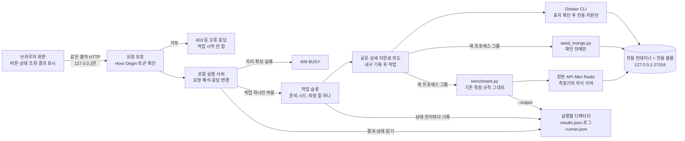
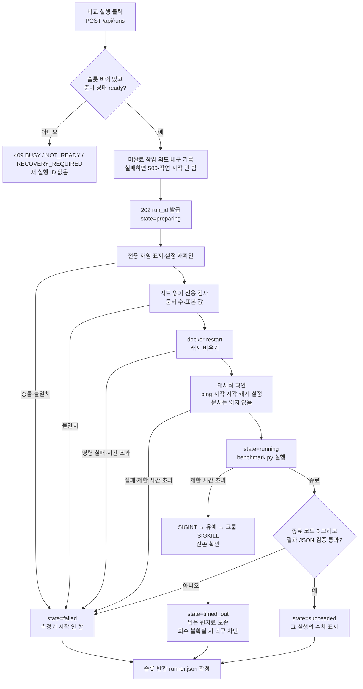
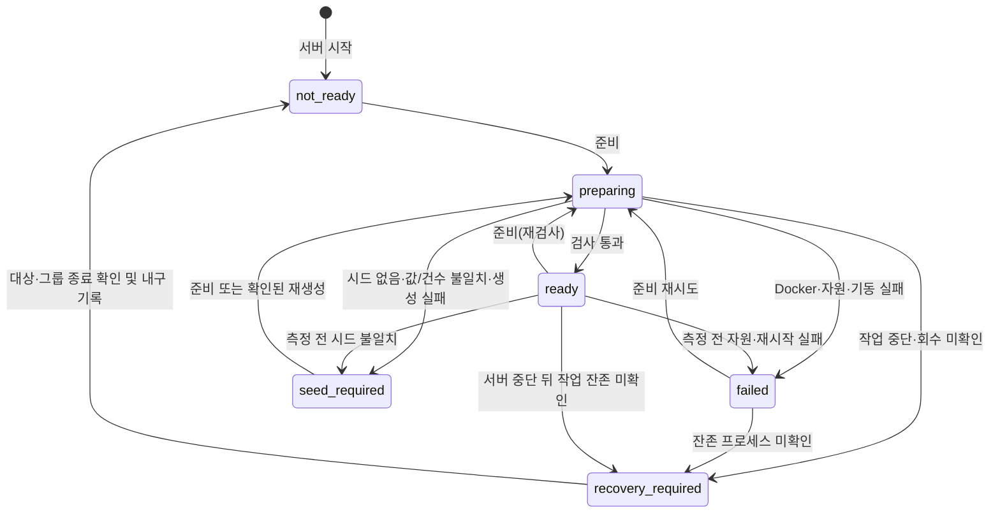

# 7단계 설계 — 로컬 준비·측정 실행 서버와 화면 계약

- 문서 상태: **7단계 구현 기준 설계 채택([D-0008](../../decisions/0008-live-benchmark-contract.md)).** 전체 설계 검토는 조건부 적합이었고 당시 차단 의견은 수정 후 해당 범위 제한 재점검에서 설계 수준 비차단. 수정본 전체의 독립 재승인과 구현·TC·실행 검증은 아직 없다. Docker를 실제로 실행해 확인한 내용도 없다.
- 채택된 범위: [B안](execution-screen-contract.md#결정-실행-환경-준비-책임) — 로컬 웹 서버의 전용 준비 동작이 Docker MongoDB 기동, 필요할 때의 시드 생성, 측정 전 재시작을 지원한다. 이 문서의 자원 이름·HTTP 경로·필드·보호 방식은 7단계 상세 계약의 설계 기준이며, 시간 제한 숫자는 실제 검증 뒤 조정 가능한 잠정 시작값이다. [7절](#7-범위-결정과-설계-기본값)에 자원 수명 정책을 기록했다.
- 근거: [7단계 개요](overview.md), [실행 조건·화면 계약](execution-screen-contract.md), [6단계 성능 비교 조건·결과](../06-integration-performance/verification.md#3-성능-비교-실행), [`benchmark.py`](../../../examples/benchmark.py), [`seed_mongo.py`](../../../examples/seed_mongo.py), [`origin_api.py`](../../../examples/origin_api.py)

## 한눈에 보는 구조와 흐름

### 구성 요소와 자원 소유

브라우저는 Docker·MongoDB·측정기에 직접 닿지 않는다. 실행 서버는 고정 설정으로만 Docker와 측정기를 호출하며, 한 번에 작업 하나만 슬롯에 들어간다. 측정 수치는 `benchmark.py`가 쓴 그 실행의 `results.json`에서만 나온다.

### 측정 요청 한 번의 흐름

준비 검사·재시작·서버 기동은 모두 측정 구간 밖이다. 재시작 **뒤에는** 컬렉션 문서를 읽지 않는다. 표본 읽기가 WiredTiger 캐시를 다시 채우면 6단계의 "측정 전 캐시 비움" 조건이 깨지기 때문이다. 다만 재시작 **전** 표본 검사도 OS/Docker 파일 캐시에 영향을 줄 수 있으므로 6단계와 동일한 캐시 상태라고 주장하지 않는다. 검사 키·범위·순서를 실행 기록과 화면 한계에 남긴다. 회수 불확실 상태에서 새 작업을 허용하지 않는 경계는 4.2절과 5절에 둔다.

## 1. 요구사항·확인한 사실·가정

**채택된 요구사항** ([개요](overview.md), [실행·화면 계약](execution-screen-contract.md))

- 브라우저의 전용 준비 동작으로 Docker MongoDB 기동, 필요 시 시드 생성, 측정 전 재시작을 지원한다. 시드는 매 실행마다 다시 만들지 않는다.
- 기존 `examples/benchmark.py`의 측정 규칙과 `mini_redis/` 제품 코드는 바꾸지 않는다. 웹 뷰는 `examples/`의 로컬 시연 기능이다.
- 준비·서버 기동·상태 준비·결과 표시 시간은 측정 구간 밖이다. 기존 원자료(6단계, 이전 웹 실행)를 덮어쓰지 않는다.
- 브라우저 시간이나 6단계 저장값으로 새 실행 결과를 대신하지 않는다. 배포·공개 서비스·동시 부하는 범위 밖이다.

**코드에서 확인한 사실** (읽은 코드 기준이며 실행으로 확인하지 않았다)

- `seed_mongo.seed()`는 `mini_redis_origin.items`를 `drop()`한 뒤 `demo` 1개와 `item-0`~`item-999999`를 넣는다. 읽기 전용 점검 기능은 없다.
- `benchmark.py`는 `--output`과 `--mongo-uri`가 필수다. 출력 디렉터리를 만들고 `<output 확장자 제외>.servers.log`를 연다. 원본 API·Mini Redis를 `subprocess.Popen`으로 띄우며 새 세션·프로세스 그룹을 지정하지 않는다. 따라서 측정기를 새 프로세스 그룹으로 띄우면 자식 서버도 그 그룹에 속한다.
- `mongo_state()`(측정 전 `collStats`·`serverStatus`)는 결과 수집용 `try` 밖에서 먼저 실행된다. 여기서 MongoDB 오류가 나면 결과 JSON 없이 종료한다.
- 측정 루프의 `KeyboardInterrupt`는 잡혀서 `aborted`로 기록되고, `finally`에서 자식 서버마다 SIGINT 후 최대 10초를 기다린 뒤 `kill()`한다. 반면 측정 전 `mongo_state()`, 정리 중 `stop()`, 측정 후 `mongo_state()`, 파일 쓰기 도중의 `KeyboardInterrupt`는 잡히지 않는다. 이 경우 결과 JSON이 없거나 자식 서버가 남을 수 있다.
- 측정기는 진행 이벤트를 내지 않고, 원자료는 마지막에 한 번 쓴다. `summary.complete`는 세 조건 모두 성공 100·실패 0이고 `aborted`가 없을 때만 참이며, 이때만 종료 코드 0이다.
- 측정기의 키 표본은 `random.Random(20261118).sample(range(count - 1), 315)`로 정해진다. 문서 수가 같으면 매 실행 같은 315개 항목을 읽는다.
- 원본 API와 시드의 Mongo 클라이언트는 서버 선택·소켓 제한 시간이 3초다. 6단계에서는 Mongo가 멈추면 조회가 약 9.1초 뒤 실패하는 것을 관찰했다.
- 6단계 정리에서 `docker rm -f`가 `mongo:7`이 선언한 **익명 볼륨 2개**(약 1.4GB)를 남긴 일이 있었다([6단계 3.2절](../06-integration-performance/verification.md#32-실제-명령과-증거)). 6단계 컨테이너 `mini-redis-bench-mongo`는 이미 삭제했다고 기록돼 있다.
- `.gitignore`는 `/.agent/`를 제외한다.

**가정**

- 시연자의 macOS에 Docker CLI가 있고, 실행 서버를 `examples/requirements-mongo.txt`가 설치된 Python으로 실행한다.
- Docker 데몬에 접근할 수 있는 같은 사용자의 다른 프로세스는 신뢰 경계 안에 있다. 자원 표지(label)는 **실수 방지용 소유 표시**이며 보안 경계가 아니다.
- 실행 서버 하나가 하나의 Docker 컨텍스트만 다룬다(Docker Desktop 기본 컨텍스트).

## 2. 구성 요소와 책임

| 구성 요소 | 책임 | 하지 않는 일 |
| --- | --- | --- |
| 화면(정적 HTML·JS) | 준비·시드 재생성·비교 실행 버튼, 상태 조회, 그 실행의 결과·실패 표시, 비활성 사유 표시 | 성능 시간 측정, Docker·DB 직접 접근, 6단계 수치 혼합 |
| 요청 보호 경계 | Host·Origin·토큰·본문 형식 확인, 실패 시 작업을 시작하지 않고 거부 | 작업 상태 변경 |
| 요청 처리(로컬 HTTP) | 경로 해석, 슬롯 확보 요청, 동기 수락·거부 응답, 상태·결과 조회 응답 | Docker 명령이나 측정기를 요청 스레드에서 오래 기다리기 |
| 작업 슬롯·실행기 | 한 번에 작업 하나 실행, 상태 전이, 시간 제한, 프로세스 그룹 회수, `runner.json` 기록 | 측정 규칙·집계 계산 |
| Docker 자원 관리 | 전용 컨테이너·볼륨 확인·생성·시작·재시작, 표지·설정 검사 | 화면에서 자원 삭제, 표지 없는 자원의 변경·삭제, 다른 포트·DB 대상 |
| 시드 검사 | 읽기 전용 문서 수·표본 값·캐시 설정 확인 | 쓰기, 컬렉션 삭제 |
| 기존 `seed_mongo.py`·`benchmark.py` | 변경 없이 자식 프로세스로 호출 | — |

서버 모듈 위치·파일 분할·정적 파일 제공 방식은 `examples/` 안이라는 조건만 지키면 **구현에 위임**한다.

## 3. 인터페이스와 데이터 흐름

### 3.1. 고정 설정 (서버 상수, 브라우저 입력 없음)

| 항목 | 7단계 설계 기준 | 비고 |
| --- | --- | --- |
| 실행 서버 | `127.0.0.1`, 기본 포트 예: `8765` | 포트만 CLI 인자로 바꿀 수 있게 하고, 호스트는 바꾸지 않는다 |
| 컨테이너 이름 | `mini-redis-live-mongo` | 6단계 이름(`mini-redis-bench-mongo`)과 다르게 해 과거 수동 자원과 혼동하지 않는다 |
| 데이터 볼륨 | `mini-redis-live-mongo-data` → `/data/db` | 이름 있는 전용 볼륨 |
| 설정 볼륨 | `mini-redis-live-mongo-config` → `/data/configdb` | 익명 볼륨 생성을 막기 위한 두 번째 전용 볼륨. 대안은 5절 |
| 소유 표지 | `io.mini-redis.owner=live-benchmark-ui`, `io.mini-redis.role=mongo|data|config` | 컨테이너·두 볼륨 모두 생성 시 부여 |
| 실행 조건 | `mongo:7`, `-p 127.0.0.1:27018:27017`, `--memory 1g`, 명령 인자 `--wiredTigerCacheSizeGB 0.25` | 6단계 재현 조건 |
| Mongo URI | `mongodb://127.0.0.1:27018` | 자격 정보 없음. 대상 DB·컬렉션은 `seed_mongo.py` 상수 |
| 실행 원자료 위치 | checkout별 `var/live-benchmark/runs/<run_id>/` | 실행 원자료·로그는 해당 checkout에 보존; 구현 시 Git 제외 규칙 추가 |
| 공유 잠금·복구 기록 | 동일 사용자·Docker 컨텍스트·고정 자원 이름을 키로 하는 저장소 바깥의 같은 디렉터리 | 모든 checkout이 동일 경로·동일 기록을 사용; 자원/작업 신원·미확정 차단·해제 증거를 내구 저장. checkout별 원자료는 참조할 수 있으나 공유 기록 자체에 복구 판단에 필요한 정보가 있어야 함 |

Docker는 셸 없이 인자 목록으로 `docker` CLI를 호출한다. 서버는 브라우저로부터 Docker 인자·URI·경로·명령을 받지 않는다.

### 3.2. 로컬 HTTP 계약 (제품 HTTP API와 별개)

공통 규칙:

- 모든 JSON 응답에 `Content-Type: application/json`, `Cache-Control: no-store`를 붙인다. CORS 허용 헤더는 **보내지 않는다.** 화면 응답에는 `Content-Security-Policy: frame-ancestors 'none'`을 붙여 다른 사이트의 프레임 안에서 버튼을 누르게 하지 않는다.
- 요청의 `Host`는 실제 제공 주소 `127.0.0.1:<port>`와 정확히 비교한다(`localhost` 별칭 불허). `Origin`이 있으면 같은 출처만 허용하고 외부 출처·`null`은 거부한다. `Origin`이 없어도 **모든 POST**는 서버 시작마다 `secrets`로 생성한 유효한 토큰 없이는 수락하지 않는다. 동일 사용자의 로컬 프로세스까지 막는 인증 체계는 아니다.
- 쓰기 요청(`POST`)은 `Content-Type: application/json`, 1KiB 이하 JSON 객체 본문, `X-Live-Bench-Token` 헤더가 필요하다. 본문 없는 동작은 `{}` JSON을 사용한다. JSON 형식은 교차 출처 요청을 사전 확인(preflight) 대상으로 만들고, 서버는 그것을 허용하지 않는다.
- 오류 본문은 채택 계약 형식 `{"error":{"code":"...","message":"..."}}`을 따른다. 메시지에 전체 명령줄·임의 내부 경로·환경 변수를 넣지 않는다. 실행 디렉터리 상대 경로와 실행 ID는 노출해도 된다.

| 요청 | 동기 판단 | 정상 응답 | 실패·중복 응답 |
| --- | --- | --- | --- |
| `GET /` | 보호 경계(Host) | 화면 HTML. 서버 시작 시 만든 토큰을 페이지에 넣는다 | `403 FORBIDDEN_REQUEST` |
| `GET /api/setup` | 보호 경계 | `200 {"state", "step", "message", "error", "active_job":{"kind","run_id"}|null, "last_run_id", "resources"}`; `recovery_required`면 원인과 복구 안내 포함 | `403` |
| `POST /api/setup` `{}` | 슬롯 비어 있음·복구 차단 없음·작업 의도 저장 성공 | `202` 준비 상태(`preparing`) | `409 BUSY`, `409 RECOVERY_REQUIRED`, 기록 실패 시 `500 RECORD_UNAVAILABLE`(작업 시작 안 함) |
| `POST /api/setup/seed` `{"confirm_replace":true}` | 확인값, 슬롯, 복구 차단 없음, 현재 상태가 `seed_required`, 작업 의도 저장 성공 | `202` 준비 상태(`preparing`, `step=seeding`) | `400 CONFIRMATION_REQUIRED`, `409 BUSY`, `409 RECOVERY_REQUIRED`, `409 SEED_NOT_REQUIRED`, `500 RECORD_UNAVAILABLE` |
| `POST /api/runs` `{}` | 슬롯, 복구 차단 없음, 현재 상태가 `ready`, 실행 기록 의도 저장 성공 | `202 {"run_id","state":"preparing"}` | `409 BUSY`, `409 RECOVERY_REQUIRED`, `409 NOT_READY`, `500 RECORD_UNAVAILABLE`(실행 ID 반환 안 함) |
| `GET /api/runs/{run_id}` | ID 형식 | `200` 실행 기록(아래) | `404 RUN_NOT_FOUND`(형식 불일치 포함) |

공통 거부: 보호 실패 `403 FORBIDDEN_REQUEST`, 형식 오류 `415 UNSUPPORTED_MEDIA_TYPE`·`400 INVALID_BODY`, 본문 초과 `413 BODY_TOO_LARGE`, 없는 경로 `404 NOT_FOUND`, 메서드 불일치 `405 METHOD_NOT_ALLOWED`. 검사 순서는 **보호 경계 → 경로·메서드 → 본문 형식 → 확인값 → 복구 차단 → 슬롯·일반 상태 → 작업 의도 내구 기록**이다. 보호·형식·확인값의 오류를 먼저 반환하되, 유효한 요청이면 `recovery_required`를 `NOT_READY`·`SEED_NOT_REQUIRED`보다 우선한다. 기록 실패까지 포함해 거부된 요청은 Docker 조작이나 자식 프로세스를 시작하지 않는다.

**채택한 상세 HTTP 계약** (제품 HTTP API와 별개)

1. 자원 충돌(`RESOURCE_CONFLICT`)은 `POST`의 동기 `409`가 아니라 수락된 작업의 결과 상태 `failed` + `error.code=RESOURCE_CONFLICT`로 알린다. 충돌 판정에 Docker CLI 호출이 필요한데, Docker 데몬이 멈춰 있으면 요청 스레드가 묶이기 때문이다. 대신 직전 작업에서 이미 알려진 충돌은 `GET /api/setup`으로 즉시 보인다.
2. 쓰기 요청 본문을 빈 본문 대신 `{}`(JSON)으로 한다.
3. `GET /api/setup`에 `active_job`·`last_run_id`를 둔다. 새로고침 뒤 브라우저 저장소 없이도 진행 중이거나 마지막 실행을 다시 찾을 수 있다.
4. `409 SEED_NOT_REQUIRED`를 추가한다. 정상 시드나 상태 미확인(`not_ready`)에서 파괴적 재생성이 실행되지 않게 한다.

### 3.3. 실행 기록과 원자료 연결

실행 ID는 `YYYYMMDDTHHMMSSZ-<무작위 16 hex>` 형식으로 서버가 만든다(`secrets` 사용). 경로 매개변수는 이 정규식에 맞을 때만 받으며, 실행 기록 루트 아래 디렉터리로만 연결한다. 실행 디렉터리는 `mkdir`(이미 있으면 실패)로 새로 만들어 이전 실행과 겹치지 않게 한다.

| 파일 | 작성 주체 | 내용 |
| --- | --- | --- |
| `runner.json` | 실행 서버 | `run_id`, `state`, `step`, 생성·시작·종료 시각(UTC), 단계별 시각, 시드 검사 키·범위·순서와 결과, 재시작 전후 컨테이너 `StartedAt`, 이미지 ID, 측정기 PID·PGID, 종료 코드/신호, 회수 기록(보낸 신호·남은 프로세스 여부), `error`, 결과 검증 결과 |
| `results.json` | `benchmark.py` (`--output`) | 기존 원자료 그대로 |
| `results.servers.log` | `benchmark.py` | 자식 서버 출력 |
| `benchmark.stdout.log`, `benchmark.stderr.log` | 실행 서버가 연결 | 측정기 표준 출력·오류(결과 JSON 없이 끝난 실패의 근거) |

`runner.json`은 상태가 바뀔 때마다 임시 파일 쓰기 후 이름 바꾸기로 교체한다. **내구 기록**은 파일과 부모 디렉터리의 저장 완료 확인까지 포함하며, 저장 실패를 성공으로 취급하지 않는다. `GET /api/runs/{id}`는 이 파일을 읽으므로 서버 재시작 뒤에도 같은 ID로 조회할 수 있다. 서버는 기록을 자동 삭제하지 않는다. 준비·시드도 동일한 내구 기록 규칙을 적용한다. 별도로 공유 잠금과 같은 자원 범위의 **공유 복구 기록**을 둔다. checkout별 원자료·실행 상세 기록을 공유 기록의 유일한 근거로 삼지 않는다.

**작업 기록의 선후 관계(설계 불변조건):** 공유 잠금을 획득한 서버는 **어느 checkout이든** 외부 작업 수락 전에 같은 자원 범위의 공유 복구 기록을 검사한다. 슬롯을 확보한 뒤 준비·시드·측정 각각의 고유 작업 ID와 종류·미완료 상태·생성 시각·작업별 식별 표지·원자료 위치를 **공유 복구 기록에도 Docker 조작이나 자식 생성 전에** 내구 저장한다. checkout별 상세 기록과 공유 기록 중 하나라도 최초 저장 실패 시 `500 RECORD_UNAVAILABLE`로 거부하고 아무 외부 작업도 시작하지 않는다. 공유 기록만 남은 부분 실패도 미확정으로 차단한다. `202`는 두 기록의 저장 성공 뒤에만 보낸다. 자식 프로세스를 새 세션으로 시작하면 실제 PID/PGID와 시작 시각·작업 식별 표지를 양쪽 기록에 즉시 갱신한다. 이 갱신이 실패하면 메모리에 보유한 자식 신원을 이용해 회수를 시도하되, 공유 미완료 기록은 안전하다고 종결하지 않으며 새 작업을 막는다. 서버가 그 사이 죽어 PID가 기록되지 않았어도 공유 의도가 남으므로 다음 시작에서 `recovery_required`다. PID만으로 오래된 프로세스를 자동 종료하지 않는다. 작업 종료/실패 기록과 회수 확인 기록은 별개로 남기며, 공유 미확정 표지는 정상적인 실패 종결이나 반복 재시작으로 지워지지 않는다. 공유 기록 손상·읽기 실패·참조된 checkout별 기록의 접근 불가도 안전 판정이 불가능하므로 차단한다. 공유 기록이 처음부터 없을 때는 해당 Docker 대상에 기존 전용 자원이 없음을 읽기 전용으로 확인한 경우에만 새 기록을 초기화하고, 존재 여부 확인이 불가능하면 차단한다.

**복구 해제 기준:** 작업 ID·시작 시각·작업별 식별 표지와 관찰된 프로세스 신원을 대조하여 해당 작업(측정기의 자식 서버 포함)과 그룹이 모두 종료됐음을 확인하고 그 확인 결과를 **공유 복구 기록과 접근 가능한 상세 기록**에 내구 저장한 뒤에만 `recovery_required → not_ready`로 전이한다. 해제 증거 저장 실패 또는 참조 상세 기록 접근 불가면 차단을 유지한다. 자동 재시작만으로 해제하거나 화면의 안내 확인 클릭만으로 해제하지 않는다. 신원/종료를 확인할 수 없으면 차단을 유지하고, 수동 조사·회수 절차를 화면 밖 운영 안내로 제공한다. 복구 판정 도구·절차의 실제 OS 동작과 저장 실패 주입은 구현 전 TC 및 실행 검증 대상이다.

`GET /api/runs/{id}` 응답은 채택 계약의 필드(`run_id`, `state`, 시각, `step`, `error`, `result`)에 `artifacts`(실행 디렉터리 상대 경로와 각 파일 존재 여부)를 더한다. `succeeded`일 때만 `result`를 채운다.

- `result.conditions.{no_cache,miss,hit}.{median_ms,p90_ms,successes,failures}` ← `results.json`의 `summary` 같은 이름 필드
- `result.method` ← `warmup_per_condition`, `rounds`, `timer`, `percentile`, `key_seed`, `key_space`
- `result.environment` ← `python`, `platform`, `machine`, `commit`, `sources_sha256`, `mongo_before`, `mongo_after`, 그리고 `runner.json`의 이미지 ID·컨테이너 설정·측정 시각·사전 검사 범위/순서. `mongo_after.error`가 있으면 환경 정보 일부 확인 불가로 표시한다.

`failed`/`timed_out`이면 `result`를 비우고, 결과 JSON이 **파싱되고 필요한 수치·필드의 유효성 검사를 통과했을 때만** `partial`에 실제 조건별 성공·실패 수와 `aborted`를 담는다. 손상되거나 유효하지 않은 파일은 `artifacts`의 식별자·존재 여부와 오류만 보이고 수치를 만들지 않는다. 화면은 `partial`로 비교 그래프를 그리지 않는다. 결과 JSON이 없으면 `partial`도 없으며 실패 수를 만들어 내지 않는다.

### 3.4. 성공 판정

다음을 **모두** 만족할 때만 `succeeded`다. 제한 시간 초과는 `timed_out`이 우선한다. 정상 종료 코드가 아닌 실행 실패·시작 실패·결과 파일 부재는 `failed: BENCHMARK_FAILED`, 종료 코드 0인데 JSON 손상·누락 필드·집계/출처 조건 위반은 `failed: RESULT_INVALID`, 회수 불확실은 그 실패 사유와 별도로 준비 상태 `recovery_required`를 우선 적용한다. 회수 미확정이면 어떠한 수치도 성공으로 표시하지 않는다.

1. 측정기가 시간 안에 종료 코드 0으로 끝났다.
2. 실행 디렉터리의 `results.json`이 JSON으로 읽히고 `summary.complete is true`, `aborted is null`이다.
3. 세 조건 모두 `successes`와 `failures`가 `bool`이 아닌 정확한 정수로 각각 100·0이고, `median_ms`·`p90_ms`가 `bool`이 아닌 유한한 비음수다. `rounds == 100`, `warmup_per_condition == 5`도 정확한 정수이며 필수 표시용 `method`·`environment`의 원자료 필드가 정상 구조로 존재한다. 측정 후 보조 정보 `mongo_after`가 오류 객체이면 결과의 수치와 별개로 환경 정보 수집 실패를 명시하고 성공 판정은 유지한다(사후 메타데이터가 없음을 숨기지 않음).
4. `command`의 `--output` 다음 인자가 이번 실행 디렉터리의 `results.json`과 정확히 대응한다(문자열 부분 일치가 아니라 인자 단위로 확인).
5. `mongo_before.count == 1000001`, `mongo_before.cache_max_bytes == 268435456`이다.
6. 측정기와 자식 서버의 회수가 확인됐다. 회수 불확실이면 성공 수치가 있더라도 실행 성공으로 판정하지 않고 새 작업을 막는다.

서버는 `summary`를 다시 계산하지 않고, 측정기가 쓴 값을 그대로 표시한다. 원자료 재계산은 검증 단계의 일이다.

## 4. 상태 전이와 불변조건

### 4.1. 작업 슬롯과 준비 상태

그림의 "준비"는 `POST /api/setup`, "확인된 재생성"은 `POST /api/setup/seed`(`confirm_replace:true`)다. 준비 상태 자체는 저장하지 않으므로 서버를 다시 띄우면 작업 기록을 점검한 뒤 `not_ready` 또는 `recovery_required`에서 시작한다. 미완료·손상 기록은 안전을 확인하기 전까지 차단한다. 측정이 성공하거나 측정기 단계(재시작 확인 뒤)에서 실패하고 회수가 확인되면 준비 상태는 `ready`로 남는다. 기록 쓰기 실패나 미확정 작업이 발생하면 새 작업을 차단한다.

- 슬롯은 서버 프로세스 안의 하나이며 종류는 `setup`·`seed`·`run` 중 하나다. 슬롯을 차지한 동안 다른 쓰기 요청은 모두 `409 BUSY`다. 실패 뒤 슬롯은 반환하되, **자원 재사용 허가는 별개**다. 잔존 프로세스가 확인되거나 회수 여부가 불명확하면 `recovery_required`로 전이하고 새 준비·시드·측정 요청을 `409 RECOVERY_REQUIRED`로 거부한다. 회수가 확인된 일반 실패만 버튼으로 재시도한다. 자동 재시도는 하지 않는다.
- 측정 작업은 슬롯을 차지하는 동안 준비 상태를 `ready`로 유지하되, 화면은 `active_job`을 보고 버튼을 비활성화한다. 측정 전 검사가 실패하면 그 결과를 준비 상태에 반영한다.
- 실행 상태: `preparing → running → succeeded|failed|timed_out`, 또는 `preparing → failed`. 종결 상태는 바뀌지 않는다. 서버가 실행 중에 비정상 종료되어 종결 기록이 없는 `runner.json`은 다음 서버 시작 때 `failed` + `SERVER_INTERRUPTED`로 확정하되, **종결 기록 저장 실패도 차단**하고 프로세스 회수를 별도로 확인하기 전에는 준비 상태를 `recovery_required`로 둔다. 시드·준비 작업도 자식 생성 전 작업 의도와 이후 PID/PGID·미종결 여부를 별도 작업 기록에 남겨 같은 규칙으로 복구한다.

### 4.2. 불변조건

1. **배타·복구 범위:** 준비·시드·측정 작업은 동시에 둘 이상 실행되지 않는다. 같은 사용자·Docker 컨텍스트·전용 자원 이름을 쓰는 **모든 checkout**의 실행 서버는 저장소 바깥의 같은 잠금과 공유 복구 기록을 사용한다(3.1·3.3절). 서버 수명 동안 배타적 `flock`을 잡고 실패하면 시작하지 않는다(OS는 서버 종료 시 잠금을 푼다). 시작 시 공유 미확정 작업을 먼저 검사하고, 다른 checkout의 미확정/읽기 불가 기록이 있으면 새 작업을 막는다. 잠금 해제 자체는 복구 완료가 아니다. 서로 다른 사용자·수동 측정기와의 동시 조작은 이 잠금으로 막지 못하므로 시연 시 동시 실행하지 않는 전제를 표시한다.
2. **파괴 동작의 조건:** `seed_mongo.py`(컬렉션 삭제)는 (a) 이번 준비 작업이 **직접 만든** 데이터 볼륨에서 시드 컬렉션이 없을 때, 또는 (b) 상태 `seed_required`에서 `confirm_replace:true`를 받았을 때만 실행한다. 두 경우 모두 직전에 컨테이너·볼륨의 표지와 연결을 다시 확인한다.
3. **표지 없는 자원 불변:** 표지가 없거나 다른 자원은 생성·시작·중지·삭제·재시작하지 않는다.
4. **측정 전 조건:** 측정기는 같은 작업 안에서 시드 검사 통과 → 재시작 → 재시작 확인 성공 뒤에만 시작한다. 재시작 뒤에는 컬렉션 문서를 읽지 않는다.
5. **결과 출처:** 화면 수치는 그 실행 ID의 디렉터리에 있는 `results.json`에서만 온다. 다른 실행이나 6단계 값으로 채우지 않는다.
6. **준비 상태의 수명:** `ready`는 메모리에만 있고 서버 재시작 때 작업 기록을 확인해 `not_ready` 또는 `recovery_required`가 된다. 오래된 `ready`가 남아 측정을 허가하는 일은 없다. 측정 때마다 다시 검사하므로 `ready`는 "측정 요청을 받아도 된다"는 뜻일 뿐 시드 정상을 보장하지 않는다.
7. **회수 확인 전 차단:** 공유 복구 기록의 `reap.leftover=true`, 미종결·손상 기록, 참조 상세 기록 접근 불가, 기록 갱신 실패 또는 프로세스 회수 미확정 상태는 작업 슬롯이 비었더라도 **어느 checkout에서도** 새 작업을 허용하지 않는다. 상태·접근 가능한 원자료 조회만 허용한다. 시드 프로세스도 예외가 아니다. 작업의 실패 기록과 자원 재사용 가능 여부를 혼동하지 않는다. 신원·그룹 종료 증거를 공유 기록에 저장해 해제하기 전에는 서버를 여러 번 다시 띄워도 차단한다.

### 4.3. 준비 작업 (`POST /api/setup`)

1. `docker info`(제한 시간 안) — 실패하면 `failed: DOCKER_UNAVAILABLE`.
2. 이미지 `mongo:7`이 없으면 `step=pulling_image`로 받는다. 이미지 ID를 기록한다.
3. 데이터·설정 볼륨을 `docker volume inspect`로 확인한다.
   - 없음 → 고정 소유 표지와 **이번 작업의 무작위 생성 표지**를 붙여 생성한다. [Docker의 `volume create` 설명](https://docs.docker.com/reference/cli/docker/volume/create/)에 따르면 같은 드라이버에서 기존 이름을 지정하면 오류 대신 볼륨을 재사용한다. 따라서 생성 성공만으로 새 볼륨이라고 판단하지 않는다. 생성 직후 재조회해 두 표지(무작위 값 포함)가 정확히 일치할 때만 이 작업의 "새로 만든 데이터 볼륨"으로 기억한다. 불일치·불확실하면 기존 볼륨으로 취급하고 자동 시드하지 않는다.
   - 있음 + 표지 일치 → 기존 볼륨으로 사용한다(자동 시드 금지).
   - 있음 + 표지 없음·불일치 → `failed: RESOURCE_CONFLICT`.
4. 컨테이너를 `docker container inspect`로 확인한다.
   - 없음 → 3.1절 설정으로 생성·시작한다. 포트 점유 등으로 시작에 실패하면 표지가 있는 생성 컨테이너는 남기고 `failed: PORT_CONFLICT` 또는 `CONTAINER_START_FAILED`로 끝낸다(다음 준비에서 다시 시작을 시도).
   - 있음 + 표지 일치 + 설정 일치(이미지, 포트 바인딩, 메모리 한도, 명령 인자, 두 볼륨 연결) → 멈춰 있으면 시작한다.
   - 있음 + 표지 일치 + 설정 불일치 → `failed: RESOURCE_MISMATCH`. 자동으로 다시 만들지 않고 수동 확인·정리 방법을 안내한다.
   - 있음 + 표지 없음 → `failed: RESOURCE_CONFLICT`.
5. Mongo `ping`이 성공할 때까지 대기한다(제한 시간).
6. 시드 검사(4.5절). 결과에 따라:
   - 통과 → `ready`.
   - 컬렉션 없음 + 이번 작업이 데이터 볼륨을 새로 만듦 → `step=seeding`으로 `seed_mongo.py`를 실행하고 다시 검사한다. 통과하면 `ready`, 아니면 `seed_required`.
   - 그 밖의 컬렉션 없음·값/건수 불일치 → `seed_required`(사유: `missing` 또는 `mismatch`와 어긋난 데이터 항목).
   - 검사 자체의 연결·쿼리 오류 → `failed: SEED_CHECK_FAILED`; 캐시 설정·컨테이너 설정 불일치 → `failed: RESOURCE_MISMATCH`. 저장 크기 하한 미달은 `failed: MEASUREMENT_CONDITION_UNMET`로 따로 알리고 시드 재생성만으로 해결된다고 안내하지 않는다.

볼륨을 새로 만든 뒤 최초 시드 전에 서버가 중단되면 다음 준비에서는 "기존 볼륨"으로 보이므로 확인 절차를 거친다. 빈 볼륨에 확인을 한 번 더 받는 보수적인 결과이며 데이터 손실 방향의 오류는 아니다.

### 4.4. 화면 밖의 자원 정리

이번 단계에 정리 버튼이나 `POST /api/setup/cleanup`은 포함하지 않는다. 버튼은 누르지 않고 화면을 닫을 수 있으므로 자원 회수를 보장하지도 못한다. 화면과 실행 안내에는 **화면 종료가 Docker 컨테이너·볼륨 삭제를 뜻하지 않음**을 명시한다. 자원을 더 이상 쓰지 않을 때는 전용 이름·소유 표지·볼륨 연결을 확인한 뒤 터미널의 명시적 정리 절차를 따른다. 특히 볼륨 삭제는 시드 데이터 삭제이므로 별도 단계로 안내한다. 실행·시드 프로세스가 남았거나 회수 미확정인 때에는 정리 명령을 실행하지 않도록 안내한다. 실제 정리 명령은 구현된 자원 이름·연결을 확인한 뒤 문서화하며, 이 설계만으로 삭제 명령을 실행하지 않는다.

### 4.5. 시드 검사 (읽기 전용)

| 항목 | 기준 | 근거 |
| --- | --- | --- |
| 컬렉션 존재·문서 수 | `collStats.count == 1000001` | 시드 기본값 + `demo` |
| `demo` | 값 `sample-response` | `origin_api.DEMO_VALUE` |
| 측정 키 315개 + `item-0`·`item-999999` | 각 값 == `seed_mongo.value_for(n)` | 측정기가 실제로 읽는 항목을 모두 미리 확인 |
| 캐시 한도 | `serverStatus.wiredTiger.cache["maximum bytes configured"] == 268435456` | 6단계 조건 |
| 저장 크기 | `collStats.storageSize`를 기록하고 캐시 한도의 2배 미만이면 측정 조건 불충족(시드 데이터 불일치와 구분) | "데이터가 캐시보다 크다" 조건을 보수적으로 확인하는 7단계 추가 기준. 6단계 확정 요구로 소급하지 않으며 실행 검증 뒤 재검토 가능 |

측정 키 목록은 측정기와 같은 식(`random.Random(KEY_SEED).sample(range(count-1), 315)`)으로 만든다. 측정기 코드를 고치지 않고 그 상수·함수를 가져다 쓰는 방식은 구현에 위임한다. 문서 수만 맞는 컬렉션은 정상으로 보지 않는다.

## 5. 자원 소유권과 수명

| 자원 | 만드는 쪽 | 소유·수명 | 자동 삭제 |
| --- | --- | --- | --- |
| 전용 컨테이너 | 준비 작업 | 서버 프로세스보다 오래 산다. 서버 종료 때 그대로 둔다 | 없음. 화면 밖의 명시적 수동 정리만 |
| 데이터·설정 볼륨 | 준비 작업 | 재시연 때 재시드를 피하려고 유지 | 없음 |
| `mongo:7` 이미지 | 준비 작업(없을 때 pull) | 공용 이미지. 서버가 소유하지 않음 | 하지 않음 |
| 측정기·시드 프로세스 그룹 | 작업 실행기 | 해당 작업의 수명. 작업이 끝나기 전에 그룹이 비었는지 확인 | 시간 초과·서버 종료 시 회수 |
| 측정기의 자식 서버 | `benchmark.py` | 측정기가 정리. 측정기가 정리하지 못하면 실행기가 그룹 단위로 회수 | 위와 같음 |
| 실행 디렉터리 | 작업 실행기 | 영구. 사용자가 직접 지움 | 없음 |
| 잠금 파일·토큰 | 실행 서버 | 서버 수명. 토큰은 메모리에만 | 프로세스 종료 시 소멸 |

**익명 볼륨을 만들지 않는다**는 불변조건을 둔다. `mongo:7` 이미지가 `/data/db`, `/data/configdb`를 볼륨으로 선언하므로 두 경로 모두 이름 있는 전용 자원을 연결해야 6단계의 남은 익명 볼륨 문제가 반복되지 않는다. 컨테이너 생성 뒤 `Mounts`에 이름 없는 볼륨이 없음을 확인하는 것을 TC로 둔다.

**프로세스 그룹 회수 절차**(측정기·시드 공통):

1. **어떤 Docker 조작이나 자식 생성보다 먼저** 미완료 작업 의도를 내구 기록한다(3.3절). 기록 성공 후 자식 프로세스를 새 세션(`start_new_session=True`)으로 띄우고 PID=PGID 및 시작 시각·작업 표지를 즉시 기록한다. 측정 작업은 `runner.json`, 준비·시드 작업은 별도 작업 기록에 남긴다. PID 기록 실패나 서버 사망으로 PID가 없는 미완료 의도 역시 복구 차단 대상이다.
2. 제한 시간이 지나면 **측정기 PID에만** SIGINT를 보낸다. 측정 루프 중이라면 측정기가 `aborted`를 기록하고 자식 서버를 정리하며 결과 JSON을 남긴다.
3. 유예 시간(제안 30초 — 측정기의 `stop()`이 자식마다 최대 10초를 기다리므로 20초보다 길게)을 기다린다.
4. 유예 뒤에도 측정기가 살아 있거나, 측정기는 끝났지만 그룹에 남은 프로세스가 있으면 `killpg(PGID, SIGKILL)`을 보낸다. 측정기가 정상 종료한 경우에도 그룹 잔존 여부를 `killpg(PGID, 0)`으로 확인한다.
5. 잔존 확인이 `ESRCH`가 될 때까지 짧게 기다리고(제안 5초), 그래도 남으면 해당 작업 기록(측정은 `runner.json`, 준비·시드는 별도 기록)에 `reap.leftover=true`를 남기고 실패 사유에 포함한다.
6. 회수 결과(보낸 신호, 종료 코드/신호, 잔존 여부, 결과 JSON 존재)를 기록한다. `timed_out`은 결과 JSON이 있더라도 유지하며 `partial`만 붙인다. 잔존 여부를 확정하지 못하면 `recovery_required`로 새 작업을 막는다.

`benchmark.py`는 측정 전·후 `mongo_state()`, 정리 중 `stop()`, 파일 쓰기 도중의 SIGINT를 잡지 않는다. 이 시점에 신호가 오면 결과 JSON이 없을 수 있고, 이때 실패 근거는 `benchmark.stderr.log`와 `runner.json`뿐이다. 측정기를 고치지 않는 조건에서 받아들이는 한계다.

서버가 SIGINT/SIGTERM으로 정상 종료하면 새 요청을 멈추고 진행 중 작업에 같은 회수 절차를 적용한 뒤, 회수 확인·기록 성공 시 실행을 `failed: SERVER_STOPPED`로 확정하고 끝낸다. 서버가 SIGKILL로 죽으면 새 세션의 측정기나 시드가 고아로 계속 돌 수 있다. 다음 서버 시작 때 종결되지 않은 작업 기록은 `SERVER_INTERRUPTED`로 표시하되, **실패 종결과 회수 확인은 독립적**이고 PID 재사용 위험 때문에 기록된 PGID에 신호를 무조건 보내지 않는다. **비정상 종료 뒤 자동 회수는 보장하지 않는다.** 이 경우 `recovery_required`에서 조회만 허용하고, 3.3절의 작업 신원·그룹 종료 확인 및 결과 기록 뒤에만 다시 준비할 수 있다. 확인·기록이 불가능하면 차단 상태를 유지한다. 복구 절차·재시작/저장 실패 실험은 구현 전 TC에 포함한다.

## 6. 실패 시 동작

| 단계 | 실패 | 결과 상태·코드 | 남는 것 | 복구 |
| --- | --- | --- | --- | --- |
| 요청 보호 | Host·Origin·토큰 불일치 | `403 FORBIDDEN_REQUEST` | 없음 | 로컬 페이지에서 다시 요청 |
| 수락 | 다른 작업 중, 준비 안 됨 | `409 BUSY`·`NOT_READY` | 없음(실행 ID도 없음) | 작업 종료 후 재시도 |
| 준비 | Docker 불가 | `failed: DOCKER_UNAVAILABLE` | 없음 | Docker 기동 후 준비 |
| 준비 | 이미지 받기 실패·시간 초과 | `failed: IMAGE_PULL_FAILED` | 부분 다운로드는 Docker 관리 | 재시도 |
| 준비 | 이름·볼륨 충돌, 포트 점유 | `failed: RESOURCE_CONFLICT`·`PORT_CONFLICT` | 외부 자원 그대로 | 사용자가 외부 자원을 직접 처리 |
| 준비 | 전용 자원 설정 불일치 | `failed: RESOURCE_MISMATCH` | 전용 자원 그대로 | 소유권 확인 뒤 수동 정리·재준비 |
| 준비 | Mongo 준비 시간 초과 | `failed: MONGO_NOT_READY` | 컨테이너 실행 중일 수 있음 | 재시도 |
| 준비·시드·측정 | 최초 작업 의도 기록 실패 | 동기 `500 RECORD_UNAVAILABLE`(외부 작업 시작 전) | 손상·불완전 기록이 있으면 차단 | 기록 상태 점검; 불확실하면 복구 확인 전 새 작업 금지 |
| 준비·시드·측정 | 시작 뒤 PID·상태·회수 기록 갱신 실패 | 해당 작업 실패, 준비 `recovery_required` | 미완료 의도·프로세스가 남을 수 있음 | 작업 신원·그룹 종료 확인과 해제 증거 내구 기록 |
| 준비·측정 전 | 시드 검사 쿼리 실패·캐시/자원 설정 불일치·저장 크기 하한 미달 | `failed: SEED_CHECK_FAILED`·`RESOURCE_MISMATCH`·`MEASUREMENT_CONDITION_UNMET` | 데이터는 변경하지 않음 | 검사/환경 조건을 고침; 시드 재생성만 안내하지 않음 |
| 시드 | 생성 실패·시간 초과 | `seed_required` (+`error: SEED_FAILED`·`SEED_TIMEOUT`); 회수 미확정이면 `recovery_required` | 불완전 컬렉션, 시드 로그·작업 기록 | 회수 확인 뒤 재생성 |
| 측정 전 | 시드 불일치 | 실행 `failed: SEED_MISMATCH`, 준비 `seed_required` | 실행 기록 | 회수 확인 뒤 재생성·재실행 |
| 측정 전 | 재시작·재시작 확인 실패 | 실행 `failed: RESTART_FAILED`, 준비 `failed` | 실행 기록 | 준비 재시도 |
| 측정 | 시작 실패·0이 아닌 종료·결과 없음 / 종료 코드 0인데 JSON 손상·집계 불일치 | 실행 `failed: BENCHMARK_FAILED` / `RESULT_INVALID`; 회수 미확정은 별도 `recovery_required` | 실제 남은 원자료·로그 | 원인·회수 확인 후 재실행 |
| 측정 | 제한 시간 초과 | 실행 `timed_out`; 회수 미확정이면 준비 `recovery_required` | 원자료(있으면)·회수 기록 | 회수 확인 뒤 재실행 |
| 서버 | 정상 종료 / 비정상 종료 | `SERVER_STOPPED` / 다음 시작 때 `SERVER_INTERRUPTED` + 회수 미확정이면 `recovery_required` | 실행·시드 작업 기록 | 회수 확인 전에는 새 작업 차단 |

모든 실패에서 슬롯은 반환되고 이미 쓰인 원자료는 지우지 않는다. **회수 불확실 상태에서 슬롯 반환은 재실행 허가가 아니다.** 화면은 실패한 실행을 비교 그래프로 그리지 않고 단계·코드·간단한 원인·실행 ID·원자료 상대 경로를 보인다. `recovery_required`에서는 새 작업 대신 안전한 복구 안내를 표시한다.

**유한 시간 제한 잠정 시작값**(7단계 구현 기준, 첫 실제 실행 뒤 조정 가능): Docker CLI 개별 호출 30초, 이미지 받기 600초, Mongo 준비 대기 60초, 시드 생성 600초(6단계 관측 38.9초), 측정기 전체 300초 + 회수 유예 30초 + 잔존 확인 대기 5초. 상태 조회 주기는 화면에서 1초를 시작값으로 둔다. 측정기 300초는 6단계 정상 실행이 수 초~수십 초 수준이라는 추정에 기반하며 실제 실행 시간은 기록돼 있지 않다. 시간 초과가 회수 완료를 보장하지는 않으며 미확정 시 차단한다.

## 7. 범위 결정과 설계 기본값

**정리 버튼 제외 채택:** 화면에서 Docker 컨테이너·볼륨을 삭제하는 버튼/API는 이번 범위에 넣지 않는다. 화면을 닫을 때 버튼을 누르지 않을 수도 있어 정리 보장 수단이 아니며, 파괴적 삭제 기능을 늘릴 이유가 약하다. 정리가 필요하면 전용 자원의 수동 정리 방법을 안내한다. 이는 **서버 종료 시 컨테이너·볼륨을 자동 삭제한다는 결정이 아니다.**

**채택한 7단계 운영 기준:** (1) 실행 원자료는 에이전트 전용 `.agent/`가 아닌 checkout별 `var/live-benchmark/`에 보관하고 구현 시 Git에서 제외한다. 복구 기록은 공유 자원 범위에 둔다. (2) 6단계와 같이 `mongo:7` 태그를 쓰되 실행한 이미지 ID를 기록해 과거 결과와 동일 이미지라고 주장하지 않는다. (3) 서버 종료 시 전용 컨테이너·볼륨은 자동 삭제하거나 중지하지 않고 유지하되 이 자원 수명을 화면과 정리 안내에 명시한다. 정리 버튼 제외와 별도로 이번 상세 계약 채택에 포함된 운영 정책이다.

## 8. 주요 결정과 대안 비교

- **자원 식별: 고정 이름 + 표지 확인.** 대안인 "이름만 확인"은 같은 이름의 외부 컨테이너를 소유 자원으로 착각할 수 있다. 실행마다 무작위 이름을 쓰면 충돌은 없지만 재시드를 피하는 볼륨 재사용이 어렵고 남은 자원 추적이 늘어난다. 표지는 위조할 수 있으므로 보안이 아니라 실수 방지 수단이라는 한계를 받아들인다.
- **`/data/configdb`도 이름 있는 볼륨.** 대안 `tmpfs`는 남는 자원이 없지만 컨테이너 메모리 1GB 한도 안에서 사용량으로 잡힐 수 있고(확인하지 않음) 6단계 조건과의 차이를 설명해야 한다. 이름 있는 볼륨은 자원이 하나 늘지만 같은 표지·정리 규칙으로 관리할 수 있다.
- **Docker 조작: CLI 인자 목록 호출.** 대안인 Docker SDK for Python은 새 의존성을 추가한다. CLI는 시간 제한·오류 처리를 서버가 직접 해야 하지만 선택 의존성을 늘리지 않는다.
- **동기 수락 + 비동기 작업.** 쓰기 요청은 보호·슬롯·상태·작업 의도 내구 저장을 동기로 판단하고 성공 뒤 `202`를 돌려준다. Docker나 측정기를 요청 안에서 기다리는 대안은 구현이 단순하지만 시드(수십 초)·측정 중 연결 끊김이나 새로고침에서 결과 연결을 잃는다. 그 대가로 자원 충돌이 동기 `409`가 아닌 작업 결과로 보인다(3.2절 채택 계약 1).
- **회수: 측정기 PID에 SIGINT → 그룹 SIGKILL.** 처음부터 그룹 전체에 SIGINT를 보내면 자식 서버가 측정기보다 먼저 꺼져 측정기의 `servers` 기록(정상 종료 여부)이 흐려진다. 측정기에게 먼저 정리 기회를 주고, 실패하면 그룹 단위로 강제 회수한다. 측정기의 정리만 믿는 대안은 계약 초안이 금지한 가정이다.
- **재시작 뒤 문서를 읽지 않음.** 재시작 뒤 표본까지 다시 검사하면 상태 확인은 강해지지만 캐시가 채워져 6단계 조건과 달라진다. 대신 재시작 직전 검사와 재시작 뒤 메타데이터 확인(`ping`, `StartedAt` 변화, 캐시 한도, `collStats.count`)으로 나눈다. `collStats`가 문서 페이지를 캐시에 올리지 않는다는 점은 확인하지 않은 가정이며 TC에서 `pages read into cache` 변화로 점검한다.
- **요청 보호: Host 확인 + Origin 확인 + 페이지 토큰 + JSON 본문.** Host 확인은 DNS 재바인딩을, Origin·JSON 본문은 다른 사이트의 요청 위조를, 토큰은 Origin을 보내지 않는 경로를 막는다. Origin만 쓰는 대안이 더 단순하지만 브라우저·확장 프로그램 차이에 의존한다. 토큰은 서버 시작마다 새로 만들고 페이지에만 넣으며 `GET` API에도 CORS 헤더를 주지 않아 다른 출처 스크립트가 읽을 수 없다. 같은 사용자의 로컬 프로세스는 막지 않는다(1절 가정).

## 9. 구현에 위임 / 실행 검증 사항

**구현에 위임:** 서버 모듈 이름·파일 분할, HTTP 서버 구현(표준 라이브러리 여부), 정적 화면 구성과 그래프 그리는 방법, Docker 출력 파싱, 측정 키 목록 재사용 방식, 기본 포트 번호, 로그 형식. 3.3절 기록 선행·실패 차단·종료 확인 증거는 구현 선택이 아니다.

**채택한 상세 계약과 실행 검증:** 3.2절 4건의 HTTP 변경, 3.3절의 작업 기록·해제 기준, 저장 크기 하한(캐시 한도의 2배·6단계 확정 요구가 아님), `localhost` 별칭 불허, 6절의 유한 시간 제한 잠정값을 구현 기준으로 채택했다. 구현 전 TC에서 실제 적정성·복구 판정 방법을 검증하며 잠정 숫자를 조정할 수 있다. 사용자 채택은 설계 검토의 제한 판정과 구현/실행 증거를 대신하지 않는다.

**확인하지 못한 것:** Docker 동작(볼륨 생성의 기존 이름 처리, 포트 충돌 시 컨테이너 상태, `docker restart` 뒤 `StartedAt` 변화, `mongo:7`의 볼륨 선언)은 6단계 기록과 일반 지식에 기댄 것이며 이번에 실행하지 않았다. 측정기 정상 실행 시간도 기록이 없어 시간 제한 값은 추정이다.

## 10. 검증 에이전트가 집중해서 볼 지점

첫 한정 검토의 **회수 불확실 상태에서 신규 작업 허용** 문제는 제한 재점검에서 설계 수준 해소(비차단)였다. 이어진 **전체 설계 검토는 조건부 적합**으로, 자식 생성 전 작업 의도 저장·기록 실패 차단·복구 해제 증거가 빠져 있다는 차단 의견과 교차 checkout 배타·측정 해석·오류 분류·스키마 보완 의견을 제시했다. 작업 의도/해제 보완의 첫 제한 재점검에서는 **공유 잠금만 있고 교차 checkout 복구 기록이 공유되지 않는 직접 충돌**이 추가 지적됐다. 3.1·3.3·4.2절 및 계약에 공유 복구 기록을 반영한 뒤, 이 항목의 초점 재확인에서 **설계 수준 비차단·새 직접 충돌 없음**으로 판정됐다. 각 재점검은 해당 변경 범위 한정이며 수정본 전체 승인이나 Docker·브라우저·프로세스 실제 동작 검증이 아니다.

1. 시드 삭제(`drop`)가 4.2절의 두 조건 밖에서 실행될 경로가 없는지. 특히 "새로 만든 볼륨" 판단이 작업 사이에 새어 나가지 않는지, 설정 불일치 자원을 자동 재생성하지 않는지.
2. 프로세스 그룹 회수: 측정기의 잡히지 않는 `KeyboardInterrupt` 구간, 측정기 정상 종료 뒤 그룹 잔존 확인, 유예 시간이 측정기 `stop()` 최대 대기보다 긴지, 서버 비정상 종료의 한계가 정직하게 적혔는지.
3. 재시작 뒤 문서를 읽지 않는다는 조건이 6단계 측정 조건 유지에 충분한지와 `collStats` 가정.
4. 요청 보호 순서: 거부가 슬롯 확보·작업 시작보다 먼저 일어나는지, CORS 헤더 미발행·토큰·Host 검사로 다른 출처 페이지가 쓰기 요청이나 결과 읽기를 할 수 없는지.
5. 성공 판정 6조건이 "그 실행의" 원자료와만 연결되는지, `partial`이 그래프로 쓰이지 않는지, 결과 JSON 없는 실패에서 수치를 만들어 내지 않는지.
6. 익명 볼륨 0개 불변조건과 화면 밖 수동 정리 안내의 소유 표지·볼륨 연결 확인 범위.
7. 3.2절 상세 HTTP 계약과 3.3절 기록 선행·해제 조건이 [실행·화면 계약](execution-screen-contract.md)의 채택 범위를 넘지 않는지.
8. 서버 비정상 종료 뒤 미종결 작업을 `SERVER_INTERRUPTED`로 실패 종결해도 **회수 미확정 차단 상태는 별도로 유지**되는지. 작업 의도·PID 기록 전후의 중단, 저장 실패, 반복 서버 시작, 신원/그룹 종료 확인 불가를 주입하는 TC를 둔다.
