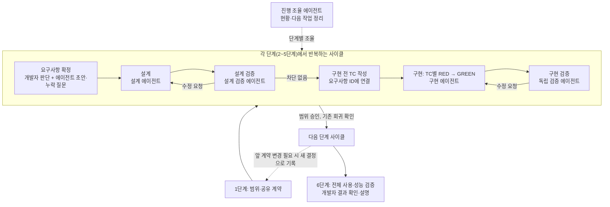

# 이터레이션 안내와 진행 결과

- 상태: 1~6단계 각각의 합의한 범위 완료 (상세 결과·한계는 단계별 검증 기록 참조). 7단계 웹 뷰는 [계약 채택·구현 전 TC 조건부 검토 의견 반영](07-live-benchmark-ui/overview.md); 로컬 서버 연결 구현·이중물 기반 자동 검증 47/47(검토 결함 2건 수정 후), 웹 화면 구현·이중물/headless 브라우저 확인(전체 50/50)([검증 기록](07-live-benchmark-ui/verification.md)), 실제 Docker·화면·독립 검토와 TC 수정본 재점검 미실행
- 근거: [과제 원문](../assignment.md), [프로젝트 진행 결정](../decisions/0001-project-workflow.md)

## 이터레이션의 의미와 읽는 순서

이터레이션은 날짜별 일정이나 단순 요구사항 목록이 아니라 **목표·선행 조건·확인 가능한 결과를 가진 작업 단위**다. 1단계에서 범위·공유 인터페이스를 정하고, 2~5단계에서 저장소→외부 사용→만료·무효화→동시성의 새 경계를 차례로 연결한 뒤, 6단계에서 전체 사용 흐름과 성능을 검증했다. 계획의 작업 순서는 [구현 단위 가이드](implementation-units.md)에 남기되, 그 계획을 완료 증거로 삼지 않는다.

`프로젝트 [요구사항](../requirements.md)·[설계](../design.md)·[구현](../implementation.md) 요약 → 이 표의 해당 단계 overview.md → 상세 명세·설계·TC·구현·검증` 순서로 읽으면 된다. 단계별 `overview.md`가 범위·체크리스트·결과 링크의 입구다. 상세 인수 조건과 ID는 `requirements.md`, 구조와 실패 경계는 `design.md`, 구현 전 계획은 `test-cases.md`, 실제 변경은 `implementation.md`, 실행 결과는 `verification.md`에 둔다. 문서의 작성 시점·TC 연결 규칙은 [산출물 가이드](iteration-deliverables.md) 참조. 모든 단계가 이 파일을 전부 갖는 것은 아니다. 1단계는 코드 없는 계약 단계, 6단계는 기존 요구의 최종 검증 단계다.

## AI와 함께 진행한 반복 루프

개발자가 범위와 선택을 판단하고 결과를 확인하며, 에이전트는 초안·설계·구현·검증을 역할별로 나눠 지원했다. 설계와 구현은 작성한 에이전트가 아니라 **별도의 검증 에이전트**가 검토했고, 수정 요청이 나오면 해당 단계로 돌아갔다. 진행 원칙은 [D-0001](../decisions/0001-project-workflow.md)에 있다.

### 단계 단위로 반복한 진행 방식

전체 설계를 먼저 끝내고 구현만 나눠 반복하는 방식이 아니라, **요구사항·설계·검증까지 포함한 한 사이클을 단계마다 반복**했다.

- **전체는 가볍게, 현재 단계는 구체적으로:** 처음에는 목표·최소 범위와 단계 사이의 공유 계약(1단계)만 정했다. 저장소 내부 설계, TTL 상세, 동시성 구조는 해당 단계에 들어가서 정했다. ([컨벤션 5절](../conventions.md#5-작은-단계로-반복하는-진행-방식))
- **앞 단계의 결과가 다음 단계의 입력:** 각 단계는 실제 구현·검증 결과를 확인한 뒤 다음 단계의 범위를 정했다.
- **이미 정한 계약도 바뀔 수 있게 기록:** 3단계에서 순차 HTTP 서버로 정한 실행 구조를 5단계에서 병렬 접수·단일 명령 스레드로 바꿨고, 이 변경을 새 결정 [D-0007](../decisions/0007-single-thread-command-execution.md)로 남겼다. 이전 결정은 지우지 않고 변경 범위만 표시했다.
- **새 연결부마다 통합 확인:** 단계를 이을 때마다 기존 테스트를 회귀로 확인하고 마지막 6단계에서 전체 흐름을 확인했다. 6단계는 새 요구사항을 만들지 않고 기존 요구를 검증하는 단계로 구성했다.
- **한 단계 안에서도 되돌아감:** 검증에서 결함이 나오면 해당 단계의 구현으로 돌아가 수정하고 재검토했다. 아래 표가 그 사례다.

### 역할과 모델

| 역할 | 모델 | 맡은 일 | 경계 |
| --- | --- | --- | --- |
| 개발자 | — | 범위·정책 선택, 요구사항 검토, 결과 확인, 핵심 로직 설명 | 에이전트의 제안은 채택 전까지 결정이 아니다. |
| 문서 작성 | `gpt-6-luna` | 요구사항·결과 문서 초안 정리 | 확인된 사실과 가정을 구분한다. |
| 설계 | `claude-opus-5-5` | 책임·계약·실패 처리 설계 | 스스로 검증 통과를 판정하지 않는다. |
| 설계 검증 | `gpt-6.1-sol` | 요구사항·기존 계약과의 충돌·누락 검토 | 확정 오류와 취향·조건부 위험을 구분한다. |
| 구현 | `claude-opus-5-5` | TC별 RED→GREEN 구현, 실제 변경 기록 | 검증 통과를 대신 선언하지 않는다. |
| 구현 검증 | `gpt-6.1-sol` | 실제 코드·호출 경로·경계 조건·실행 결과 검토 | 검토 범위 밖은 승인하지 않고 해시·명령으로 근거를 남긴다. |
| 고난도 최종 검토 | `gpt-6-astra` | 복잡한 설계 판단·검토 결과 충돌·여러 모듈에 걸친 위험 평가 | 필요할 때만 투입한다. |
| 진행 조율 | `gpt-6-sol` | 최신 진행 문서·검증 기록 기준의 다음 작업 정리 | 제안·확정 결정·실제 완료를 구분한다. |

모델은 각 역할 에이전트의 현재 프로필 설정 기준이며, 단계마다 실제 어떤 에이전트가 어떤 모델로 작업했는지를 개별 기록한 것은 아니다.

### 검증 루프가 실제로 잡아낸 것

단계마다 설계 검토와 구현 검토를 거쳤고, 구현 검토에서 결함이 나온 단계는 수정 요청 → 수정과 회귀 테스트 추가 → 제한 재검토 승인의 순서를 밟았다.

| 단계 | 검증 역할이 찾은 것 | 이후 처리 | 근거 |
| --- | --- | --- | --- |
| 2 | 설계 오류 없음. 저장 실패 보장 범위와 미결정 표기를 보완 요청 | 보완 후 초점 재검토 해소. TC 24개 통과, 보완 probe 49개 | [설계 검토](02-hash-table/overview.md#3-설계-검토--문서-계약-검토-완료), [검증](02-hash-table/verification.md) |
| 3 | 설계 검토에서 `HEAD` 본문 생략·중복 `Content-Length` 거부 지적. 구현 검토에서 캐시 리다이렉트(R1), 긴 선행 0 길이(R2), `stored` 숫자 1/1.0 허용(R3) 발견 | 설계에 반영, R1~R3 회귀 테스트 추가, 제한 재검토 승인. 최신 HTTP 32개·저장소 24개 통과 | [3단계 설계 8절](03-http-api/design.md#8-설계-검토-결과와-구현에-위임한-부분), [검증](03-http-api/verification.md#독립-검토-지적과-제한-재점검) |
| 4 | 만료 항목 제거 중 메모리 할당 실패 시 항목 수가 어긋나는 결함 | 계산을 버킷 확정 전으로 이동, 회귀 테스트 추가. 6개 경로 포함 14개 시나리오 PASS | [검증](04-expiration-invalidation/verification.md#독립-검토-수정-요청과-제한-재점검) |
| 5 | 완료 통지 실패 시 요청 영구 대기, Ctrl-C 후 명령 스레드 잔존, 제출 전 연결 리셋 후에도 PUT 적용 | 세 결함 수정, 제한 재검토 승인. 최종 계측 적용 25/25·HTTP 회귀 47/47·보완 10/10 | [검증](05-concurrency/verification.md#최초-독립-검토와-제한-수정-최초-검토-소스-이후) |
| 6 | 성능 측정 스크립트의 실패 원자료 보존(F1), TC 상태 문구(F2) 지적 | 수정 후 제한 재검토 승인. 조건별 100/100 | [검증](06-integration-performance/verification.md#3-성능-비교-실행) |

### 사람의 개입이 결과를 바꾼 지점

- **측정 조건:** 성능 비교에서 원본 응답에 인위적 지연을 넣지 않고 동시 부하는 제외하기로 정했다. 비교 목적이 "클라이언트가 캐시를 쓰는 이유(메모리 캐시의 장점)"이기 때문이다. 과제 의도(서버 DB 조회 대 메모리 캐시 읽기)에 맞춰 원본을 Docker MongoDB(데이터가 WiredTiger 캐시보다 큼)로 두고 호출마다 다른 키를 읽게 했다(독립 검증 승인). [6단계 조건](06-integration-performance/overview.md#확정된-성능-비교-조건)
- **중복 검증 방지:** 최종 검증 단계에서 이미 통과한 단계별 검증을 전부 반복하지 않고 새 연결부와 영향 경로의 회귀만 고르기로 정했다. 진행 조율 단계에서 이미 끝난 검증을 다시 위임하려던 제안은 현황·기록과 대조해 바로잡았다. 6단계도 새 요구사항을 만들지 않고 기존 요구를 검증하는 단계로 정리했다. [기존 증거 재사용](06-integration-performance/verification.md#11-기존-검증-증거-재사용)
- **설명 확인:** 해시 버킷 선택, 충돌 구분, 덮어쓰기와 TTL 해제, 만료 키 처리, 단일 스레드 이유, 재해싱 조건을 개발자가 직접 설명했다. 최종 설명 가능 여부는 본인 확인으로 기록했고 독립 구술 검증과 구분한다. [결과 정리·설명](06-integration-performance/verification.md#4-결과-정리설명)

### 검증을 믿을 수 있게 한 방식

- **구현 전 TC:** 요구사항 ID에 연결한 TC를 먼저 쓰고, 계획(`test-cases.md`)과 실행 결과(`verification.md`)를 분리했다. [산출물 가이드](iteration-deliverables.md)
- **작성자와 검증자 분리:** 구현 에이전트의 자체 점검과 독립 검증의 판정을 따로 기록했고, 보고만으로 승인하지 않고 소스 해시와 실제 실행 결과를 대조했다.
- **승인 범위 한정:** 제한 재검토의 승인은 검토한 결함·직접 영향 경로에 한정하고, 재실행하지 않은 범위는 미실행으로 남겼다.
- **실패 이력 보존:** 계측 실패, 최초 결함, 성공 재실행 로그를 지우지 않았다. 계측으로 통과시킨 5단계 동시성 테스트는 무보정 원본 runner의 통과와 구별해 적었다.
- **재실행 최소화:** 이미 통과한 단계는 전부 다시 돌리지 않고 새 연결부·영향 경로의 회귀만 선택했다.

## 단계별 진행 결과

| 단계·선행 관계 | 목적과 얻은 결과 | 근거·한계 |
| --- | --- | --- |
| [1. 범위·공유 계약](01-scope-and-contract/overview.md) — 과제 원문 | 최소 범위·Python/HTTP 기본 경계 확정. 구현·실행 검증 단계가 아니다. | [1단계 개요](01-scope-and-contract/overview.md), [D-0002](../decisions/0002-python-http-interface.md), [D-0003](../decisions/0003-http-response-contract.md) |
| [2. 해시 테이블 저장소](02-hash-table/overview.md) — 1단계 계약 | 직접 구현한 저장소와 단위 TC 24개 통과·독립 검토 승인. HTTP·TTL·동시성은 당시 범위 밖. | [요구사항 `REQ-02-001`~`008`](02-hash-table/requirements.md), [구현](02-hash-table/implementation.md), [검증](02-hash-table/verification.md) |
| [3. 외부 HTTP·응답 재사용](03-http-api/overview.md) — 2단계 저장소 | 외부 호출·원본 API 예제 연결. 최신 HTTP 32개·저장소 24개 통과, 독립 범위 승인. | [요구사항 `REQ-03-001`~`008`](03-http-api/requirements.md), [검증](03-http-api/verification.md). 고정 포트 수동 시연 미실시 |
| [4. 만료·명시적 무효화](04-expiration-invalidation/overview.md) — 2·3단계 | TTL·삭제 무효화 연결, 최초 결함 수정 뒤 제한 독립 재검토 통과. | [요구사항 `REQ-04-001`~`006`](04-expiration-invalidation/requirements.md), [검증](04-expiration-invalidation/verification.md) |
| [5. 동시성 점검·방어](05-concurrency/overview.md) — 2~4단계 | 결함 3건 해소 후 HTTP 범위 승인. 계측 적용 동시성 25/25·수정 후 HTTP 회귀 47/47·보완 10/10 통과. | [요구사항 `REQ-05-001`~`005`](05-concurrency/requirements.md), [검증](05-concurrency/verification.md). 원본 테스트 임시 접점은 저장소에 미반영; 무보정 원본 runner Green과 구분 |
| [6. 전체 사용·성능 검증](06-integration-performance/overview.md) — 앞선 기능 | 새 REQ ID 없이 기존 기능 증거 재사용과 외부 흐름 E-001~007 7/7, R-001/002 코드·증거 점검. 설명 가능 여부 본인 확인으로 완료. 성능 비교는 MongoDB·키 분산 원본 조건으로 측정해 독립 검증 승인(수정 요청 반영). | [TC](06-integration-performance/test-cases.md), [검증](06-integration-performance/verification.md). 독립 구술 검증 아님; MongoDB·키 분산 조건에서 히트가 미사용보다 빨랐으며(독립 검증 승인) 다른 환경에 일반화하지 않음 |

각 행의 통과는 **그 단계의 검증 범위**에 대한 것이다. 서로 다른 단계의 계측 조건·테스트 수를 하나의 전체 통과율로 더하지 않는다. 새 모듈 연결 때 통합 확인을 하고 마지막 단계에서 실제 원본 API를 포함한 흐름을 점검했다. 6단계는 기존 독립 테스트를 전부 다시 실행하지 않고 제품 해시 및 영향 경로를 확인해 증거를 재사용했다. 자세한 실행 명령과 한계는 각 `verification.md`에 있다.

**후속 작업(계약 채택·[TC](07-live-benchmark-ui/test-cases.md) 조건부 검토 의견 반영, 서버 연결 구현·이중물 기반 자동 검증, 실제 Docker·화면·독립 검토 미실행):** [7단계 실시간 성능 비교 웹 뷰](07-live-benchmark-ui/overview.md) — Docker 기동·필요 시 시드 생성·측정 전 재시작을 지원하는 로컬 준비 동작과 기존 측정기의 브라우저 실행·결과 표시. TC 수정본의 별도 재점검은 없으며 [D-0008](../decisions/0008-live-benchmark-contract.md)의 상세 계약 채택과 1~6단계의 실행 완료를 구분한다.

## 남은 범위와 문서 운영

이번 과제에서 합의한 1~6단계 범위에 막힌 항목은 없다. Optional 영속성, 배포 형태·런타임 세부 구성, 3단계 고정 포트 수동 시연, 5단계 원본 테스트 임시 계측 접점의 정식 반영은 **별도 후속 작업**이며 완료에 포함하지 않는다. 60초 반복 검증은 운영 시간 전체의 보증이 아니고, 6단계 성능 비교와도 다르다. 필요 시 [5단계 검증](05-concurrency/verification.md)과 [6단계 검증](06-integration-performance/verification.md)의 제한을 확인한다.

새 단위가 생기면 [공통 진행 체크리스트](implementation-units.md#진행-체크리스트)를 해당 `overview.md`에 맞춰 적용한다. 요구사항→설계·검토→구현 전 TC→구현→검증을 구분하며, 실제 상태는 이 표와 해당 단계 개요에 근거 링크로 갱신한다. 1단계처럼 코드가 없는 단위나 6단계처럼 검증 전용 단위에는 불필요한 파일을 만들지 않는다. [산출물 가이드](iteration-deliverables.md)
