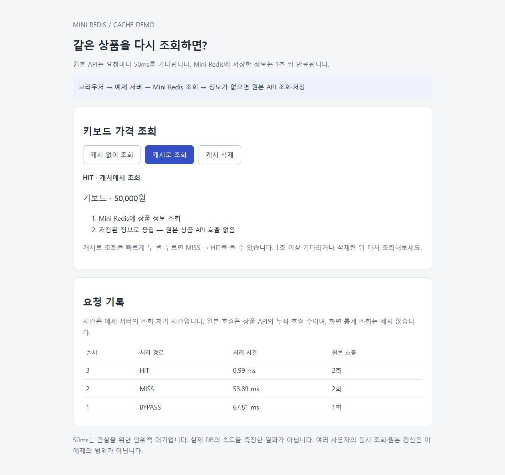
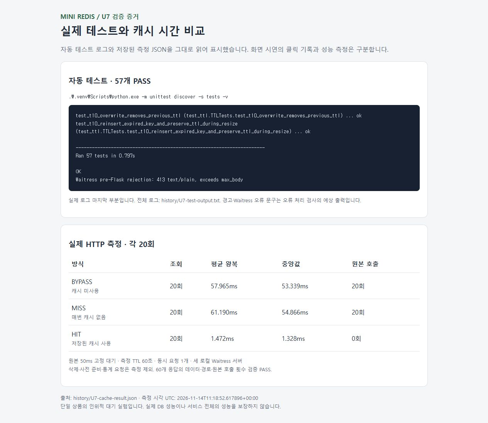

# U7 — 캐시 예제와 성능 비교

## 합의한 조건과 구현 계획

R-12·R-13, T-16. 사용자는 쉬운 설명 후 아래 조건으로 진행하는 데 동의했다. 이 파일에 계획과 실제 결과를 함께 기록한다.

- 상품 하나를 반환하는 로컬 원본 HTTP API, 원본 요청마다 50ms 고정 대기.
- 작은 HTML의 캐시 없이 조회·캐시로 조회·삭제 버튼. 상품·경로·시간·원본 호출 횟수 표시.
- 화면용 TTL 1초. 성능 비교용 TTL 60초.
- 캐시 미사용은 매번 원본, 첫 조회 Miss 뒤 Hit는 동일 데이터와 원본 호출 증가 없음, 만료·삭제 후 재조회는 원본 재호출.
- 같은 상품의 미사용·Miss·Hit 각각 20회 순차 HTTP 왕복 측정. 임의 배속 통과 기준은 두지 않는다. 데이터·경로·호출 횟수는 필수 조건이다.

### 구조와 파일

Mini Redis 8080, 예제 서버/HTML 8081, 원본 API 8082를 따로 실행한다. 예제 서버가 Mini Redis와 원본에 HTTP로 요청한다. 원본 API가 자기 서버의 요청 스레드를 기다리는 구조를 피하고 각 호출을 분명하게 구분하기 위한 배치다. 새 의존성 없이 Flask·Waitress·표준 urllib을 사용한다.

- examples/cache_demo.py: 원본 API, 캐시 조회 흐름, 예제 웹 서버 실행.
- examples/cache.html: 버튼 3개와 관찰 기록. 브라우저 자체 캐시가 실험을 가리지 않도록 예제 응답은 no-store.
- tests/test_cache_demo.py: 실제 세 서버로 데이터·원본 횟수·만료·삭제·화면 제공 검사. 시간 주입으로 만료 경계 제어.
- tests/measure_cache.py: 20회씩 순차 측정하고 history/U7-cache-result.json 저장. 측정 중 캐시 삭제는 Miss 준비 작업이며 측정 구간 밖.
- README·TESTING·history 목차·WORKLOG 등 현재 상태 갱신. 저장 엔진은 수정하지 않는다.

### 실행 순서

- [x] 필수 테스트 작성 → 미구현 실패 관찰 → 예제 구현 → 필수 테스트 통과.
- [x] 실제 HTTP 미사용·Miss·Hit 20회씩 실행. 원본 횟수·같은 응답 확인, 원시 시간·요약 보관.
- [x] HTML 관찰과 최종 회귀·문서 검사, 결과와 미검증 정리.

### 한계

단일 상품·순차 요청·원본 고정 대기 실험이다. 동시 Miss의 중복 원본 호출 방지, 원본 수정과 캐시 무효화의 원자성, 장애 시 원본 우회 정책은 이번 범위가 아니다. 예제 의존 서버 오류는 성공으로 숨기지 않고 502로 알린다. 이 측정은 실제 DB나 실서비스의 성능 보장이 아니다. 커밋·푸시는 별도 요청 때 한다.

## 실제 실행과 결과

### 미구현 실패 → 구현 → 통과

1. tests/test_cache_demo.py를 먼저 작성했다. 최초 실행은 `ModuleNotFoundError: examples.cache_demo`로 실패했다. 기존 저장소의 결함이 아니라 예제 모듈 미구현 때문이다.
2. 예제 API·HTML을 추가한 뒤 같은 테스트 3개가 통과했다. 기능 구현 후 별도 제품 버그는 발견하지 않았고 거짓 수정 이력을 남기지 않는다.
3. 의존 오류 검사에서는 실행 중인 Redis 서버의 없는 경로를 요청해 HTTPError를 만들었다. 예제의 502와 오류 메시지를 확인했다. 테스트 출력의 경고는 이 의도적인 실패에서 나온 로그다.

환경: Windows, Python 3.13.14, Flask 3.1.3, Waitress 3.0.2. 새 의존성은 추가하지 않았다. 기존 U6 로컬 변경을 보존했다.

```powershell
.\.venv\Scripts\python.exe -m unittest tests.test_cache_demo -v
.\.venv\Scripts\python.exe -m tests.measure_cache
.\.venv\Scripts\python.exe -m unittest discover -s tests -v
```

### 필수 동작 결과

| 상황 | 실제 입력과 결과 | 판정 |
| --- | --- | --- |
| 캐시 미사용 | 같은 상품 2회, BYPASS 2개·원본 호출 2회 | PASS |
| Miss → Hit | 이후 캐시 조회 2회, MISS/HIT·원본 합계 3회. 모든 응답은 id=1·키보드·가격 50000 | PASS |
| 만료 | 주입한 시간 999,999,999ns에서 HIT, 1,000,000,000ns에서 MISS·원본 재조회 | PASS |
| 삭제 | 캐시 삭제 true 뒤 MISS·원본 재조회. 해당 테스트 원본 총 3회 | PASS |
| 화면과 실패 | HTML 버튼·설명·no-store, 의존 HTTP 오류를 502로 응답 | PASS |

테스트는 실제 Mini Redis·예제·원본 Waitress 서버를 각각 임시 localhost 포트로 띄운다. TTL 경계는 시간 주입으로 확인하고, 성능은 주입 없이 실제 단조 시간으로 측정한다. U7 테스트 스택은 청소 작업자를 시작하지 않고 접근 시 만료를 확인한다. 능동 청소는 기존 U4, 실행 진입점은 U6 검증 범위다.

### 실제 HTTP 시간 비교

각 방식 20회 순차 요청, 같은 상품·원본 50ms 대기, TTL 60초. 미사용 → Miss → Hit 순서로 한 차례 측정했다.

| 방식 | 원본 추가 호출 | 평균 왕복 | 중앙값 왕복 |
| --- | ---: | ---: | ---: |
| BYPASS | 20 | 57.965ms | 53.339ms |
| MISS | 20 | 61.190ms | 54.866ms |
| HIT | 0 | 1.472ms | 1.328ms |

- 모든 60개 응답의 데이터와 경로를 assert로 확인했다. 원본 호출 차이는 20/20/0으로 검증했다. Hit를 준비하는 최초 Miss 1회는 원본 호출 차이를 세기 전에 수행했다.
- Miss는 매 요청 직전에 키를 삭제했다. 삭제·준비 조회·통계 요청은 측정 시간에서 제외했다. 실제 요청 시간에는 캐시 조회·원본 조회·저장 등 해당 경로의 전체 HTTP 처리가 포함된다.
- 클라이언트의 perf_counter_ns로 요청 시작부터 JSON 응답 해석까지 측정했다. 화면의 elapsed_ms는 예제 서버 처리 구간이며 왕복 시간과 다른 값이다.
- [원시 결과](U7-cache-result.json)에 60회 개별 왕복·서버 처리 시간, 요약·측정 조건·UTC 실행 시각을 보관한다.
- 이번 조건에서 Hit는 원본의 50ms 대기를 생략했다. Miss는 원본 호출 외에 Redis 조회·저장도 필요했고 평균 시간이 미사용보다 길었다. 단일 측정의 분산·순서 효과를 제거한 정밀 벤치마크가 아니다. 일반적인 성능 배속이나 실제 DB 결과로 확대하지 않는다.

### 화면·회귀·정리

브라우저에서 상품·HIT·Redis 조회 후 원본 호출 생략 설명과 요청 기록의 동일 원본 횟수를 확인했다. [확인한 화면](U7-cache-screen.jpg)을 저장했다. 화면 클릭 기록은 수동 관찰 자료이며 위 60회 성능 결과와 섞지 않는다. 임시 브라우저 탭과 검증용 서버는 종료했다.

최종 회귀 명령으로 **57개 자동 테스트 PASS**. 기존 10,000키 청소 부하는 재실행하지 않았다. UI 전체 접근성·모바일·교차 브라우저 검증은 하지 않았다.

## 함께 볼 핵심 코드와 현재 상태

examples/cache_demo.py의 product 함수에서 `/get`을 먼저 호출한다. 값이 있으면 문자열 JSON을 상품으로 복원해 HIT로 응답한다. 없으면 원본 `/product`를 호출하고 `/set`으로 저장한 뒤 MISS로 응답한다. 캐시 미사용은 Redis를 조회하거나 변경하지 않고 원본만 호출한다.

`value is None`은 캐시 정보 유무를 구분하는 조건이다. 원본 상품 조회는 저장소 락을 잡은 채 실행하지 않으며, Mini Redis와 원본은 예제 서버에서 각각 HTTP로 호출한다. 따로 분리된 요청들이므로 동시 Miss를 하나로 합치는 원자성은 없다.

상태: U1~U7의 합의한 1차 필수 구현·검증 범위 통과. 사용자 핵심 코드·결과 검토 대기. 커밋·푸시는 하지 않았다.

## 사용자 요청에 따른 스크린샷·실행 로그 보관

결과를 문서에서 볼 수 있게 해달라는 요청으로 전체 57개 테스트를 로그 보관용으로 한 번 더 실행했다. **57개 PASS / 0.797초**. 이 출력 원본을 [U7-test-output.txt](U7-test-output.txt)에 보관했다. 성능 실험은 재실행하지 않고 기존 JSON의 60회 측정값을 사용했다.

### 실제 시연 화면

새 임시 예제 서버에서 캐시 미사용 → 캐시 첫 조회 → 재조회 버튼을 순서대로 눌렀다. BYPASS/MISS/HIT의 상품은 같고, 원본 누적 호출은 1/2/2회였다. 이 화면의 시간은 개별 서버 처리 시간이며 앞선 20회 평균 왕복과 구분한다.



### 실제 테스트·성능 결과 화면

실행 로그의 마지막 부분과 기존 측정 JSON을 읽어 표시한 결과 페이지를 브라우저로 캡처했다. 터미널 자체를 캡처한 이미지가 아니며 예상 출력으로 만든 화면도 아니다. 전체 로그와 JSON을 함께 보관해 출처를 확인할 수 있다.



README에서는 긴 이미지를 접어서 열어볼 수 있게 연결했다. 임시 결과 HTML은 .tmp/ 아래에 두고 Git에서 제외했다. 검증용 서버·브라우저 탭은 종료했다.

최종 파일 형식 검사에서 캡처 바이트가 JPEG인데 PNG 확장자를 붙인 실수를 발견했다. 이미지 내용은 변환하지 않고 세 캡처의 확장자를 .jpg로 고치고 문서 링크를 갱신했다. 제품 기능 문제가 아니라 캡처 저장 이름의 오류다.
